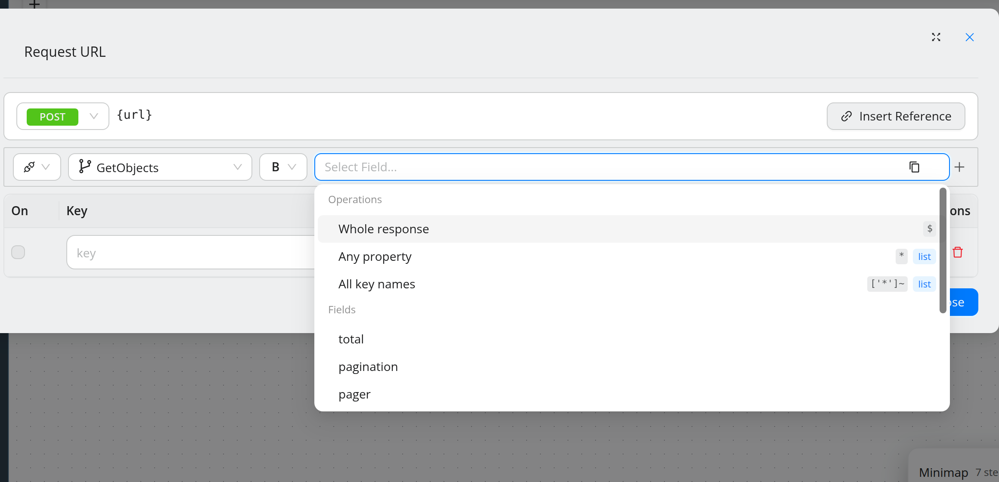

.. _concept-data-mapping:

############
Data mapping
############

.. contents::
   :local:

Steps are useless in isolation: the value of a workflow is that the output of one
call becomes the input of the next. That wiring is done with **references** and,
where a plain copy is not enough, **transformations**.

References
==========

A reference takes a value from an earlier step's response and puts it into a
later step's request — into the URL, a header, or the body.

References point at a method **by colour**, not by name or position, so they
survive renaming and reordering. Internally a reference looks like
``#FFCFB5.(response).success.result[].id``: colour, section, path.

You never type that. The **reference generator** walks you through
*connector → method → field*.

Arrays and XML
--------------

Paths are JsonPath, and array indexes start at ``0``.

* ``[*]`` references the whole array.
* ``[<index>]`` references one element, e.g. ``[0]`` for the first.
* Inside a loop, append the iterator to walk through it: for a loop with
  iterator ``i`` and parameter ``result``, use ``result[i]``.
* For XML responses, ``@`` offers the attributes of a tag.

Operations
----------

.. versionadded:: 5.3

When you pick a field, the dropdown lists **Operations** above the **Fields**.
Each shows its label, the syntax it appends and a hint. Typing an operation's
syntax, such as ``[-1]``, jumps to it.

.. list-table::
   :header-rows: 1
   :widths: 28 22 50

   * - Operation
     - Syntax
     - Returns
   * - **Whole response**
     - ``$``
     - The whole response body, unchanged (called *The root object* before
       5.3).
   * - **First element of the array**
     - ``[0]``
     - The first element, as a single value.
   * - **Last element of the array**
     - ``[-1]``
     - The last element, as a single value. Continue with a field name to take
       a field from it.
   * - **The whole array**
     - ``[*]``
     - All elements, as a list.
   * - **Number of elements**
     - ``.length()``, e.g. ``$.items.length()``
     - How many elements the array has, as a number — useful in a condition, to
       continue only if a list is not empty.
   * - **Any property**
     - ``*``, e.g. ``$.data.*``
     - Every property of an object. Continue with a field name to pick that
       field from all of them. The result is a list.
   * - **All key names**
     - ``['*']~``, e.g. ``$.data['*']~``
     - The names of all properties of an object, as a list — not their values.

Paths that can match several values are marked *list*: they return a list of
all matches, even when only one matches.

Reference validation
--------------------

.. versionadded:: 5.3

A reference is checked while you build it — its syntax, and whether the path
exists in the method's example response. The field turns red for an error and
amber for a warning; the tooltip gives the message and a hint.

* **Errors** disable **Insert** in the reference generator, for example *The path
  must start with $.*, *A bracket is not closed.* or *This loop iterator is not
  available here: the reference is not inside that loop.*
* **Warnings** only advise, for example *“..” searches the whole response —
  usually a typo for a single dot.* or *This field is not in the method's
  example response. The run fails if it is missing from the real response.*

Warnings for the whole workflow are collected in the Problems panel — see
:doc:`../guides/check-a-workflow`.

Sources
-------

A reference can come from four places:

* **Method** — the response of an earlier step, as *Body*, *Header* or *Status*.
* **Constant** — a literal value.
* **Webhook** — a parameter of the webhook that started the workflow.
* **Global variable** — a value defined once for many workflows, written
  ``{{global.name}}``. See :doc:`../guides/global-variables`.

.. versionchanged:: 5.3
   **Global variable** was added as a fourth source.

Direct references
=================

If a field holds a reference and nothing else, that is a **direct reference**: a
one-to-one copy with no code in between. The UI says so explicitly and shows the
two parameter paths.

Direct references execute faster than a scripted transformation. Prefer them; only
reach for a transformation when you actually need to transform the value.

Transformations
===============

A transformation is a script that computes a target field from one or more
references. It runs during execution, per field.

The contract is fixed:

* the incoming references are ``VAR_0``, ``VAR_1``, … in order,
* the result must be assigned to ``RESULT_VAR``.

.. code-block:: javascript

   let result = VAR_0.toUpperCase();
   RESULT_VAR = result;

The **Variable Information** panel tells you, for each variable, which method and
field it comes from and where the result is used — worth reading before you
change someone else's script.

To try a JavaScript transformation with test values before a real run, open the
:doc:`../guides/script-playground` from the transformation panel.

Global variables in transformations
-----------------------------------

.. versionadded:: 5.3

A transformation can use global variables: as an input (``VAR_n``), through
``ref("{{global.name}}")`` in JavaScript, or by importing a **script** variable of
the same language and calling it like a function. JavaScript transformations can
also write a mutable variable with ``set("{{global.name}}", value)``. See
:doc:`../guides/global-variables`.

Deleting a reference replaces its variables in the script with
``VARIABLE_NOT_EXIST`` rather than silently shifting the others. Editing a
reference leaves the script alone.

Languages
---------

* **JavaScript** — runs inside the OpenCelium core on Nashorn
  (``org.openjdk.nashorn:nashorn-core 15.4``). The default, and the fastest.
* **Python 3**, **Ruby** — run in the separate ``polyglot-engine`` service,
  sandboxed.

.. deprecated:: 5.0
   **Python 2** is no longer offered in 5.x. Use Python 3 instead.

.. code-block:: python

   result = VAR_0.upper()
   RESULT_VAR = result

.. code-block:: ruby

   result = VAR_0.upcase
   RESULT_VAR = result

The engine is a separate service you deploy yourself
(`opencelium/polyglot-engine <https://github.com/opencelium/polyglot-engine>`_)
and enable under ``opencelium.polyglot``. While it is disabled, transformations run
on JavaScript; if it is enabled but unreachable, execution falls back to
JavaScript. Its reachability is reported on the System Check page.

.. warning::
   The configuration block belongs under ``opencelium:``, not at the top level of
   ``application.yml``. A top-level ``polyglot:`` block binds nothing and fails
   silently. See :doc:`../reference/configuration`.

Data aggregators
================

A transformation shapes one field. A **data aggregator** collects data across the
calls of a whole workflow, so a notification can summarise the run.

An aggregator has a name, a set of **arguments**, and a script that assigns
values to those arguments. You attach it to a step, reference its arguments in a
notification template, and the values are filled in when the schedule sends the
notification.

.. note::
   A data aggregator only takes effect for **post** notifications — the ones sent
   after a run. Attaching it and then using a *pre* or *alert* notification will
   silently produce nothing.

Webhook parameters
==================

A workflow started by a webhook can read the webhook's query parameters (GET) or
payload (POST). Create parameters by name and type — ``Array``, ``Boolean``,
``Integer``, ``Number``, ``Object``, ``String``, ``Undefined`` — and reference
them like any other source.

In an endpoint they are written literally as ``${name:type}``, e.g.
``{url}/api/${methodName:string}``.

.. note::
   Do not confuse this with a **Trigger Workflow** step, which *calls* another
   workflow's webhook. Its response is only the trigger acknowledgement, never
   the result of the triggered workflow.

Where to go next
================

* :doc:`../guides/build-a-workflow` — wire two steps together.
* :doc:`execution` — when all of this actually runs.
