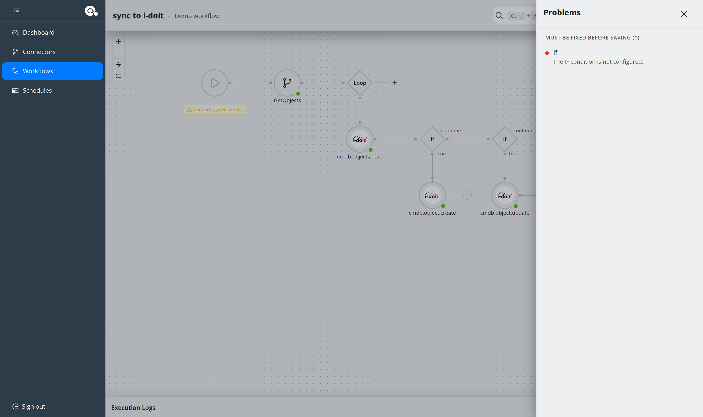

.. _guide-check-workflow:

################
Check a workflow
################

.. contents::
   :local:

.. versionadded:: 5.3

The editor checks the workflow while you edit it. An IF block without a
condition, a field link to a step that is gone, or a path that is not valid
JsonPath shows up straight away, not only when a save or a test run fails. The
**Problems** panel lists everything the check found and takes you to the step it
is on.

The badge in the header
=======================

The badge sits in the editor header, just left of **Save**, and is always
visible:

* A check mark means there are no errors or warnings. Its tooltip reads *No
  errors or warnings — show the problems list*.
* A warning icon with a number counts the steps that have errors or warnings,
  for example *3 steps have problems — show them*. Notices are not counted.

Click the badge to open the panel.

The Problems panel
==================

The panel slides in from the right. Opening it closes the **Schedules**,
**Change History** and other side panels. Close it with the **×** (*Close
problems*), with ``Esc``, or by clicking outside it.

The problems are grouped by what they mean for saving:

.. list-table::
   :header-rows: 1
   :widths: 36 64

   * - Group
     - Meaning
   * - **Must be fixed before saving**
     - Errors. The workflow cannot be saved, and a test run cannot start, until
       they are fixed.
   * - **Asked about when saving**
     - Warnings. Saving still works, but asks first.
   * - **For information**
     - Notices. They describe the last run or the system, not the workflow, and
       never stop a save.

Each group shows its count in brackets. With nothing to report the panel says
*No problems found in this workflow.*

Each entry names the step, by its label or method name (IF and LOOP blocks
appear as *If* and *Loop* unless you renamed them), and the problem. Entries are
sorted left to right, then top to bottom, like the steps on the canvas. Comment
boxes are not checked.

Go to a problem
---------------

Click an entry. The canvas centres on the step and rings it in the problem's
colour, red for an error and amber for a warning. The ring goes away when the
problem is fixed or when you click empty canvas.

What is checked
===============

.. list-table::
   :header-rows: 1
   :widths: 22 12 66

   * - Problem
     - Severity
     - Message
   * - IF block without a condition
     - Error
     - *The IF condition is not configured.*
   * - LOOP block without a condition
     - Error
     - *The loop is not configured.*
   * - Field link to a step that no longer exists
     - Error
     - *1 broken field link: Method missing* (or *n broken field links: …*)
   * - Transformation script lacks the variable for a reference
     - Error
     - *… broken field link: Script variable missing*
   * - Field link that cannot be read from where it is used, for example a loop
       iterator outside its loop
     - Warning
     - *… broken field link: Not readable here*
   * - Field link to a field the source method's response does not declare
     - Warning
     - *1 field link reads a field the method's response does not declare*
   * - Reference path that is not valid JsonPath
     - Warning
     - *1 reference has a path that is not valid JsonPath*
   * - The last save or test start was rejected by the server
     - Notice
     - The server's message for that step.
   * - The step's connector test fails
     - Notice
     - *Connector test failed — the connector could not be reached.*, *Connector
       test failed — the connector's credentials were rejected.*, or *Connector
       test failed. Error: "…"*

Some notes on the table:

* *Not readable here* is only a warning because it is often a passing state while
  you rearrange steps: the source exists, it just cannot be read from the current
  place yet.
* The response a method declares is an example, not a contract. A field missing
  from it is therefore only a warning; the real response may well contain it.
* The JsonPath check runs in the browser and only approximates the server, so it
  warns instead of refusing. It looks at references in request bodies; XML
  bodies are not checked.
* Server messages from a rejected save are kept until the next attempt.

A test run that failed at a step is not listed in the panel — the run reports it
in its own log, see :doc:`debug-a-workflow`. The minimap does show it.

Saving with problems
====================

The check runs before the save comment is asked for.

.. list-table::
   :header-rows: 1
   :widths: 18 82

   * - Severity
     - What happens
   * - **Error**
     - The save is refused. This applies to every save, including the automatic
       one after you rename the workflow. The affected
       steps get a red outline, the canvas centres on the first one, and a message
       says what is wrong — *Cannot save: "<step>" — <problem>*, or *Cannot save:
       n steps have problems that must be fixed first. They are marked on the
       canvas.* A test run is refused the same way (*Cannot start the test run:
       …*).
   * - **Warning**
     - When you press **Save** (or ``Ctrl+S``), a dialog *Save with warnings?*
       lists the steps that may not run as expected. **Save anyway** saves; cancel
       to fix them first. Warnings do not stop a test run, and an automatic save
       does not ask.
   * - **Notice**
     - Never stops anything.

The server still validates every save as before. If it rejects one, the step gets
a red outline and the message also appears in the panel under **For
information**.

Related checks
==============

* **Minimap** — the rings and the *steps need attention* pager in the minimap use
  the same list of problems, plus failed test runs. See :ref:`guide-minimap`.
* **Reference fields** — while you type a reference in a body, header or URL, the
  field itself is checked against the method's example response and shows a
  tooltip with the reason. That check is per field; the panel collects the
  results for the whole workflow. See :doc:`../concepts/data-mapping`.
* **Field links** — the broken links the panel lists are the same ones the field
  links lens and list mark in red. See :doc:`trace-field-links`.

Where to go next
================

* :doc:`build-a-workflow` — the canvas and the minimap.
* :doc:`trace-field-links` — find and repair broken field links.
* :doc:`debug-a-workflow` — what to do when a test run fails.
