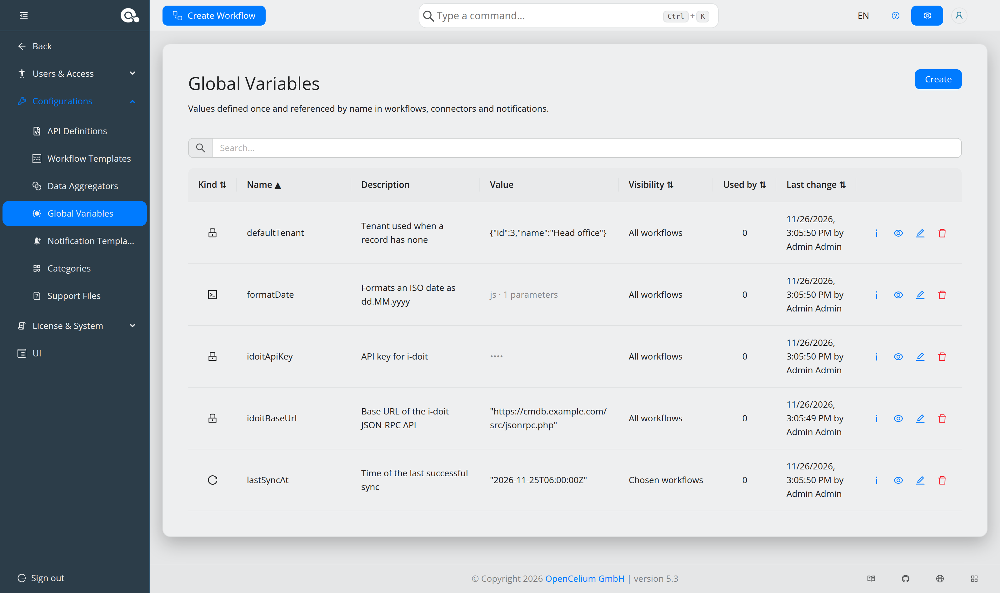
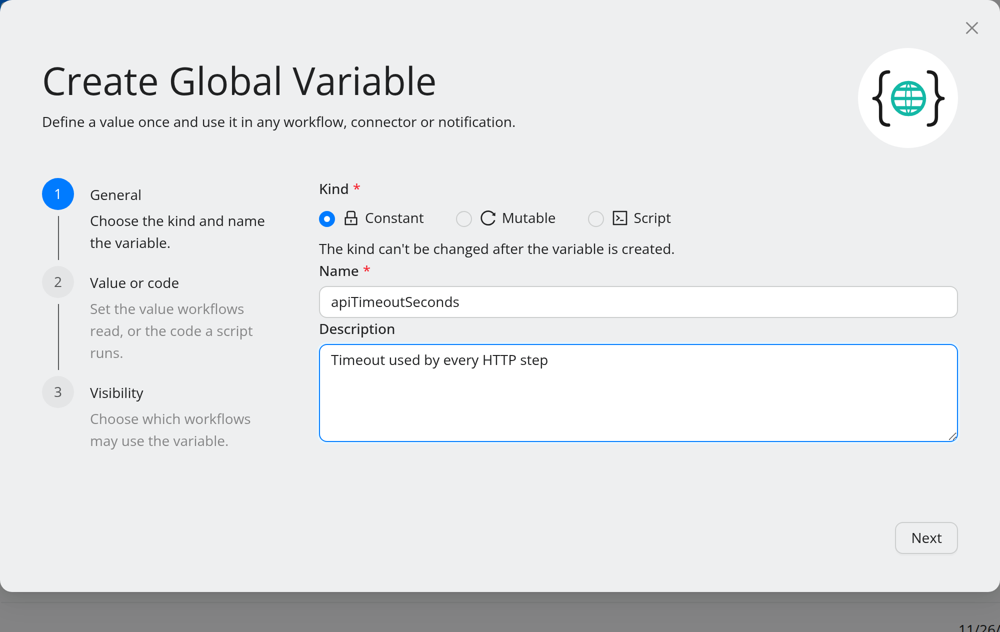
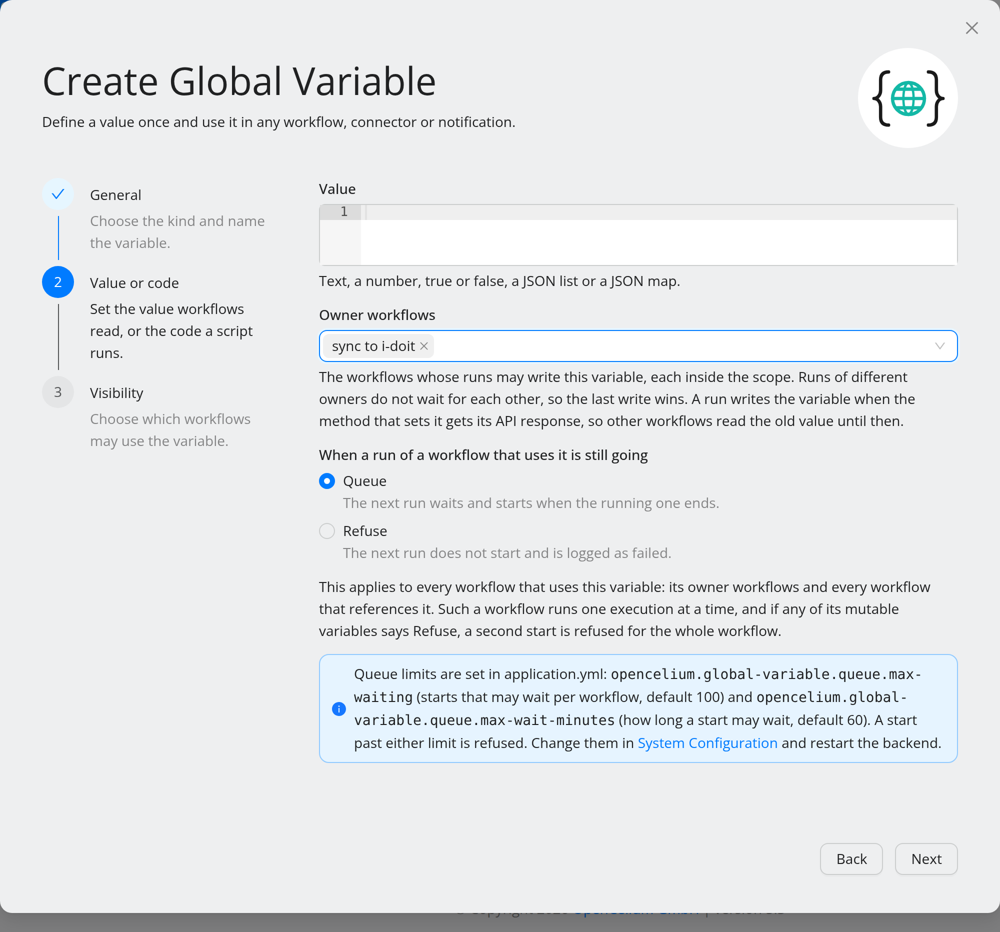
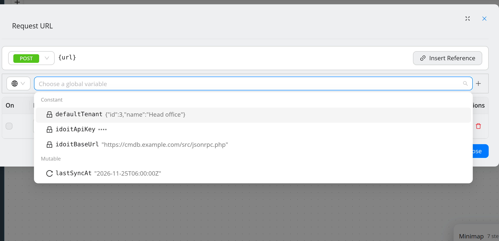
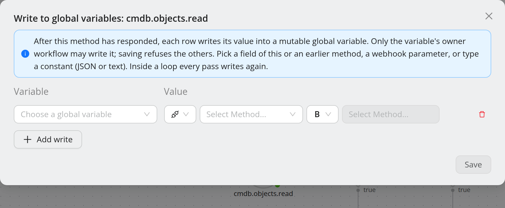
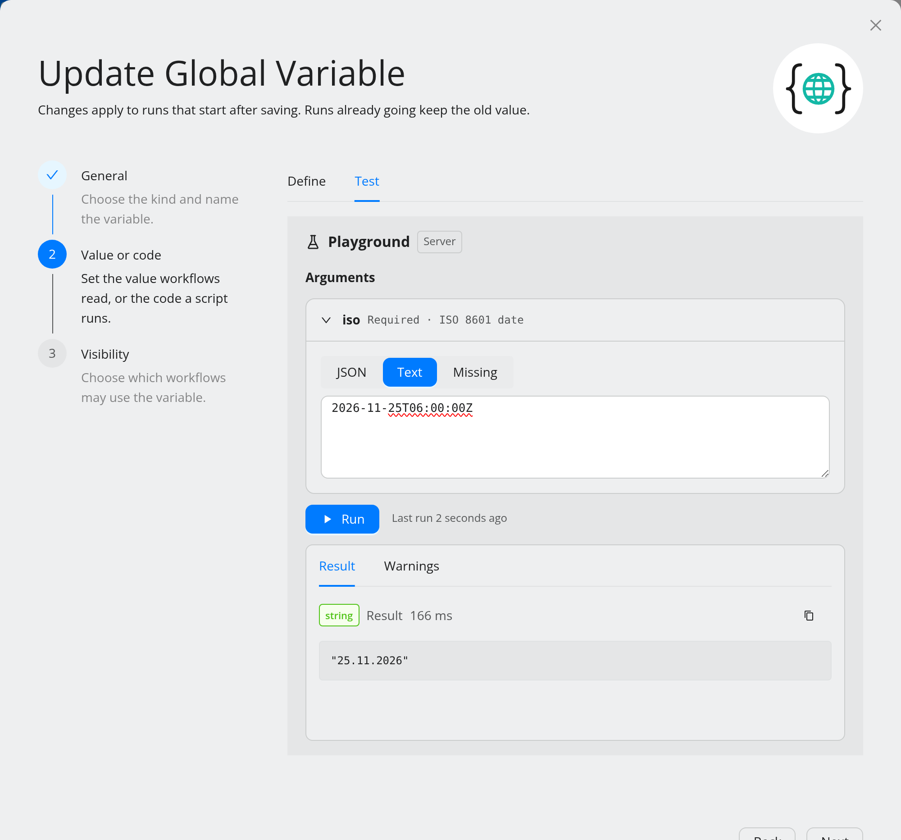
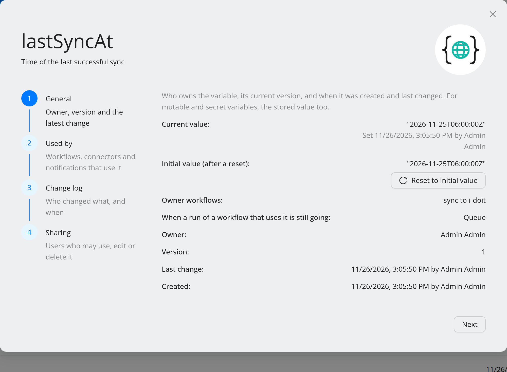

.. _guide-global-variables:

################
Global variables
################

.. versionadded:: 5.3

A **global variable** is a value you define once and reference by name in any
workflow, connector or notification: a base URL, a list of tenants, a counter
that one workflow keeps up to date, or a small function that several
transformations share. Change the variable, and every place that uses it picks up
the new value — no need to edit ten workflows.

You find them under **admin menu → Configurations → Global Variables**. The entry
is shown only if your role has ``READ`` on the ``GLOBAL_VARIABLE`` component (see
:doc:`../reference/permissions`).

*The list shows the kind, name, description, current value, visibility, how many
places use the variable, and the last change.*

.. contents::
   :local:

Three kinds
===========

You choose the kind when you create the variable. It cannot be changed later.

.. list-table::
   :header-rows: 1
   :widths: 18 82

   * - Kind
     - What it is
   * - **Constant**
     - Only users change it. Workflows read it. A constant can be marked
       **Secret**.
   * - **Mutable**
     - Its **owner workflows** change it during runs. Other workflows read it.
   * - **Script**
     - A shared function that returns a value each time it is called. It is
       written in JavaScript, Python 3 or Ruby and used from a transformation of
       the same language.

Create a global variable
========================

Click **Create** on the list page. The wizard has three steps.

**1. General** — choose the **Kind** (Constant, Mutable or Script; the default is
Constant), then enter a **Name** and an optional **Description** (at most 512
characters).

The name is what you type in references, so choose it with care:

* 1 to 64 letters, digits or ``_``, starting with a letter,
* unique, ignoring case — ``apiBaseUrl`` and ``APIBASEURL`` are the same name.
  The form checks this while you type.

**2. Value or code** — the fields depend on the kind:

* **Constant** — the **Secret** switch and the **Value**.
* **Mutable** — the **Value** (the initial value), the busy policy and the
  **Owner workflows**. See `Let a run update a mutable variable`_.
* **Script** — language, code and parameters, in the tabs **Define** and
  **Test**. See `Script variables`_.

*The Value or code step of a mutable variable.*

**3. Visibility** — choose which workflows may use the variable: **All
workflows**, **Chosen categories** or **Chosen workflows**. Choosing a category
includes its subcategories. For the last two options pick at least one category
or workflow.

.. note::
   Connectors can only use variables visible to **All workflows**. If a connector
   should use a variable, do not narrow its visibility.

How the value is typed
----------------------

A value can be any JSON value, up to 64 KB. What you type is saved as JSON when
it parses as JSON, and as plain text otherwise. The field tells you what it was
saved as: *text*, *number*, *true / false*, *null*, *list* or *map*.

* ``42`` is saved as a number, ``true`` as true / false,
  ``{"maxPerPage": 100}`` as a map, ``https://api.example.com`` as text.
* To keep a number-like value or ``true``/``false`` as text, wrap it in quotes:
  ``"123"``.

Secret constants
----------------

Turn on **Secret** for passwords, tokens and keys. A secret value is never shown
again after saving and is masked in execution logs. When you edit a secret, leave
the value empty to keep the stored one, or enter a new value to replace it.
Turning the Secret switch off requires you to enter a new value.

Only constants can be secret. A secret cannot be restored from the change log.

.. important::
   Secret values are encrypted with a key the operator sets. Without it, a
   built-in key is used that is the same on every installation. See
   `Secrets and the secret key`_ before you save the first secret.

Use a global variable in a workflow
===================================

The syntax
----------

A reference to a global variable is written ``{{global.name}}``. To read part of a
structured value, add a path:

* ``{{global.apiBaseUrl}}`` — the whole value,
* ``{{global.limits.maxPerPage}}`` — a key of a map,
* ``{{global.tenants[0].id}}`` — a field of the first element of a list (indexes
  start at ``0``).

A path that leads nowhere — a missing key, an index past the end — resolves to
``null``.

To send the text ``{{global.name}}`` literally, escape it with a backslash:
``\{{global.name}}`` is sent as ``{{global.name}}``.

References are stored by name. That is why a variable that is in use cannot be
renamed (see `Limits and errors`_).

Where you can use it
--------------------

* the URL, headers and body of a method,
* the conditions of an ``If`` and the input of a ``Loop``,
* the arguments of a transformation,
* the request data (credential fields) of a connector,
* notification templates and the **Send Notification** step.

The reference picker
--------------------

Wherever the reference generator appears — URL editor, body, condition builder,
notifications — its source select offers **Method**, **Webhook** and **Global
variable** ("The value of a global variable"). Choose **Global variable**, then
pick the variable from the searchable list, grouped by kind.

The list only offers variables that are visible to this workflow and that you may
use. If it says *No global variables you may use here*, check the variable's
visibility and its sharing. Inserted references show as chips labelled
**Global**.

Connectors and notification templates
-------------------------------------

In a connector's request data and in the body of a notification template, a globe
button **Insert a global variable** next to the field opens the same list and
inserts the reference at the cursor.

A connector only sees variables whose visibility is **All workflows**; saving a
connector that uses another one is refused.

Loop over a global variable
---------------------------

A ``Loop`` can take a global variable as its input. Choose **Global variable** as
the source in the loop's condition:

* ``For`` walks the elements of a list,
* ``ForIn`` walks the keys of a map, or the indexes of a list,
* ``SplitString`` walks the parts of a text.

Inside the loop, append the iterator as you would for a method response:
``{{global.tenants[i].id}}`` for ``For``, ``{{global.regions['j'].url}}`` for
``ForIn``, ``{{global.csv[k]~}}`` for the current part of a ``SplitString``. See
:doc:`branch-and-loop`.

In JavaScript transformations
-----------------------------

In a JavaScript transformation, ``ref("{{global.name}}")`` returns the value of
the variable.

Let a run update a mutable variable
===================================

A mutable variable has an initial value and a current value. Only runs of its
**owner workflows** may write it; all other workflows in its visibility read it.
Pick at least one owner workflow in the wizard; each must be inside the
variable's visibility.

There are two ways to write a value.

Write to global variables
-------------------------

Right-click a connector, HTTP request or trigger step and choose **Write to global
variables**. The dialog *Write to global variables: <method>* has one row per
write, with the columns **Variable** and **Value**. Use **Add write** to add a
row, then **Save**.

* The **Variable** must be a mutable variable this workflow owns.
* The **Value** can be a field of this or an earlier method, a webhook parameter,
  or a constant you type (JSON or text). A typed value is stored as JSON if it
  parses as JSON, otherwise as text.
* The writes run after the method has responded. Inside a loop every pass writes
  again.

With set() in a JavaScript transformation
-----------------------------------------

In a JavaScript transformation, ``set("{{global.name}}", value)`` writes the
variable:

.. code-block:: javascript

   set("{{global.lastSyncedId}}", VAR_0);
   RESULT_VAR = VAR_0;

* ``set()`` works in JavaScript only. In Python or Ruby the run fails with
  *set() writes a global variable from JavaScript only*.
* The target is the whole reference, without a path.
* The write happens after the script has finished.

The :doc:`script-playground` shows ``set()`` calls under **Writes to global
variables (not saved)** without writing anything.

Rules for writes
----------------

* Only runs of an owner workflow may write. Saving a workflow that writes a
  variable it does not own is refused.
* A write replaces the whole value.
* Runs of different owner workflows do not wait for each other, so the **last
  write wins**.
* A **test run** writes only to its own copy. The stored value never changes.
* Every run that writes adds one *Written by a run* entry per variable to the
  change log. The newest 200 of these entries are kept per variable
  (``opencelium.global-variable.change-log.max-run-entries``).

While an owner workflow is running, the variable shows a badge *Being updated by
run #<id>*.

The busy policy: one run at a time
----------------------------------

A workflow that uses a mutable variable — as an owner or just by reading it — runs
**one execution at a time**. The busy policy (*When a run of a workflow that uses
it is still going*) decides what happens to a second start:

* **Queue** (default) — the next run waits and starts when the running one ends.
* **Refuse** — the next run does not start and is logged as failed.

If any mutable variable a workflow uses is set to **Refuse**, a second start is
refused for the whole workflow. The editor shows this as *Runs one at a time: a
second start waits until the running one ends* or *… is refused*, naming the
variables responsible.

Waiting starts are limited in ``application.yml``:

* ``opencelium.global-variable.queue.max-waiting`` — starts that may wait per
  workflow (default ``100``),
* ``opencelium.global-variable.queue.max-wait-minutes`` — how long a start may
  wait (default ``60``).

A start past either limit is refused. Change them under **System Configuration**
and restart the backend.

Reset to the initial value
--------------------------

The details dialog of a mutable variable shows the **Current value** and the
**Initial value (after a reset)**. **Reset to initial value** replaces the current
value by the initial one; runs that start afterwards read it. The reset is logged.

Script variables
================

A script variable is a function you write once and call from many
transformations — date formatting, a checksum, a lookup table.

Define the script
-----------------

On the **Define** tab choose the **Language** — JavaScript (default), Python 3 or
Ruby — and write the **Code**. The language cannot change after creation.
JavaScript runs inside the OpenCelium core; Python 3 and Ruby run on the
polyglot engine (see :doc:`../concepts/data-mapping`).

* The code is the body of a function.
* JavaScript must ``return`` a value. Python without ``return`` returns ``None``;
  Ruby returns its last expression.
* A script uses only its parameters. It may not call ``ref()`` or ``set()``.
* At most 256 KB of code.

**Parameters** — add one row per parameter with a name (letters, digits, ``_`` or
``$``, not starting with a digit, unique), an optional description, a
**Required** flag and, for optional parameters, a **Default** (JSON). Arguments
are passed by position; an optional parameter that is not passed uses its
default.

.. code-block:: javascript

   // parameters: date (required), pattern (optional, default "dd.MM.yyyy")
   var d = new Date(date);
   return pattern.replace("dd", ("0" + d.getDate()).slice(-2))
                 .replace("MM", ("0" + (d.getMonth() + 1)).slice(-2))
                 .replace("yyyy", d.getFullYear());

Test the script
---------------

On the **Test** tab enter the **Arguments** and run the test. The result is shown
with its type and the time it took; errors such as *Syntax error*, *The script
returned no value* or *The script took too long* are shown instead.

Call it from a transformation
-----------------------------

A script variable cannot be read as a value. You import it into a transformation
of **the same language** and call it there:

#. Add the script variable as an input of the transformation, as you add a
   method reference, using the source **Global variable**. The input must be
   exactly the reference, e.g. ``{{global.formatDate}}``, with no path. It gets
   the next variable name, for example ``VAR_1``, shown in the script as
   ``//var VAR_1 = {{global.formatDate}};``, and the variable information says
   *is the script variable formatDate: call it as VAR_1(…)*.
#. Call it like a function:

   .. code-block:: javascript

      RESULT_VAR = VAR_1(VAR_0, "dd.MM");

A run uses the script code as it was when the run started. A transformation that
imports a script is limited to 5 seconds
(``opencelium.global-variable.script-timeout-ms``, default ``5000``); the same
limit applies to the Test tab.

What a run reads
================

When a run starts, it takes a snapshot of the variables visible to the workflow:

* **Constants** and **scripts** are read from the snapshot. A change you save
  reaches the next run, not the one already going.
* **Mutable** variables are read live, at each read, so a run sees writes of
  other owner runs as they happen.

The execution log records the snapshot with one ``GLOBAL_SNAPSHOT`` line per
variable, giving its name, version and value. Secret values appear as ``****``; a
value over 4 KB (or once a run has logged 32 KB in total) appears only as its
size. Secret texts are also masked elsewhere in the execution log; very short
texts are not masked.

Details, change log and sharing
===============================

**Details** in a row of the list opens a dialog with four steps:

* **General** — owner, version, creation and last change; for mutable and secret
  variables also the stored value.
* **Used by** — every workflow, connector and notification that refers to the
  variable, and whether it *Reads*, *Writes* or *Imports* it.
* **Change log** — every saved or rejected change to the value, settings or
  sharing, with who made it (a user, or a run). **Restore** on a row makes that
  version's value current again, as a new logged change. For a mutable variable
  it becomes the **initial** value; reset afterwards to make it current. Secrets
  cannot be restored.
* **Sharing** — give other users access.

Permissions
-----------

Two layers apply:

* The **role** needs the ``GLOBAL_VARIABLE`` component with ``READ``, ``CREATE``,
  ``UPDATE`` or ``DELETE`` to see the page and perform those actions at all.
* Each **variable** grants **Use**, **Edit** and **Delete** per user on the
  **Sharing** step. *Use* lets a user reference the variable in their workflows;
  *Edit* and *Delete* include *Use*.

The creator is the variable's owner. The owner and admins always hold all three
rights, and only they can change the sharing. The list shows only the variables
you may view. Saving a workflow that references a variable you may not use is
refused.

Limits and errors
=================

* The **kind** and a script's **language** are permanent.
* A variable that is **in use** cannot be deleted or renamed, and its visibility
  cannot be narrowed so that a user of it falls outside. A script's parameters
  cannot be changed so that existing calls no longer fit. Remove the references
  first — the dialog lists them (*It is still used here. Remove these references
  first:*).
* Softer problems open *This change may affect these places* with **Save
  anyway**.
* If someone else saved the variable after you opened it, saving is refused
  (HTTP 409, *Someone else saved first*). **Reload** and make your change again.
* Changes apply to runs that start after saving; runs already going keep the old
  value.

Saving a workflow, connector or notification checks every global reference
against the user who saves; a run checks them again when it starts. The errors:

.. list-table::
   :header-rows: 1
   :widths: 30 70

   * - Code
     - Meaning
   * - ``UNKNOWN_VARIABLE``
     - The variable does not exist.
   * - ``OUT_OF_SCOPE``
     - The variable is not visible to this workflow.
   * - ``SCOPE_NOT_ALL``
     - A connector uses a variable not visible to all workflows.
   * - ``NO_USE_PERMISSION``
     - You may not use the variable.
   * - ``INVALID_WRITE_TARGET``
     - A write target is not exactly ``global.<name>``.
   * - ``NOT_MUTABLE``
     - The written variable is not mutable.
   * - ``NOT_OWNER``
     - The workflow writes a variable it does not own.
   * - ``SCRIPT_NOT_CALLABLE``
     - A script variable is read as a value; import it into a transformation of
       its language instead.
   * - ``IMPORT_LANGUAGE_MISMATCH``
     - The script is written in another language than the transformation.

The same check applies to imported or pasted workflows: a reference to a variable
that does not exist on this installation, or that is not visible or usable
there, is refused on save. Create the variable first.

Size limits, configurable under ``opencelium.global-variable`` in
``application.yml``: ``max-value-bytes`` (default ``65536``) and
``max-script-bytes`` (default ``262144``).

Secrets and the secret key
==========================

.. important::
   **For operators.** Secret values are encrypted with AES using their own key,
   set by ``opencelium.global-variable.secret-key`` in ``application.yml`` or the
   environment variable ``OPENCELIUM_GLOBALVARIABLE_SECRETKEY`` (the environment
   variable wins).

   If no key is set, a built-in key is used. It is the same on every
   installation, so it hides values but does not protect them. **Set the key
   before the first secret is saved.** There is no key rotation: after changing
   the key, every secret has to be entered again.

See :doc:`../reference/configuration` and :doc:`configure-the-system`.

Command palette
===============

.. list-table::
   :header-rows: 1
   :widths: 50 50

   * - Command
     - Effect
   * - ``list global-variables``
     - Opens the list.
   * - ``create global-variable``
     - Opens the create wizard.
   * - ``search global-variable by name <v>`` / ``by id <v>``
     - Opens the variable in a dialog.
   * - ``update global-variable by name <v>`` / ``by id <v>``
     - Opens the update wizard in a dialog.

There is no delete command. The commands follow your ``GLOBAL_VARIABLE``
permissions. See :doc:`../reference/command-palette`.

Where to go next
================

* :doc:`../concepts/data-mapping` — references and transformations.
* :doc:`script-playground` — try a transformation that reads or writes global
  variables.
* :doc:`send-notifications` — use global variables in notifications.
* :doc:`../start/whats-new-5-3` — everything else that is new.
