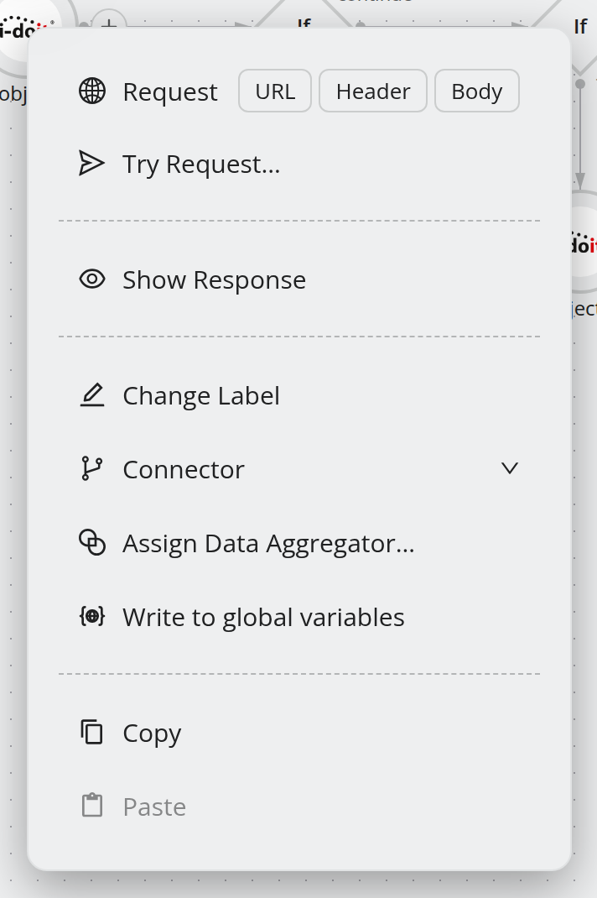
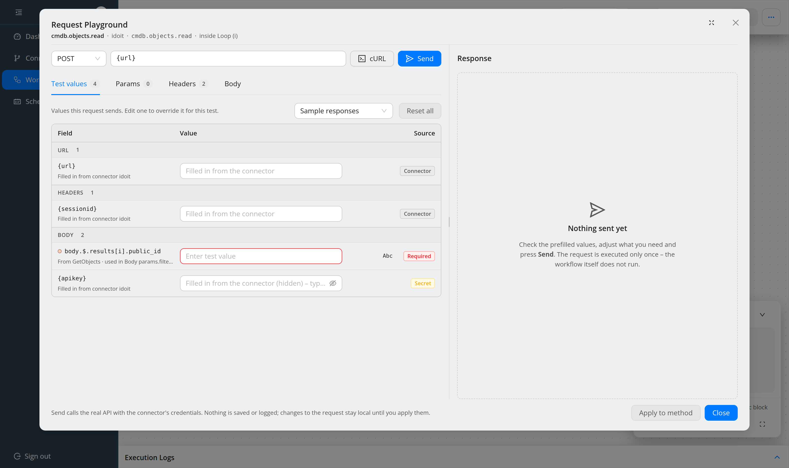

.. _guide-request-playground:

####################
Try a single request
####################

.. contents::
   :local:

.. versionadded:: 5.3

The **Request Playground** sends one step of a workflow on its own. You see the
request exactly as a run would build it, change the values it uses, send it to
the real API and look at the answer — without running the rest of the workflow.
Use it to find out why a call fails, to try a different parameter, or to fetch a
fresh sample response for mapping.

The same dialog opens from a logged run, prefilled with the values that run
used, and can show the request as a cURL command.

Open the playground
===================

In the workflow editor, right-click a connector step or an HTTP request step and
choose **Try Request…**. It sits right below the **Request** row of the context
menu.

**Try Request…** is not offered for:

* a **Trigger Workflow** step — it calls another workflow's webhook, so trying it
  would start that other workflow for real,
* **If**, **Loop**, **Start** and notification steps,
* any step while the graph is locked — in read-only mode or while a test run
  holds the canvas, the context menu is not available at all.

The dialog title names the step. For a step nested inside a loop or an ``If``,
a breadcrumb such as *inside Loop (iterator) › If* shows where it sits.

The dialog
==========

The left side holds the request, the right side the response. You can drag the
divider between them and maximise the dialog.

URL bar
-------

At the top: the **HTTP method**, the **URL** with its references shown as chips,
the **cURL** button (see `Copy a request as cURL`_) and **Send**. You can change
the method and the URL for this test. **Send** stays disabled while the dialog is
still working out which values the request needs, or if that failed.

Test values
-----------

**Test values** lists every dynamic value the request sends, grouped into
**URL**, **Headers** and **Body**: references to other steps, webhook
parameters, connector placeholders and so on. Edit a value to override it for
this test; the undo icon on a row puts the prefilled value back, and
**Reset all** does that for every row. The **Abc** / **{ }** toggle on a row
decides whether the value is sent as text or as JSON.

If the request has no dynamic values, the tab says so: it is sent exactly as
configured.

**Prefill values from** decides where the values come from:

.. list-table::
   :header-rows: 1
   :widths: 32 68

   * - Option
     - Values from
   * - **Execution #<id>**
     - A logged run. Only offered when you opened the playground from the logs —
       see `Open a logged request in the playground`_.
   * - **Paused test run**
     - The test run that is paused on or after the source step. Disabled
       otherwise, with the hint *Pause a test run on this step to use its
       values.*
   * - **Your last test of this method**
     - The values you sent the last time you tested this step. They are kept for
       the current browser session only.
   * - **Sample responses**
     - The saved sample responses of the source steps.
   * - **Manual input only**
     - Nothing; you type every value.

The default is the first of these that is available, in the order Execution,
Paused test run, Last test, Sample responses.

A badge in the **Source** column tells you where each value came from — for
example **Test run**, **Sample**, **Manual** (you changed it), **Connector**
(filled in by the server from the connector), **Secret** (from the connector and
never shown), **Required** (no value yet, enter one) or **Missing** (the
connector does not define this field, so the placeholder is sent as written).
Hover a badge for the full explanation.

Secret connector values stay hidden: the input is empty with the placeholder
*Filled in from the connector (hidden) – type to override*. Leave it empty and
the server fills in the real value.

Global variables in the request are read with their current value. Currently the
playground resolves only global variables that are open to all workflows; a
variable that is limited to certain workflows shows up as a value you enter
yourself. See :doc:`global-variables`.

Params, Headers and Body
------------------------

* **Params** — the query parameters of the URL. Switch one off, change it, or
  add one with **+ Add parameter**.
* **Headers** — every header with its **Origin**: **Fixed** (set by the API
  definition), **Dynamic** (change it in **Test values**), **Connector** (from
  the connector), **Secret** (from the connector, masked) or **Editable** (change
  it freely for this test). Add one with **+ Add header**.
* **Body** — the body as **Pretty** or **Raw edit**, with the body type (JSON,
  XML, x-www-form-urlencoded). References are highlighted; set their values in
  **Test values**. If raw JSON becomes invalid, the last valid body is sent.

These changes apply to this test only, until you choose **Apply to method**.

Send the request
================

.. warning::
   **Send** calls the **real API** with the connector's credentials. It is not a
   simulation. A ``POST``, ``PUT``, ``PATCH`` or ``DELETE`` can create, change or
   delete data in the target system.

Pressing **Send** builds the request the way a workflow run would and sends it
once. The workflow itself does not run, nothing is saved, and nothing is written
to the execution log. Reading the connector's data can itself send a request,
for example the connector's token call.

For any method other than ``GET``, ``HEAD`` and ``OPTIONS`` you are asked first:
*Send a real <method> request?* The request is sent only if you confirm.

Before sending, the dialog checks that every value marked as JSON is valid JSON.
When the values were prefilled from an execution, every value that could not be
recovered has to be entered first.

The request uses the connector's timeout. If the connector sets none, the
server waits 5 seconds for the connection.

Read the response
=================

The right side shows the status code, the duration, the size and the run
number, plus a badge if the body contains a JSON-RPC error. Three tabs:

* **Body** — **Pretty** or **Raw**, with **Copy**. **Save as sample for mapping**
  stores the body as the step's sample response, so its fields become available
  for mapping. A binary response offers **Download** instead.
* **Headers** — the response headers.
* **Request** — the request as it was sent. Hidden connector values
  (passwords, secrets, tokens) and secret global variables are shown as
  ``****``.

If the connector's data cannot be read — for example because its
authentication fails — the panel says *Could not read the data of connector …
– nothing was sent*.

Apply your changes
==================

Edits to the method, URL, params, headers and body stay inside the dialog.
**Apply to method** writes them back to the step. Like any other edit, it is
saved with the workflow. **Apply to method** and **Save as sample for mapping**
are disabled in read-only mode.

.. _guide-request-playground-logs:

Open a logged request in the playground
=======================================

When a logged call failed, you can open exactly that call in the playground:

#. Open the log tree — in the logs panel of a test run, or in the
   **Execution Logs** dialog of a schedule (**View logs** in the schedule list).
#. Expand the connector, then the method.
#. Click **Open in Playground** in the method details.

The button is shown only if your role has the **UPDATE** permission on
connections, and not while the editor is read-only.

From the **Execution Logs** dialog, the workflow opens in the editor (or the
dialog closes, if it is already open there). The editor selects and centres the
step and opens the playground with **Prefill values from** set to
**Execution #<id>**: the test values are the ones recorded in that run. For a
step inside a loop, they come from the iteration you were looking at. A value
whose source step did not run in that iteration is marked **Not executed in
this run**.

Two messages can appear instead:

* *This step no longer matches the logged run* — the workflow has changed since
  that run.
* *Could not load the logged execution* — the log could not be read.

Sending works exactly as above: it is a real request.

.. _guide-request-playground-curl:

Copy a request as cURL
======================

Click **cURL** in the URL bar to see the request as a command you can run in a
terminal. The panel *cURL (built by the server)* shows the command, with
**Copy** to put it on the clipboard.

.. danger::
   The cURL command contains the connector's **real, unmasked credentials and
   tokens**, so that it works when you run it. Treat it as a secret: do not paste
   it into tickets, chats or shared documents. Only **secret global variables**
   are masked as ``****`` — insert their values yourself before running it.

How the command is generated:

* The server builds it exactly as **Send** would send the request — but does not
  send it.
* It is generated once when the panel opens, and afterwards only when you press
  **Regenerate**. When the test values or the request change, the panel shows
  *Request changed – regenerate*.
* Each generation reads the connector's data, which can run the connector's
  authentication, for example a real token request.

Format: one option per line, ending in ``\``, every argument in single quotes.
``--insecure`` is added if the connector trusts any certificate, and
``--connect-timeout`` follows the connector's timeout. The command is written
for a POSIX shell (bash, zsh, Git Bash), not for Windows ``cmd`` or PowerShell.

No screenshot of the panel is included on purpose, because it shows real
credentials.

Where to go next
================

* :doc:`script-playground` — test a transformation script on its own.
* :doc:`debug-a-workflow` — run the whole workflow and read its log.
* :doc:`global-variables` — values shared between workflows.
