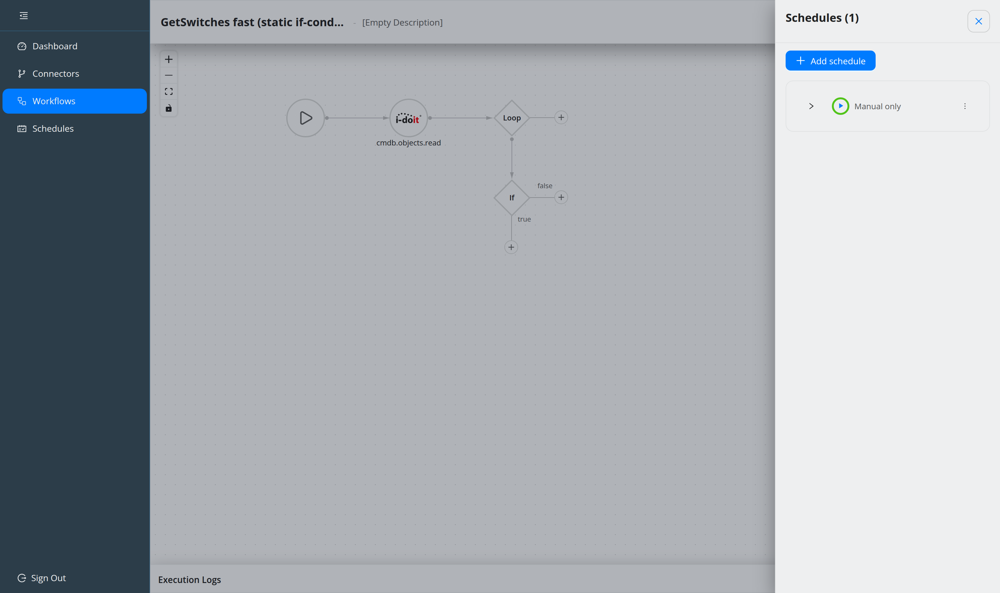
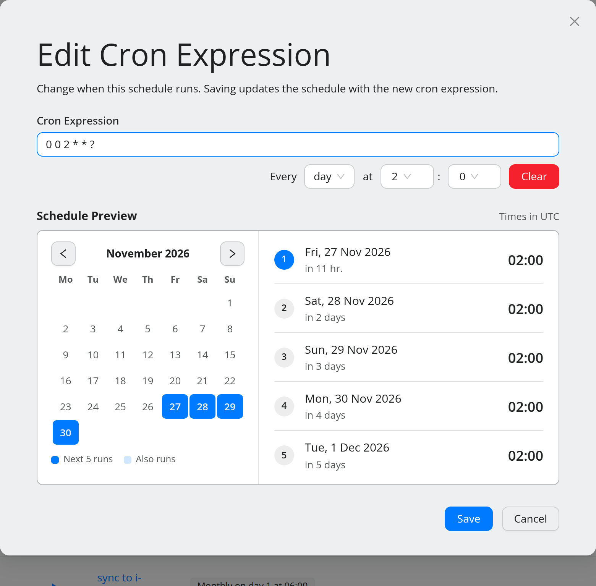
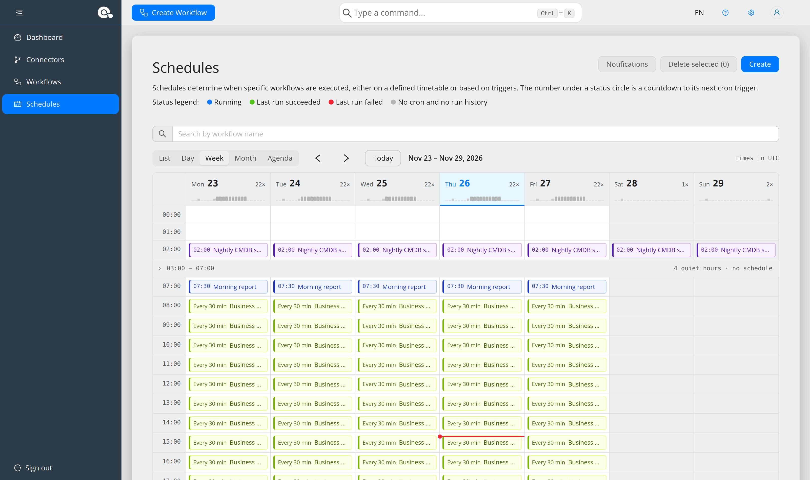
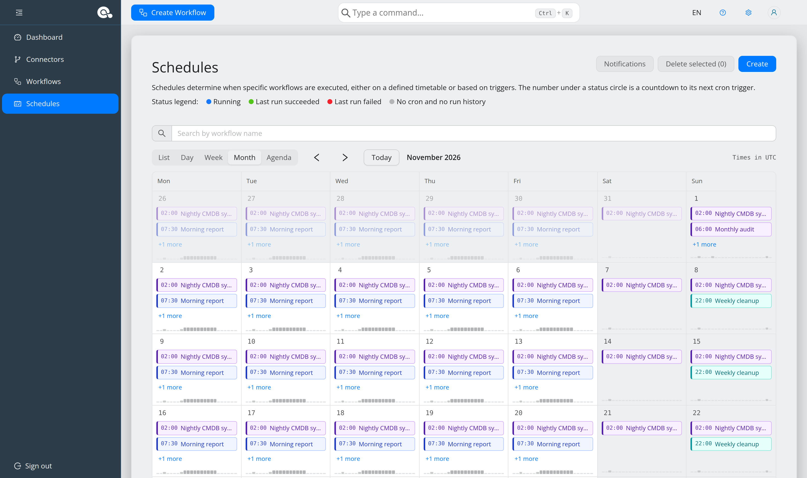
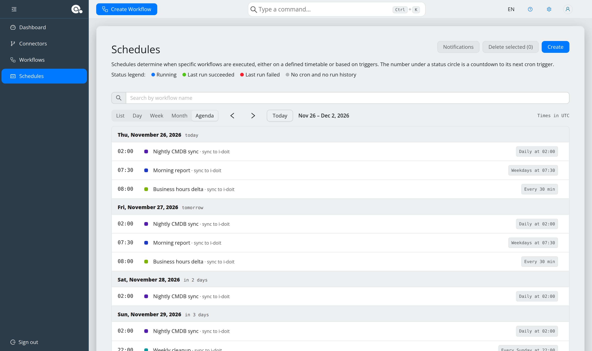
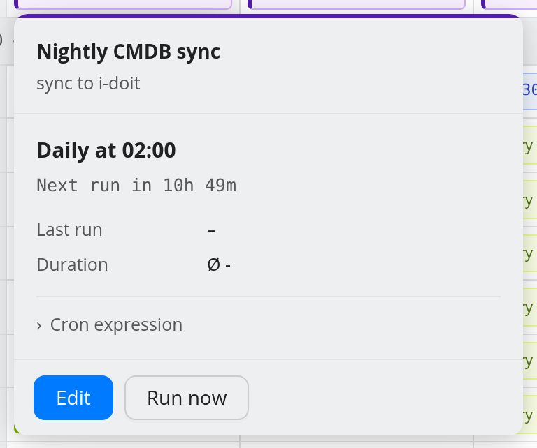
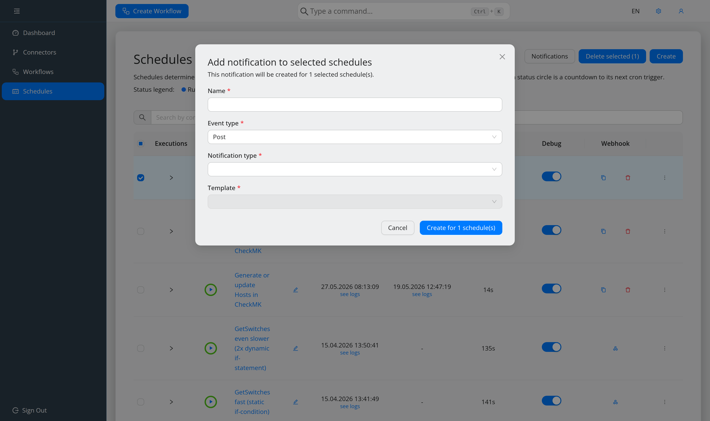

######################
Schedule and notify
######################

.. contents::
   :local:

Create a schedule
=================

Either from the workflow editor — the **schedules pill** in the header, **Create
schedule**, already scoped to the open workflow — or from **Schedules → Create**.

A schedule needs:

* a **title** (first step, mandatory) — it identifies the schedule in the list,
* a **workflow** (mandatory),
* **logs**, off by default,
* a **cron expression**, optional.

``Ctrl+Enter`` advances and submits.

.. note::
   Schedules can only be attached to a **saved** workflow. Until the first save the
   drawer says so.

Leave logging off unless you need it, and switch it on from the list's **Debug
mode** column when you do — see :doc:`debug-a-workflow`.

Cron expressions
================

The generator builds the common cases: pick values from the lists. You can also
type an expression directly; it is validated as you type, and an invalid one
shows *Invalid cron expression* or the server's reason.

.. versionchanged:: 5.3
   The text field is now what counts. The generator only shows an expression it
   can represent; for anything else it stays empty and you edit the text. It no
   longer rewrites an expression you typed, keeps the seconds field, and no longer
   shifts the weekdays by one. Its **Clear** button empties the field.

Under the field, the **Schedule Preview** shows when the expression fires: a
small month calendar and the **Next 5 runs** with date, time and how far away
they are. The preview names the time zone it uses, *Times in …* (see below). For an expression it cannot evaluate it says
*Invalid or unsupported cron expression*.

In the schedule list, the **Schedule** column shows the expression in plain
words — *Daily at 12:00*, *Every 5 minutes*, *Weekdays at 08:00* — with the raw
expression in the tooltip. Click it to edit the expression without the full
wizard (*Edit Cron Expression*).

.. versionchanged:: 5.3
   The column was called **Cron** and showed the raw expression.

OpenCelium uses Quartz, so an expression is 6 or 7 fields: second, minute, hour,
day of month, month, day of week, and optionally year.

.. code-block::

   0 0 12 * * ?        every day at 12:00
   0 15 10 * * ? *     every day at 10:15
   0 0/5 14,18 * * ?   every 5 min, 14:00-14:55 and 18:00-18:55

More examples are in the `Quartz tutorial
<https://www.quartz-scheduler.org/documentation/quartz-2.2.2/tutorials/crontrigger.html>`_.

.. note::
   Only one schedule per workflow runs at a time. A second start is refused.

   A workflow that uses a **mutable global variable** whose busy policy is
   **Queue** behaves differently: a second start waits until the running one
   ends, instead of being refused. See :doc:`global-variables`.

.. _guide-schedule-calendar:

See the schedules in a calendar
===============================

.. versionadded:: 5.3

Above the schedule list, the switch **List | Day | Week | Month | Agenda** shows
the same schedules as a calendar of their upcoming runs. The calendar shows the
schedules the list currently shows, so the search box applies to it as well.
Use the arrows and **Today** to move through time.

.. list-table::
   :header-rows: 1
   :widths: 16 84

   * - View
     - Shows
   * - **Week**
     - Seven day columns, Monday first, with one row per hour. Each run is a chip
       with its time and the schedule's name; a schedule that runs every few
       minutes appears as one chip *Every n min*. After two chips in an hour,
       **+n more** switches to the Day view.
   * - **Day**
     - One day, with every run of each hour.
   * - **Month**
     - The whole month, with a small bar per hour of each day showing how busy
       it is. Click a day number to open that day.
   * - **Agenda**
     - The next seven days as a list: time, schedule, its timing in plain words,
       and whether the last run was ok.

Some things the Week and Day views point out:

* **Quiet hours** — three or more hours in a row without any run fold into one
  band, for example *01:00 – 06:00 · 5 quiet hours · no schedule*. Click it to
  expand it.
* **Clashes** — an hour is marked *Starts less than 5 minutes apart* when two
  schedules start within five minutes of each other.
* **Failures** — runs of a schedule whose last run failed are marked. If such a
  run is hidden behind **+n more**, the button carries a red dot, and clicking it
  opens that run's card.
* **Now** — a line marks the current time.

Every schedule with a cron expression is drawn; a paused schedule is not shown
differently. Schedules without a cron expression do not appear.

Click a run to open its card:

It shows the schedule and workflow, the timing in plain words, when the next run
is, the last run with its duration, the last failure if any, the average
duration, and whether debug mode is on. The raw cron expression is folded away
under **Cron expression**, for copying. **Edit** (or **View**, without the
permission to change it) opens the schedule; **Run now** starts it.

.. warning::
   **Run now** really starts the workflow, with all its effects on the connected
   systems.

Times are shown in the time zone named in the toolbar, *Times in …*. It is the
server time zone if the administrator set ``serverTimeZone`` in the frontend's
``config.json`` (see :ref:`ref-config-server-time-zone`), otherwise your browser's
time zone. Quartz fires the schedules in the server's time zone, so without that
setting the calendar can be off by the difference.

The dashboard has a matching **Schedule** card with the next 24 hours and the
next runs; **All schedules →** opens the list.

Webhooks
========

A webhook lets an outside system trigger the workflow by calling a URL. Use the
schedule's **Generate webhook URL** action, then the copy icon to take the URL.

The workflow can read the webhook's query parameters or payload — see
:doc:`../concepts/data-mapping`.

.. warning::
   Removing a webhook invalidates the URL immediately and cannot be undone.

Notifications
=============

The notifications in this section belong to a **schedule**: they are sent before
it runs, after it ran, or when it failed. To post a message at a particular point
*inside* a workflow, with data from its steps, use a **Send Notification** step
instead — see :doc:`send-notifications`.

First create a **notification template** under **Configurations → Notification
Templates**: a name, a type (*Email*, *Slack* or *Teams*), and a subject and body.
Templates can reference ``{USER_NAME}``, ``{USER_SURNAME}``, ``{USER_TITLE}``,
``{USER_DEPARTMENT}``, ``{CONNECTION_ID}``, ``{CONNECTION_NAME}``,
``{SCHEDULER_ID}``, ``{SCHEDULER_TITLE}`` — and any aggregator arguments.

.. note::
   ``CONNECTION_ID`` and ``CONNECTION_NAME`` mean the **workflow**; the reference
   names were kept so existing templates keep working.

Then attach a notification to the schedule. It needs a name, an event type, a
notification type, a template, and either recipients (e-mail) or a URL (webhook).

.. list-table::
   :header-rows: 1
   :widths: 16 84

   * - Event
     - Fires
   * - **pre**
     - before the schedule runs
   * - **post**
     - after it ran
   * - **alert**
     - on failure

To apply the same notification to many schedules, select them with their
checkboxes and use the **Notifications** bulk action: configure once, created for
each. The result message reports how many succeeded and how many failed.

.. note::
   A **data aggregator** only takes effect for **post** notifications. Attaching
   one and then using *pre* or *alert* silently produces nothing — see
   :doc:`../concepts/data-mapping`.

E-mail needs ``spring.mail`` configured, otherwise nothing is sent and
:ref:`ref-system-check` reports Email as *Down*.

Channel payloads
================

The subject and body are wrapped into the payload the channel expects. The
templates are files you can adapt, in
``src/backend/src/main/resources/notification/``:

* ``default.json`` — plain ``${subject}`` / ``${text}``,
* ``slack.json`` — a Slack *blocks* payload,
* ``teams.json`` — a Teams adaptive card (schema 1.4).
