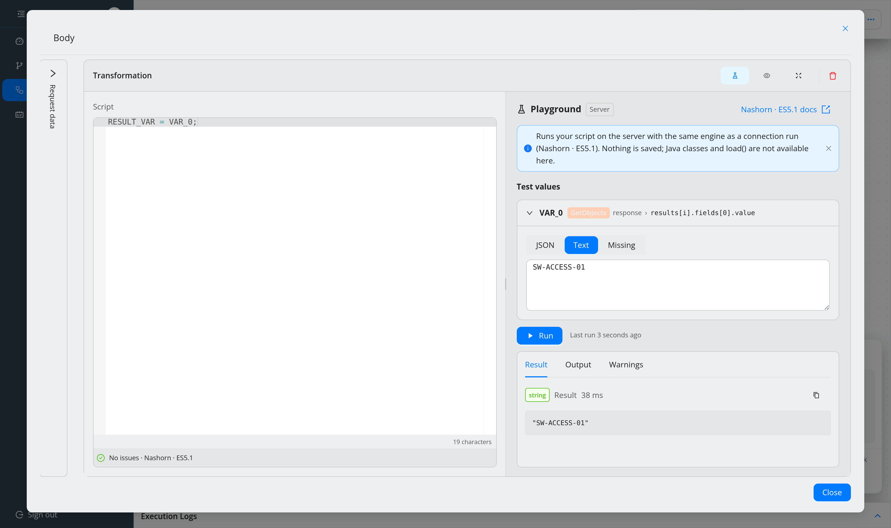

.. _guide-script-playground:

############################
Test a transformation script
############################

.. contents::
   :local:

.. versionadded:: 5.3

A transformation script used to be testable only by running the whole workflow.
The **Script Playground** runs the script on its own: you enter test values for
its variables, press **Run** and see the result, the printed output and any
compatibility warnings — next to the code you are editing.

Open the playground
===================

#. Open the body of a step, for example with **Request → Body** in the step's
   context menu.
#. Select a reference that has a transformation. The **Transformation** panel
   opens on the right.
#. Click the **flask** icon (*Playground*) in the **Transformation** header.

The icon is only there when the script language is **JavaScript**. Python and
Ruby scripts run only when the workflow runs.

With the playground open, the editor makes room for it: the request data on the
left collapses, the script sits on the left and the playground on the right
(stacked on narrow screens). The maximise button gives both the full window.

What runs where
===============

The script runs **on the server**, with the same engine a workflow run uses
(Nashorn, ECMAScript 5.1). The header link **Nashorn · ES5.1 docs** leads to the
engine's documentation. The run happens in a sandbox: Java classes and
``load()`` are not available, and no external system is called. Nothing is
saved.

Enter test values
=================

**Test values** has one entry per ``VAR_n`` of the transformation (with the
reference it stands for) and one per ``ref("…")`` call in the script. Each entry
has three modes:

.. list-table::
   :header-rows: 1
   :widths: 20 80

   * - Mode
     - The variable is
   * - **JSON**
     - The JSON value you paste or type.
   * - **Text**
     - A string, typed without quotes.
   * - **Missing**
     - ``""`` — an empty string, as for a reference with no data on the server.

A ``VAR_n`` that points at a global variable starts with the variable's current
value; secret constants start empty. A ``VAR_n`` that points at a script
variable becomes a function you call, as in ``VAR_0(…)``. See
:doc:`global-variables`.

Your test values are remembered per transformation in the browser's local
storage, so they are still there next time — on this browser only. Keep that in
mind before pasting real customer data.

Run the script
==============

Press **Run** or :kbd:`Ctrl+Enter` (:kbd:`Cmd+Enter` on macOS), in the editor or
in the panel. **Run** is disabled while the script has a syntax error, while a
JSON test value is invalid, and while a run is in progress. The status line shows
*Not run yet*, *Not run since your last edit* or *Last run <time>*.

The output has three tabs:

.. list-table::
   :header-rows: 1
   :widths: 20 80

   * - Tab
     - Shows
   * - **Result**
     - The value the script returned, its type and the duration, with
       **Copy result**.
   * - **Output**
     - Everything the script printed with ``print(...)``. ``console.log`` does
       not exist on the server engine — use ``print`` instead.
   * - **Warnings**
     - Compatibility problems with the server engine. Click one to jump to its
       line.

A runtime error marks the line in the editor.

The result must be a string, number, boolean, ``null``, a plain object or an
array.

If the script writes a global variable with ``set()``, the playground lists the
writes under **Writes to global variables (not saved)**. A real run writes these
values once the transformation has finished; the playground only shows them.

Limits
======

.. list-table::
   :header-rows: 1
   :widths: 50 50

   * - Limit
     - Default
   * - Run time per script
     - 5 seconds (``opencelium.script-run.timeout``)
   * - Runs at the same time, server-wide
     - 2 (``opencelium.script-run.max-concurrent``)
   * - Script length
     - 100,000 characters
   * - Test values
     - 1 MB
   * - Printed output
     - 65,536 characters

When the server is already running the maximum number of scripts, a run is
refused with *The server is busy running other scripts. Try again in a moment.*
(HTTP 429).

Where to go next
================

* :doc:`request-playground` — send a whole request on its own.
* :doc:`../concepts/data-mapping` — references and transformations.
* :doc:`debug-a-workflow` — see the script's value in a paused debug run.
