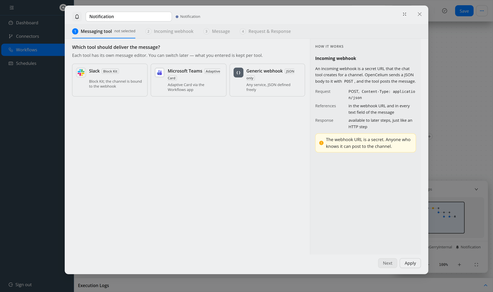
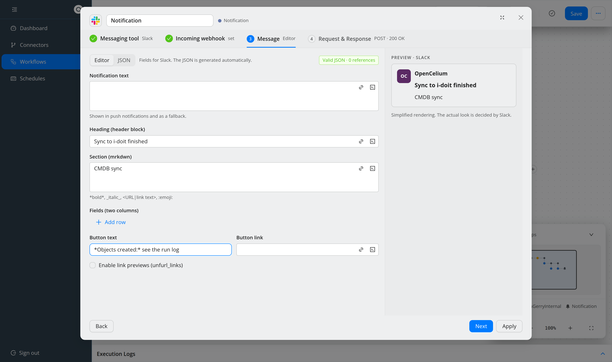

.. _guide-send-notifications:

##################
Send notifications
##################

.. contents::
   :local:

.. versionadded:: 5.3

A **Send Notification** step posts a message to Slack, Microsoft Teams or any
other service that accepts an incoming webhook — in the middle of a workflow,
with data from earlier steps in the text. Use it to tell a channel that an order
was synchronised, that a ticket was created, or which record a step could not
process.

You could build the same call as a plain HTTP request, but the notification step
guides you through it: it knows the webhook URL format and the message layout of
each tool, shows a preview, and lets you send a test message.

.. note::
   This step is different from the **schedule notifications** described in
   :doc:`schedule-and-notify`. Those are sent before or after a schedule runs, or
   when it fails, and use notification templates. They are unchanged in 5.3. A
   Send Notification step is part of the workflow and runs where you put it.

Add the step
============

Hover a node, click the **+** handle and choose **Send Notification** — *Post a
message to Slack, Microsoft Teams or any other incoming webhook.* The setup dialog
opens straight away.

On the canvas the step shows the tool's logo with a bell badge and its status:
*Ready: tool and webhook URL are set* or *Incomplete: choose a tool and set the
webhook URL*. A new step says *Choose tool*. Double-click the step, press
``Enter`` while it has focus, or click the badge to open the dialog again.

The setup dialog
================

At the top of the dialog you can give the step a label (*Step label*). The label
is also what the execution logs show for this step, instead of a bare ``POST``.

The dialog has four steps, shown in a bar with a short summary of each. Steps 2
to 4 are available once a tool is chosen. Move with **Back** and **Next**, or
click a step in the bar; **Apply** takes the settings into the workflow. The
dialog can be maximised.

1. Messaging tool
-----------------

*Which tool should deliver the message?*

.. list-table::
   :header-rows: 1
   :widths: 24 76

   * - Tool
     - Message format
   * - **Slack**
     - Block Kit. The channel is bound to the webhook.
   * - **Microsoft Teams**
     - An Adaptive Card, sent through the Teams **Workflows** app.
   * - **Generic webhook**
     - Any service. You define the JSON body yourself (*JSON only*).

You can switch the tool later; what you entered is kept per tool.

The side panel *How it works* summarises the mechanism: OpenCelium sends the
message as a ``POST`` with ``Content-Type: application/json`` to the webhook URL,
references are allowed in the URL and in every text field, and the response is
available to later steps, as for an HTTP request.

.. warning::
   The webhook URL is a secret. Anyone who knows it can post to the channel.

2. Incoming webhook
-------------------

Paste the **Webhook URL**, or build it from references — for example to post to
a different channel per team. References can come from a method, a webhook
parameter or a global variable.

A line under the field checks the format as you type:

* *Format matches Slack* (or *Microsoft Teams*),
* *This does not look like a … webhook URL. Expected: …* — Slack URLs start with
  ``https://hooks.slack.com/services/``; Teams URLs come from
  ``logic.azure.com`` or ``powerplatform.com``,
* *Built from references at run time* — the URL can only be checked when the
  workflow runs.

The guide on the right explains, step by step, where to get the URL in the chosen
tool, with the URL format, the response and typical errors, and a link to the
official documentation:

* **Slack** — create an app at ``api.slack.com/apps``, activate *Incoming
  Webhooks* and add a webhook for the channel. One webhook posts to one channel.
* **Microsoft Teams** — in the channel, open **⋯ → Workflows** and use the
  template *Post to a channel when a webhook request is received*. Microsoft is
  retiring the classic Office 365 connectors, so create new webhooks this way.
* **Generic webhook** — copy the URL from the target system and build the body as
  that system documents it.

3. Message
----------

For Slack and Teams you choose between two modes:

* **Editor** — fields for the tool's message layout; the JSON is generated for
  you.
* **JSON** — *This exact body is sent. References are allowed in every string.*
  A status line shows *Valid JSON · n references* or the parse error.

A generic webhook is configured as JSON only.

.. list-table::
   :header-rows: 1
   :widths: 22 78

   * - Tool
     - Editor fields
   * - Slack
     - **Notification text** (required; shown in push notifications and as a
       fallback), **Heading**, **Section** (Slack *mrkdwn*), **Fields** (two
       columns), **Button text** and **Button link**, and the switch **Enable link
       previews**.
   * - Microsoft Teams
     - **Title** with a **Title colour** (Default, Accent, Success, Warning,
       Critical), **Text** (Markdown), **Facts**, **Button text** and **Button
       link**, an optional **Mention** (UPN or e-mail), and **Show the card at full
       width**.

Fields and facts are rows of label and value; add them with **Add row**.

Every text field accepts **references**, with the same picker as elsewhere
(method, webhook parameter or global variable), so you can write *Order …
shipped* with the order number in the middle. A field can also be computed by a
**transformation** — *Compute this value with a script (transformation)* — which
receives the field's step references as ``VAR_0``, ``VAR_1`` … (see
:doc:`../concepts/data-mapping`). A transformation needs at least one step
reference, and is not available for a field that contains webhook parameters or
other text besides the reference.

If you edit the JSON by hand, it takes precedence and the editor is locked. Use
**Discard JSON and use editor** to go back, or **Regenerate from editor** to
rebuild the JSON from the editor fields.

The **preview** on the right renders the message roughly as the tool will. It is
a simplified rendering; the actual look is decided by the tool.

4. Request & Response
---------------------

The **Request** tab shows what is sent: the URL, the headers and the body. The
``Content-Type: application/json; charset=utf-8`` header is fixed; **Add header**
adds others, for example ``Authorization`` for a generic webhook. The body comes
from the **Message** step (*Edit in "Message"*).

The **Response** tab shows the **Expected status** — *200 OK* for Slack, *202
Accepted* for Teams — and a sample body. Under **Response parameters for later
steps** it lists the references later steps can use, such as the HTTP status and
the response body, each with a copy button.

.. note::
   Teams answers *202 Accepted*, which only means the request was accepted.
   Whether the card was posted is shown in the run history of the Teams workflow.

Send a test message
-------------------

**Send test message** sends the current message once and shows the result, for
example *HTTP 200 · 180 ms*. References to earlier steps are filled with
placeholders such as ``[customer.name]``.

.. warning::
   The test message is a real ``POST``: it really appears in the channel.

Use the step in a workflow
==========================

The step behaves like an HTTP request in the rest of the editor:

* It is saved, tested and run with the workflow; the request is always a
  ``POST`` with a JSON body.
* Later steps can read its response with references.
* It can be the source or the target of a jump — see
  :doc:`skip-steps-with-joints`.
* The workflow check covers it like any other step — see :doc:`check-a-workflow`.
* In the minimap legend it appears as **Notification**, with a bell.

The context menu of the step opens the dialog on the matching part: **Open
notification**, **Change messaging tool**, **Incoming webhook**, **Edit
message**, the **Request** row with **URL**, **Header** and **Body**, **Show
Response**, **Change Label**, **Assign Data Aggregator…**, and **Copy** /
**Paste**.

Where to go next
================

* :doc:`schedule-and-notify` — notifications attached to a schedule.
* :doc:`call-any-api` — plain HTTP requests.
* :doc:`../concepts/data-mapping` — references and transformations.
* :doc:`global-variables` — values shared between workflows, for example a
  webhook URL used in several places.
