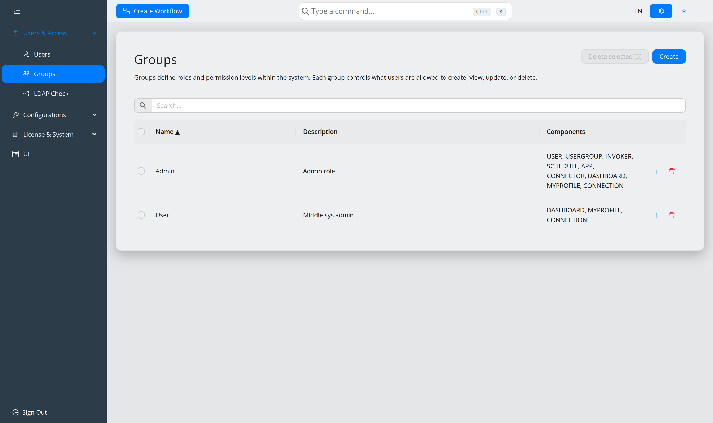
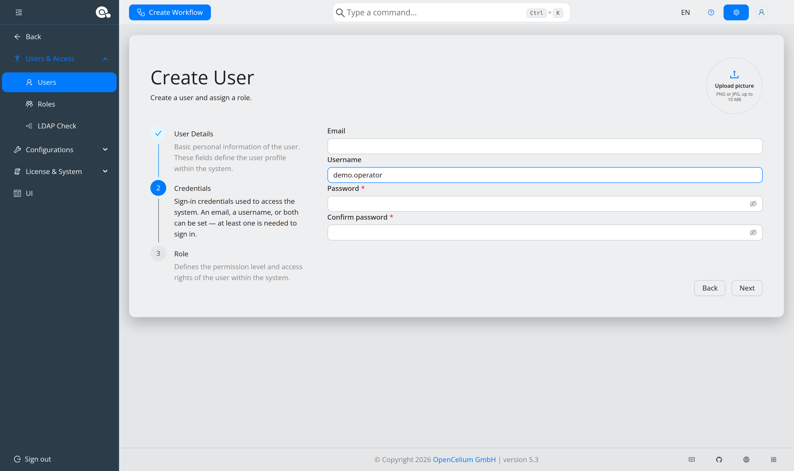
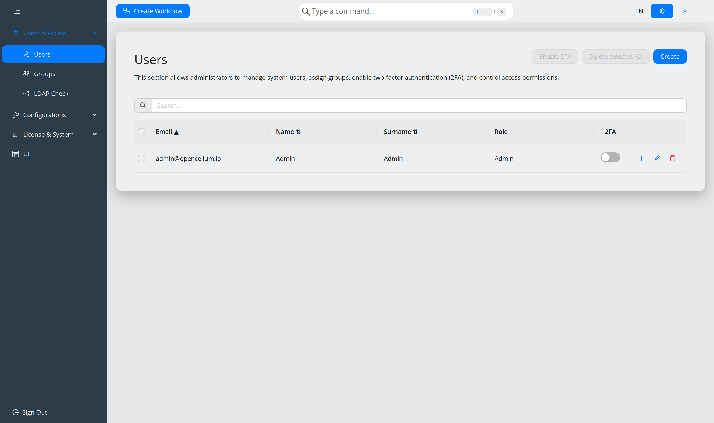
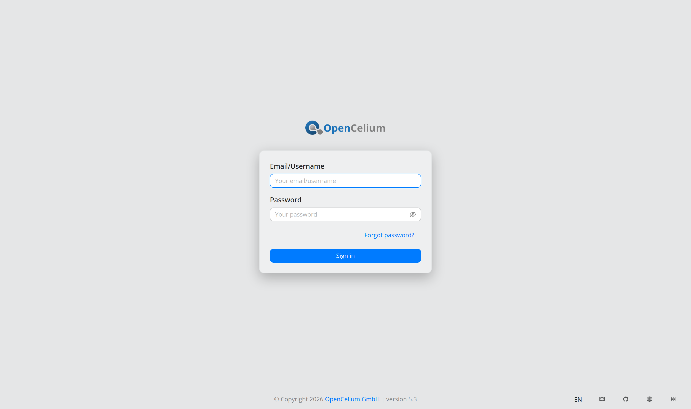
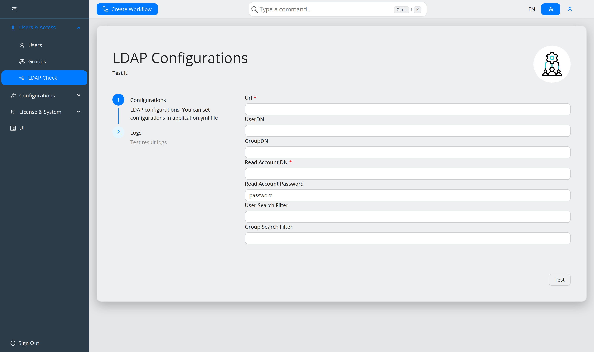
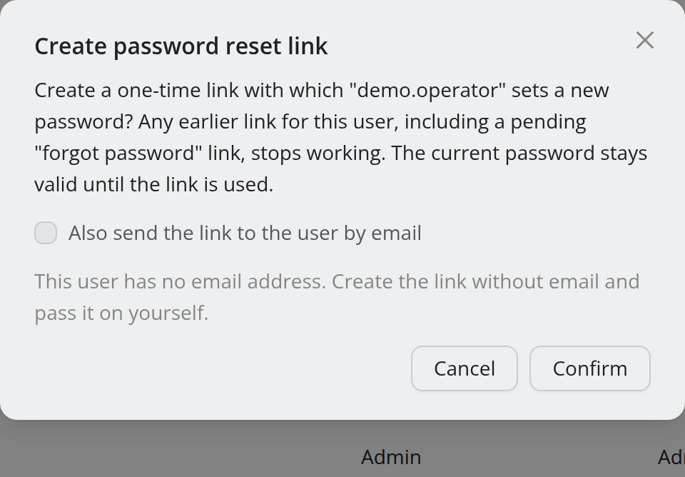

#########################
Users and permissions
#########################

.. contents::
   :local:

Permissions are granted per **role**, never per user. A user gets exactly the
rights of their role. The component and action matrix is in
:doc:`../reference/permissions`.

.. note::
   Up to 5.1 the interface called roles **groups**. The API and the command
   palette have always called them ``role``.

Create a role first
===================

**Users & Access → Roles → Create**. Two steps:

* **Role Details** — name (mandatory), description, optional icon. *(5.2: the
  icon is uploaded and cropped round in the wizard, and shown in the role list.)*
* **Permissions** — select the components the role may touch, then tick the
  actions per component. At least one is required; the *admin* column ticks a whole
  row.

A role named **admin** (in any letter case) also gets the guided tours, see
:doc:`../start/guided-tours`.

Effect in the interface: missing **READ** hides a component's menu entry
altogether; missing CREATE/UPDATE/DELETE hides only those actions. The command
palette follows the same rules.

Then create users
=================

**Users & Access → Users → Create**. Three steps:

* **User Details** — title, name, surname, department, organization, phone, and
  the profile picture.
* **Credentials** — **Email** and **Username** (each up to 255 characters) and
  the password (at least 8 characters). An email, a username or both can be
  set; at least one is needed to sign in.
* **Role** — the role.

.. versionchanged:: 5.3
   Email and username are separate fields. Up to 5.2 the email address was the
   username. A user without an email address can sign in with the username, but
   cannot use *Forgot password* — an administrator creates a reset link instead
   (see :ref:`guide-users-password-link`).

Rules for the username:

* It may not contain ``@``, so it can never be mistaken for an email address.
* It is unique, compared without regard to letter case, across OpenCelium and
  LDAP users.
* Leaving the email blank stores no email address at all.

.. note::
   The signed-in user cannot delete themselves.

Signing in
==========

Users sign in with their email address **or** their username, in the
**Email/Username** field.

.. versionadded:: 5.3
   Failed sign-ins are rate-limited. After 5 failures for one account, or 20
   from one client address, within 15 minutes, further attempts are refused with
   HTTP ``429`` until the window has passed. A successful sign-in clears the
   failures of that account. The limits are configurable — see
   :ref:`ref-config-code-only`.

The limit is kept in memory, so restarting the backend resets it. Behind a
reverse proxy the client address is only recognised with the shipped nginx
configuration and ``server.forward-headers-strategy: native``; otherwise all
users share one client budget.

Profile pictures
================

.. note::
   **New in 5.2.**

The picture tile in the user wizard — and on everyone's own **Profile** page —
uploads a PNG or JPG of up to 10 MB, crops it to a circle, replaces or deletes it.
The picture appears in the user list and on the profile icon in the top bar.

When you leave the e-mail field, OpenCelium checks whether the address has a
`Gravatar <https://gravatar.com>`_ and, if so, asks *Use Gravatar picture?*.
For a user who already has a picture, the Gravatar replaces it on Save. Once a
Gravatar is known, the tile also offers **Refresh from Gravatar**.

The Gravatar lookup needs online services switched on
(:ref:`ref-config-online-services`) and the application served over HTTPS (or
``localhost``); otherwise it simply does not appear. Nothing is sent to Gravatar
when it is off.

Two-factor authentication
=========================

Toggle 2FA per user in the **2FA** column of the user list, or for several users at
once by selecting them and using **Enable 2FA**.

At the next login the user scans the QR code with an authenticator app, then enters
the generated code as a second step.

LDAP
====

For central user management, configure ``spring.security.ldap`` — see
:ref:`ref-configuration`. Users then sign in with their directory credentials, and
``group-role-mapping`` maps directory groups onto OpenCelium roles, with
``default-role`` as the fallback.

Test it under **Users & Access → LDAP Check**, which shows the effective
configuration and the test log.

.. versionchanged:: 5.3
   Signing in with an identifier that belongs to a local OpenCelium account no
   longer tries the directory first. Up to 5.2 every sign-in went to LDAP
   first, so failed binds for local accounts could count towards the
   directory's lockout. Unknown identifiers still go to LDAP, which is how a
   directory user's first sign-in works.

.. warning::
   In 5.0 this block is ``spring.security.ldap``. Before 5.0 it was
   ``spring.data.ldap``. An unchanged 4.x file silently stops authenticating.

For failures, raise ``logging.level.org.springframework.security.ldap`` to
``DEBUG`` and watch ``journalctl -xe -u opencelium -f``.

Passwords
=========

Users change their own password in the profile dialog; it logs them out
immediately.

A forgotten password is reset from the sign-in page, which mails a reset link. The
new password needs at least 8 characters with an uppercase letter, a lowercase
letter, a number and a special character. (5.2 dropped the old 16-character cap
in the browser.) This requires ``spring.mail`` to be configured —
without it the page says password reset is unavailable.

The self-service reset works **only with an email address**. Typing a username
there shows a hint to contact the administrator, and so does an account without
an email address — LDAP accounts, for example. The link is valid for a few
minutes (``opencelium.forgot-psw.token-activity-time``).

.. _guide-users-password-link:

Create a password reset link for a user
---------------------------------------

.. versionadded:: 5.3

An administrator can create a one-time link with which a user sets a new
password — for users without an email address, or when mail is not set up.

#. In **Users & Access → Users**, click the row icon **Create one-time password
   reset link** of the user.
#. Confirm **Create password reset link**. Tick **Also send the link to the user
   by email** if the user should get it by mail as well. The box is unticked by
   default, and it is disabled when the user has no email address or the
   server's mail is not available (Email not *UP* on :ref:`ref-system-check`).
#. The **Password reset link** dialog shows the link and its expiry. Copy it and
   pass it on through a trusted channel.

What to know about the link:

* It is valid for **24 hours** (``opencelium.forgot-psw.admin-link-activity-time``)
  and works **once**.
* It is shown only in this dialog and cannot be displayed again. Anyone who has
  it can set the password for the account.
* Creating it invalidates every earlier link of that user, including a pending
  *Forgot password* link. The current password stays valid until the link is
  used.
* LDAP users cannot get a link; their password is managed in the directory.
* If the email cannot be sent, no link is created and the earlier link stays
  valid.
* The link opens the frontend's ``/set-password`` page, built from
  ``opencelium.forgot-psw.base-url`` — see :ref:`ref-config-forgot-psw`.

The action is offered to administrators who also have *update* on Users.

After updating to 5.3: check usernames
--------------------------------------

The 5.3 database update cleans up usernames once, so that they can be unique and
used for signing in:

* Usernames are trimmed; empty ones become empty (``NULL``).
* **A username that contains** ``@`` **is removed** from every account that is
  not an LDAP account.
* An OpenCelium account whose username equals that of an LDAP user loses it.
* Of the remaining duplicates, the account with the lowest id keeps the
  username.

Blank email addresses are cleared the same way. After updating, check the user
list and give a username back to anyone who needs one to sign in. Accounts with an
email address can still sign in with it.

Sessions
========

A ``401`` or ``403`` signs the user out automatically, closes open dialogs, and
remembers the route so they return to it after signing in again.
