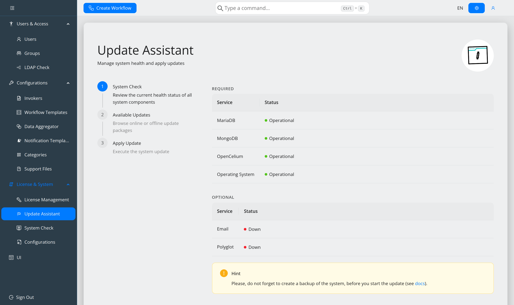
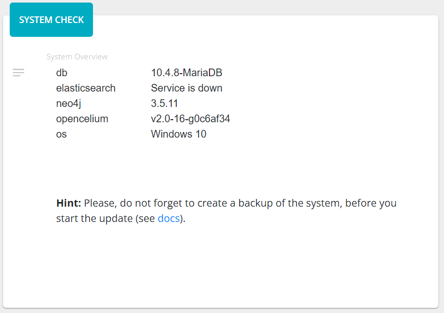

########
Updating
########

.. _ref-update-assistant:

The Update Assistant
""""""""""""""""""""

For ZIP installations the update is driven from the interface, under
**License & System → Update Assistant** (admin menu, ``Alt+M``). If a newer
version is available in the package cloud it is announced here.

Three steps:

.. list-table::
   :header-rows: 1
   :widths: 28 72

   * - Step
     - Content
   * - **System Check**
     - The current health of all components, and a reminder to back up.
   * - **Available Updates**
     - Online packages from the package cloud, or an offline package you upload.
   * - **Apply Update**
     - Runs the update.

.. note::
   The page moved from ``/update_assistant`` to ``/update-assistant``. The old URL
   still redirects.

Follow the progress with ``journalctl -xe -u opencelium -f``.

Compatibility Matrix
"""""""""""""""""""""

.. raw:: html

	
The tests were conducted using the archived package version (ZIP) and the Ubuntu 24.04 LTS operating system.

	 

	

	    

	    

	

	
	<table id="compatibility-datatable" class="table table-striped table-hover w-100"></table>

|
|

.. note::
        | The matrix lists the upgrade paths that have actually been tested.
        | New target rows are added once the release tests for the
        | individual source versions have been completed.

.. warning::
        | Before updating, always do a full backup of your system!

.. contents::
   :local:

Updating to 5.3
"""""""""""""""

Update with the method for your installation type, described under
*From OC 4.x to 5.0* below (Update Assistant, package manager or Docker Compose).
What is new is in :doc:`../start/whats-new-5-3`. This section lists what happens
automatically and what you should check afterwards.

What happens automatically
==========================

* **Database.** The new database changesets run on the first start. They add the
  global variable tables and the ``GLOBAL_VARIABLE`` permission component (the
  Admin role gets it; other roles must be granted it under **Roles**), keep only
  one session per user, extend password reset tokens and clean up usernames and
  email addresses (see below). On MariaDB older than 10.10 the global variable
  tables keep the collation ``utf8mb4_general_ci``.
* **Configuration.** The startup configuration migration adds the new 5.3 keys to
  ``application.yml``, including ``opencelium.global-variable.*`` and
  ``opencelium.forgot-psw.admin-link-activity-time``. It does not add
  ``secret-key`` and does not change existing values. It now migrates the file
  that ``OPENCELIUM_CONFIG_FILEPATH`` points at; if the file is not found, the log
  says *YAML migration skipped: '<path>' does not exist*.
* **Older workflows and templates** are upgraded on read again, including
  templates imported from very old versions. An imported template keeps the
  version its upgrade reached.
* **Changelog page.** The frontend build (``npm run build``) now also generates
  the **Changelog** page from ``CHANGELOG.rst`` in the repository root. Without
  the file the build still succeeds and the page shows no entries.

What to check after updating
============================

#. **Configuration file path.** Make sure the **System Configuration** page can
   save. Check ``opencelium.config.file-path`` in ``application.yml``, or set
   ``OPENCELIUM_CONFIG_FILEPATH`` to the location of ``application.yml`` — see
   :ref:`ref-config-file`.
#. **Reset link URL.** Set ``opencelium.forgot-psw.base-url`` to
   ``https://<your host>/set-password``. Old ``/reset-password`` links keep
   working, but admin-created reset links need the URL — see
   :ref:`ref-config-forgot-psw`.
#. **Secret key for global variables.** Set
   ``opencelium.global-variable.secret-key`` (or
   ``OPENCELIUM_GLOBALVARIABLE_SECRETKEY``) to a long random string **before
   anyone saves the first secret global variable**. The built-in fallback key is
   the same on every installation, and there is no key rotation — see
   :ref:`ref-config-global-variable`.
#. **Server time zone.** Add ``"serverTimeZone"`` (for example
   ``"Europe/Berlin"``, the zone the backend runs in) to the frontend's
   ``config.json``. The build does not write it, so add it by hand after every
   frontend build or update. Without it, schedule times are shown in each
   browser's zone — see :ref:`ref-config-server-time-zone`.
#. **Upload size.** The shipped nginx configuration still sets
   ``client_max_body_size 200M``, while uploads of templates, API definitions and
   offline update packages may be up to 1 GB. If you need bigger uploads, raise
   it, for example to ``1G``, and reload nginx.
#. **Usernames.** The database update removes usernames that contain ``@`` from
   non-LDAP accounts and resolves duplicates. Check the user list — see
   :doc:`../guides/users-and-permissions`.
#. **Roles.** Grant ``GLOBAL_VARIABLE`` to roles other than Admin that should
   work with global variables.

.. note::
   The master password is no longer kept in the browser. After the update,
   users enter it again after every page reload and every new sign-in.

.. note::
   Request URLs are now sent as typed, and reference values are encoded as
   data. Methods that relied on the old behaviour — pre-encoded reference values,
   or values containing ``&`` — may send different URLs. See
   :doc:`../reference/api` (section *URL encoding*).

From OC 4.x to 5.0
""""""""""""""""""

.. note::
   The conceptual side of this upgrade — what changed, what happens to your
   workflow data, and which configuration keys moved — is in
   :doc:`../start/upgrade-to-5`. This section is the mechanics.

5.0 is a major release. Read this section before you update.

What changes, and what you must adjust
======================================

5.0 renames connections to workflows, rebuilds the frontend, and moves two
``application.yml`` keys. Your workflow documents are converted on read and are
not rewritten until you save them.

All of that — including the three changes that silently break things if skipped —
is covered once in :doc:`../start/upgrade-to-5`. **Read it before running the
commands below.**

Update zip file installations
=============================

| Log in to OpenCelium, open the admin menu and click on *Update Assistant*.
| Click here to see, how to use :ref:`Update Assistant <ref-update-assistant>`.

Update DEB package for Ubuntu 24.04 LTS
=======================================

.. code-block:: sh
	:linenos:

	apt update
	apt install --only-upgrade -y opencelium
	

Update RPM package for SUSE Linux Enterprise Server 15 SP5
==========================================================

.. code-block:: sh
	:linenos:

	zypper refresh
	zypper update -y OpenCelium

Update RPM package for RedHat 9.2
=================================

.. code-block:: sh
	:linenos:

	yum update
	yum update -y OpenCelium

Update Docker Compose
=================================

.. warning::
        | Before updating, do a backup of your configuraton files (conf folder and .env file) 
        | to preserve your own settings! 

.. warning::
   ``docker compose down -v`` also **deletes the named volumes** of the
   project. If your database data is kept in named volumes, it is deleted with
   them. Back up the databases first, and check your ``docker-compose.yml``
   before you run the command.

.. code-block:: sh
	:linenos:

        cd opencelium-docker
	docker compose down -v
	git pull
        docker compose up -d
	
| 
|

From OC 3.x to 4.1
"""""""""""""""""""

.. note::
        | This update guide is intended for existing zip file 3.x installations.
        | For all other installations, please send us an email to : support@opencelium.io

.. warning::
        | 3.x cannot be updated to 5.0 directly. Update to 4.1 as described here
        | first, then follow *From OC 4.x to 5.0* above. The Neo4j-to-MongoDB
        | migration tool used in the last step of this guide was removed in 5.0,
        | so it has to be run while you are still on the 4.x line.

Prepare Update
==================

**1. Stop Services:**

.. code-block:: sh
        :linenos:

        oc stop_backend
        systemctl stop nginx

**2. Install MongoDB:**

| Use default MongoDB installation guide.
| You can find documentation here: `MongoDB Installation <https://www.mongodb.com/docs/manual/administration/install-on-linux/>`_

**3. Backup current installation**

.. code-block:: sh
        :linenos:
        
        mkdir /opt/opencelium /opt/openceliumOld
        mv -t /opt/openceliumOld /opt/conf /opt/logs /opt/scripts /opt/src /opt/tools /opt/CHANGELOG.rst /opt/LICENSE.md /opt/README.md

Install Application
===================

Download and unzip application, and create a link for it.

.. code-block:: sh
        :linenos:

        wget --content-disposition "https://packagecloud.io/becon/opencelium/packages/anyfile/oc_4.1.zip/download?distro_version_id=230" -P /opt/opencelium/
        unzip -o -d /opt/opencelium/ /opt/opencelium/oc_4.1.zip
        rm /opt/opencelium/oc_4.1.zip
        rm /usr/bin/oc
        ln -s /opt/opencelium/scripts/oc_service.sh /usr/bin/oc
        chmod +x /usr/bin/oc

Configuration
==================

**1. MariaDB:**

Create mysql user for OpenCelium. Older versions always used the MySQL root user, but now we use a separate openlium db user.

.. note::
	| Please change the password (secret1234) in the following command line!
	| After running the command, enter your root password at password prompt, to create opencelium user.

.. code-block:: sh
        :linenos:

        mysql -u root -p -e "GRANT ALL PRIVILEGES ON opencelium.* TO 'opencelium'@'localhost' IDENTIFIED BY 'secret1234'; FLUSH PRIVILEGES;"

**2. MongoDB:**

Start and enable mongod service and create a user for Opencelium.

.. code-block:: sh
        :linenos:

        systemctl restart mongod
        systemctl enable mongod
        mongosh --eval "db.getSiblingDB('opencelium').createUser({user: 'oc_admin', pwd: passwordPrompt(), roles: ['readWrite','dbAdmin' ]})"

**3. Nginx:**

| Remove old config and link new configuration file for OpenCelium.
| Debian/Ubuntu:

.. code-block:: sh
	:linenos:
	
	rm /etc/nginx/sites-enabled/oc
	ln -s /opt/opencelium/conf/nginx.conf /etc/nginx/sites-enabled/oc.conf
	
SUSE Linux Enterprise/RedHat:

.. code-block:: sh
	:linenos:
	
	rm /etc/nginx/conf.d/oc
	ln -s /opt/opencelium/conf/nginx.conf /etc/nginx/conf.d/oc.conf
	
.. note::

        | For SSL, use /opt/opencelium/conf/nginx-ssl.conf file and add your certificates.

	

**4. OpenCelium:**

Create and adjust configuration.

.. code-block:: sh
        :linenos:

        cp /opt/opencelium/src/backend/src/main/resources/application_default.yml /opt/opencelium/src/backend/src/main/resources/application.yml
        cp /opt/openceliumOld/src/backend/src/main/resources/invoker/* /opt/opencelium/src/backend/src/main/resources/invoker/
        cp /opt/openceliumOld/src/backend/src/main/resources/templates/* /opt/opencelium/src/backend/src/main/resources/templates/

.. note::
        | Modify application.yml
        | Within section "Database configuration section of MariaDB and MongoDB":
        | - change password of opencelium user for MariaDB (default "secret1234")
        | - change password of oc_admin user for MongoDB in uri line (default "secretsecret")
        | - Just in case you had special settings in application.yml, copy these settings to the new application.yml
        |   (See old application.yml in /opt/openceliumOld/src/backend/src/main/resources)
        |  
        | Just in case you are using SSL, add certs to the ssl section. 
        | It has to be a p12 keystore file with password! 
        | If you just have key and pem you can create a p12 as follows:

        
        .. code-block:: sh
                :linenos:
                
                openssl pkcs12 -export -out /opt/opencelium/src/backend/src/main/resources/opencelium.p12 -in /etc/ssl/certs/opencelium.pem -inkey /etc/ssl/private/opencelium.key
        
Finally start OpenCelium backend and frontend.

.. code-block:: sh
        :linenos:

        ln -s /opt/opencelium/conf/opencelium.service /etc/systemd/system/opencelium.service
        systemctl daemon-reload
        systemctl enable opencelium
        systemctl start opencelium
        systemctl start nginx

.. note::
        | Afterwards you can connect to `http://localhost`      
        | Default User and Password is:
        
        | admin@opencelium.io
        | 1234
        
        | If you want to have a look into OpenCelium Logs please use:
        
        .. code-block:: sh
                :linenos:
                
                journalctl -xe -u opencelium -f
                
              
**5. Migration from Neo4j to MongoDB:**

Since version 4.0 OpenCelium stores its connection data in MongoDB. The
*Migration* tool moves the data from Neo4j to MongoDB when you come from an
older version. It has to be run as the **last** step, after the application
itself was updated.

| Log in to OpenCelium, open the *AdminPanel* and click on *Migration*.
| Enter the Neo4j URL, user and password you used before — see the old
  ``application.yml`` in your backup directory — and click *Migrate* to start.

.. note::
        | The Migration card exists in the 4.x line only. It was removed in 5.0,
        | so this step must be completed before updating to 5.0.

