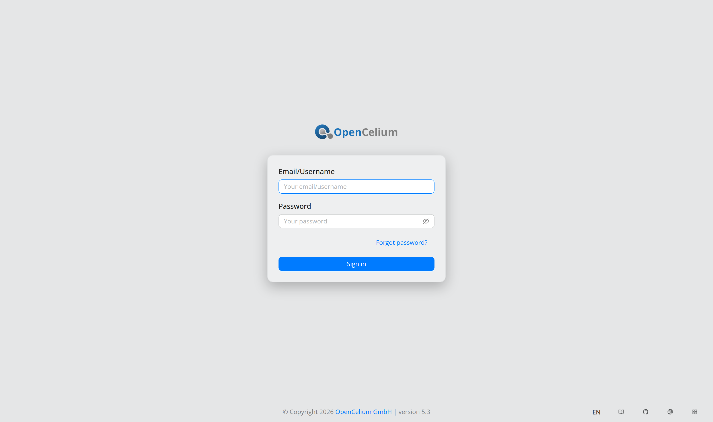
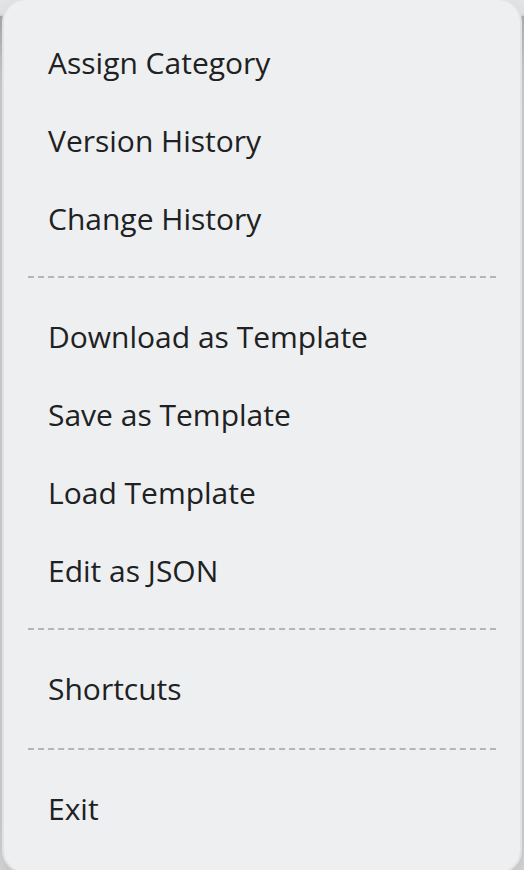
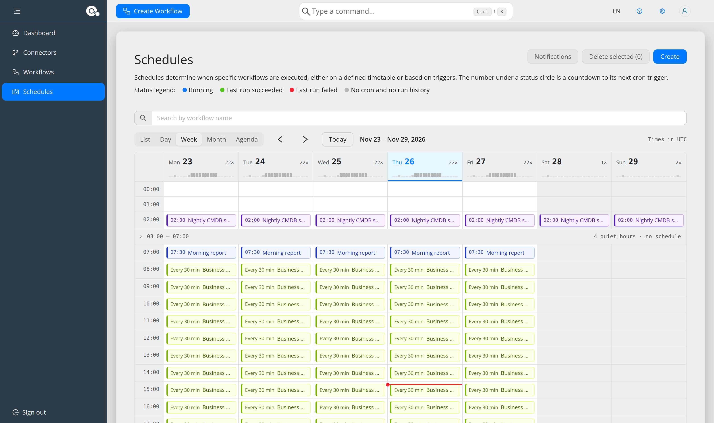
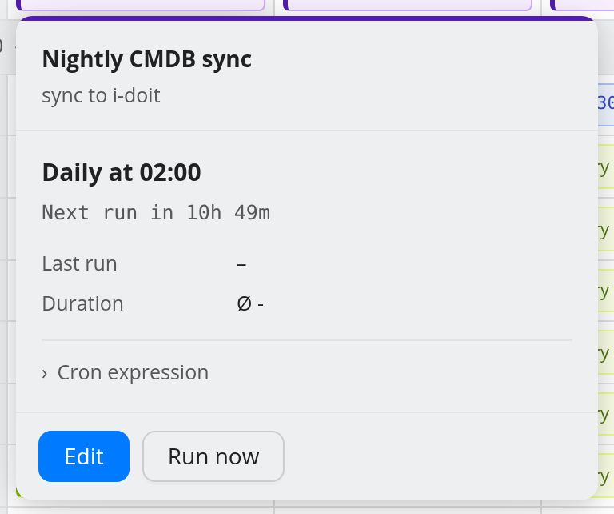
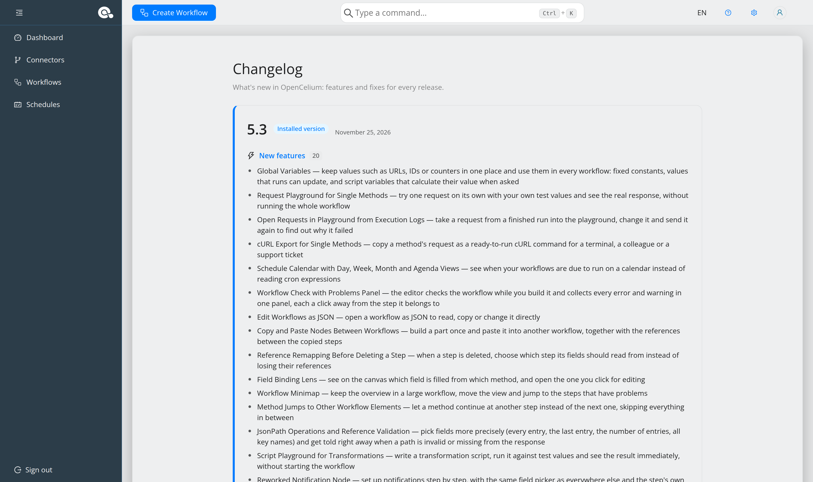

.. _ref-screens:

#######
Screens
#######

.. contents::
   :local:

A map of the interface. The guides explain what to *do*; this page says where
things are.

Sign-in page
============

The sign-in page asks for **Email/Username** and **Password**. You can sign in
with your email address or with your username. **Forgot password?** leads to the
self-service reset, which works only with an email address — see
:doc:`../guides/users-and-permissions`.

.. versionchanged:: 5.3
   Sign in, Forgot password and Set password share one layout with the logo,
   the form in the middle and a footer. The footer has a language toggle left of
   its links: a text button showing the current language (*EN* or *DE*).

Layout
======

* **Sidebar** (left) — navigation, collapsible to icons, with **Sign out** at the
  bottom.
* **Top bar** — Create Workflow, the command palette, the language toggle
  (EN/DE), the **Help** menu *(5.2)*, the menu switcher, and the profile icon —
  showing your profile picture once you have one.
* **Content**, with a subscription alert strip above it when the license needs
  attention.
* **Footer** — copyright and version, and icon links to the documentation,
  GitHub, the OpenCelium website and the Service Portal *(5.2)*.

The **Help** menu starts the onboarding and dashboard tours (administrators) and
opens the documentation, the **Changelog** *(5.3)* and the Service Portal; see
:doc:`../start/guided-tours`.
For administrators a **Setup** checklist pill sits in the bottom-right corner
until it is dismissed.

There are **two menus**, switched with the menu switcher or ``Alt+M``; the last
page you visited in each is restored. Entries you cannot read are hidden entirely.
Every leaf is a real link, so ``Ctrl``/``⌘``/middle-click opens a new tab.

Main menu
=========

.. list-table::
   :header-rows: 1
   :widths: 22 78

   * - Entry
     - Page
   * - **Dashboard**
     - Operational overview — see :ref:`ops-monitoring`.
   * - **Connectors**
     - Connector list and wizard.
   * - **Workflows**
     - Workflow list; the editor opens from here.
   * - **Schedules**
     - Schedule list and calendar *(5.3)*, executions, webhooks, notifications,
       support logs.

Admin menu
==========

.. list-table::
   :header-rows: 1
   :widths: 24 76

   * - Group
     - Entries
   * - **Back** *(5.3)*
     - Returns to the main menu.
   * - **Users & Access**
     - Users, Roles, LDAP Check
   * - **Configurations**
     - API Definitions, Workflow Templates, Data Aggregators,
       **Global Variables** *(5.3)*, Notification Templates, Categories,
       Support Files
   * - **License & System**
     - License Management, Update Assistant, System Check, System Configuration
   * - *(top level)*
     - UI

**Global Variables** is shown only to roles with *read* on the
``GLOBAL_VARIABLE`` component; see :doc:`../guides/global-variables`.

.. note::
   **External Applications** and the 3.x **Migration** card no longer exist.
   Component health is now :ref:`ref-system-check`; the Neo4j migration was
   retired with the 4.x line.

Lists
=====

Every list behaves the same: title and subtitle, a search field naming what it
searches, sortable columns, per-row *view / update / delete* icons with tooltips,
row checkboxes enabling bulk actions, and expandable sub-rows where a row has
detail.

Destructive actions confirm first. The confirm dialog focuses **Cancel** and shows
a loading state, so a slow delete cannot fire twice.

.. versionchanged:: 5.3
   A list keeps its search, filters, sort order, page and page size in the
   address (``q``, ``sort``, ``page``, ``size``, ``f.<filter>``). Coming back from
   a view or update page — or with **Back to list** — restores them, and the
   address can be bookmarked or shared.

Some lists have extra row actions. On **Users**, administrators find **Create
one-time password reset link** *(5.3)*; see
:doc:`../guides/users-and-permissions`.

Wizards
=======

Create, update and view all use one wizard: named steps with their own header and
subtitle, per-step validation, conditional sections, step actions such as **Test
connector** that can gate the submit, ``Ctrl+Enter`` to advance, and a success
screen recommending follow-ups.

Workflow editor
===============

Its own header replaces the application header. See
:doc:`../guides/build-a-workflow` for the areas and
:ref:`ref-shortcuts` for the canvas shortcuts.

.. versionchanged:: 5.3
   The editor header now also carries the language toggle, the **Help** menu,
   the menu switcher and your profile, as in the application's top bar. In the
   editor, **Help** offers **Start workflow tutorial** (administrators) instead
   of the two tours, followed by Documentation, Changelog and Service Portal. On
   windows up to 1600 px wide these entries fold behind your profile picture;
   below 700 px they are dropped and **Schedules** moves into the header menu.

Next to **Save** sits the **problems badge** *(5.3)*: a check mark when the
workflow is clean, otherwise a warning icon with the number of steps that have
errors or warnings. Clicking it opens the **Problems** panel — see
:doc:`../guides/check-a-workflow`.

Header menu entries: Assign Category, Version History, **Change History**,
Download as Template, Save as Template, Load Template, **Edit as JSON** *(5.2)*,
Shortcuts, Exit.

Panels and overlays, and what opens each:

.. list-table::
   :header-rows: 1
   :widths: 30 70

   * - Surface
     - Opened by
   * - **Step drawer** (right)
     - The **+** handle on a node.
   * - **Execution Logs** (bottom)
     - A test run; collapsed until there is output.
   * - **Version History** (right)
     - Header menu → Version History.
   * - **Change History** (right)
     - Header menu → Change History. *(5.1)*
   * - **Schedules** (right)
     - The schedules pill in the header.
   * - **Problems** (right)
     - The problems badge in the header. ``Esc`` closes it. *(5.3)*
   * - **Request Playground** (dialog)
     - Context menu of a method step → **Try Request…**, or **Open in
       Playground** in the execution logs. *(5.3)* See
       :doc:`../guides/request-playground`.
   * - **Script Playground** (beside a transformation)
     - The flask button in the header of a JavaScript transformation. *(5.3)*
       See :doc:`../guides/script-playground`.
   * - **Minimap** (bottom right)
     - Always shown; collapsible. Hidden while the field links lens is on.
       *(5.2)*
   * - **Field links lens** (on canvas)
     - *Show field links* in the canvas controls. *(5.2)*
   * - **Field links** list (right)
     - *Show the list of field links* in the canvas controls. *(5.2)*
   * - **Field link** drawer (right)
     - Clicking an arc or a row of the field links list. *(5.2)*
   * - **Edit workflow as JSON** (dialog)
     - Header menu → Edit as JSON. *(5.2)*
   * - **Node toolbar**
     - Selecting a single node. Carries *add jump*, *remove jump*, *add comment*
       and *delete*. *(5.1)*
   * - **Debug controls** (on canvas)
     - A test run in debug mode: pause, step forward, speed. *(5.1)*

.. note::
   **New in 5.1.** The canvas gained two things that are not steps: **jumps**,
   drawn in green between two method nodes
   (:doc:`../guides/skip-steps-with-joints`), and **comment boxes**, anchored
   notes that minimise to a badge on their step
   (:doc:`../guides/annotate-a-workflow`).

Execution log details
---------------------

.. versionchanged:: 5.3
   The details of a method in the execution logs have two tabs instead of four:
   **Sent / Received** shows the request body (*Request*) and the response body
   (*Response*) side by side, **Headers** shows the request and response headers
   side by side. The panes can be copied, bodies maximised. **Open in
   Playground** sits at the right of the tab bar. A failed run opens at the
   step where it stopped.

The same view is used in the schedule logs dialog, the test-run panel of the
editor and the response dialog. See :doc:`../guides/debug-a-workflow`.

Schedules calendar
==================

.. versionadded:: 5.3

Above the schedules list a switch offers **List**, **Day**, **Week**,
**Month** and **Agenda**. The calendar views draw the runs of the schedules the
list currently shows — the search applies — with arrows and **Today** to move
in time, and the time zone as *Times in <zone>* (see
:ref:`ref-config-server-time-zone`).

* **Week** and **Day** show hours as rows. Three or more quiet hours in a row
  fold into one band; frequent schedules are condensed into one *Every N min*
  chip, and a full cell ends in *+N more*.
* **Month** shows the days with a small load bar per day; the day number opens
  the Day view.
* **Agenda** lists the runs of the next seven days, grouped by day.

Clicking a run opens its card: the cron in plain words, the next run, the last
run and the last failure, the average duration, **Edit** or **View**, and
**Run now**. Only schedules with a cron expression are drawn; a paused schedule
looks the same as an active one.

The schedule form shows a **Schedule Preview** under the cron field with the next
five runs.

Changelog
=========

.. versionadded:: 5.3

**Help → Changelog**, or the palette command ``changelog``, opens ``/changelog``:
*What's new in OpenCelium: features and fixes for every release.* The installed
release comes first, split into **New features** and **Fixes**; earlier releases
are listed below under **Previous versions**.

The page is generated from ``CHANGELOG.rst`` when the frontend is built.

Messages
========

Actions produce toasts, with the specific backend code where one exists
(``CONNECTOR_NOT_FOUND``, ``OPERATOR_EXPRESSION_IS_EMPTY``,
``CONCURRENT_TEST_IS_FORBIDDEN``) rather than a generic failure. Long-running work
reports over the WebSocket. Panels are wrapped in error boundaries, so one failing
card shows a recoverable fallback instead of blanking the page.

.. note::
   The global search field of earlier versions is gone; the command palette
   replaced it. There is no notification drawer in 5.0.

Profile
=======

Three sections: **User Details**, **Update Password** (which logs you out), and
**Permissions**. The profile picture can be uploaded, replaced, cropped and
deleted right there; the change applies at once, without a Save. *(5.2)*

.. _ref-upload-limits:

Upload limits
=============

From 5.2 every upload checks the file type and size before anything is sent to the
server, and says which rule a file broke.

.. list-table::
   :header-rows: 1
   :widths: 40 30 30

   * - Upload
     - Types
     - Maximum size
   * - Workflow templates
     - ``.json``, ``.zip``
     - 1 GB
   * - API definitions
     - ``.xml``, ``.zip``
     - 1 GB
   * - Connector icon, user picture, role icon
     - ``.png``, ``.jpg``, ``.jpeg``
     - 10 MB
   * - Application logo (UI settings)
     - ``.png``, ``.jpg``, ``.jpeg``
     - 10 MB
   * - License import / extra operations
     - ``.txt``
     - 10 MB
   * - Offline update package
     - ``.zip``
     - 1 GB

Pictures go through a crop dialog first. Connector icons, user pictures and role
icons are cropped to a circle; the application logo keeps its proportions. SVG is
not accepted for pictures.

.. note::
   The nginx example in :ref:`ref-configuration` limits request bodies to
   ``client_max_body_size 200M``. Raise it on the proxy if you upload larger
   files.

A themed **404** page is shown for unknown routes inside the app shell.
