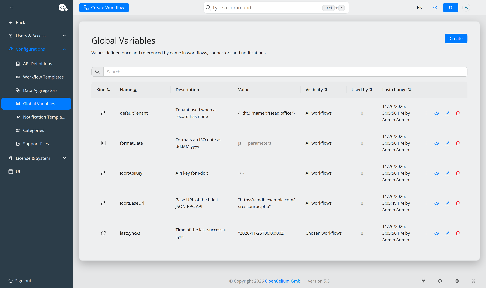
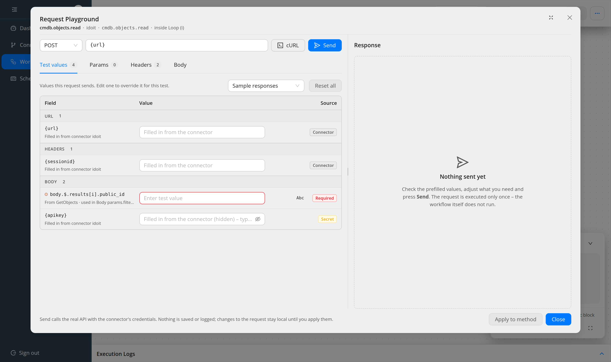
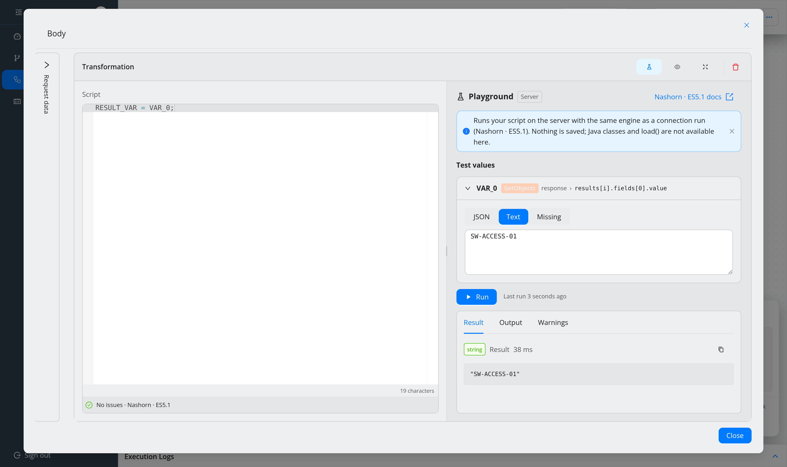
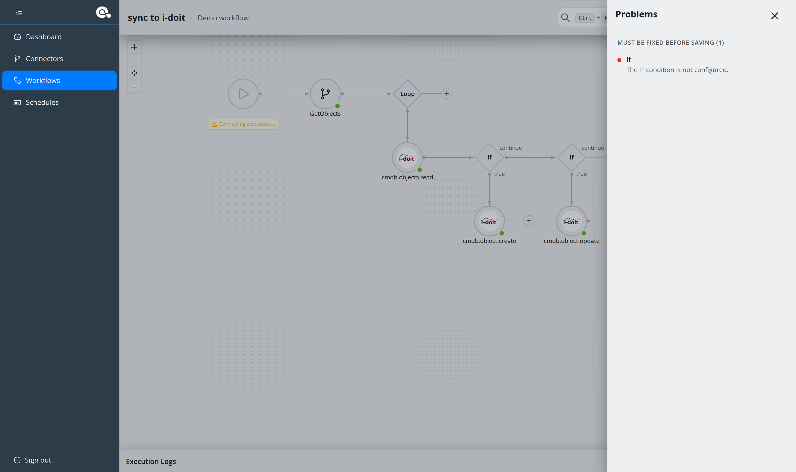
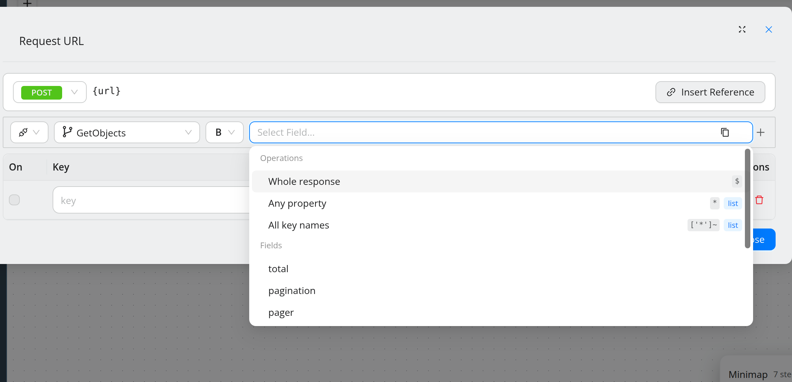
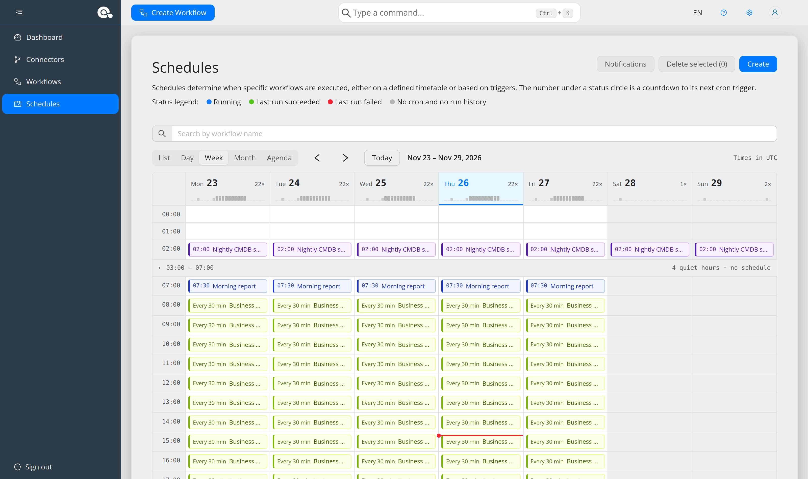
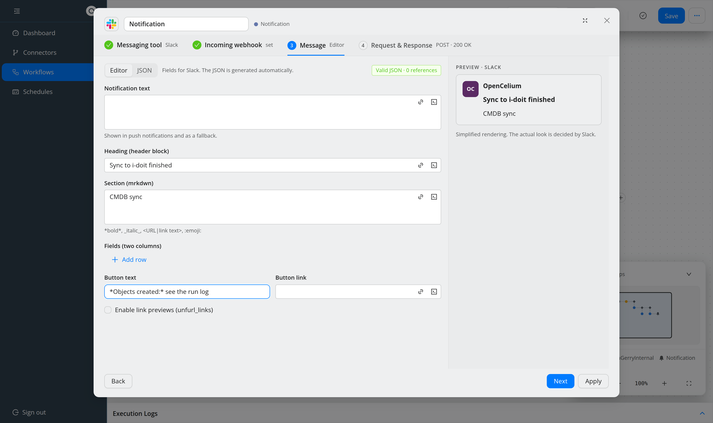
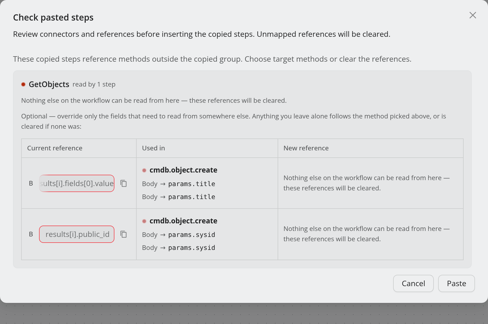
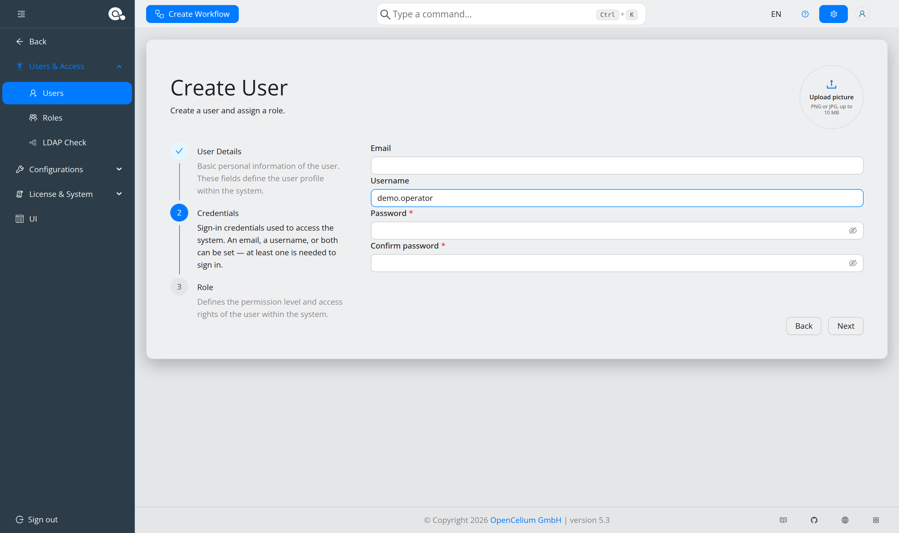

.. _start-whats-new-5-3:

####################
What is new in 5.3
####################

.. contents::
   :local:

5.3 is about values you define once and requests you can try on their own.
**Global variables** keep URLs, IDs, counters and small helper scripts in one
place for every workflow. A single request or a transformation script can now be
**tried in isolation**, without running the whole workflow. The editor **checks the
workflow** while you build it, the schedules get a **calendar**, and a
**notification** to Slack, Microsoft Teams or any webhook is now a step of its own
in the workflow.

From 5.2 the upgrade is a package update, see :doc:`../operations/updating`. The
database changes run by themselves on the first start, and the YAML migrator adds
the new ``application.yml`` keys. Before you upgrade, read
:ref:`whats-new-5-3-upgrade`: a few defaults and behaviours changed. Upgrading from
4.x? Read :doc:`upgrade-to-5` first.

Global variables
================

.. versionadded:: 5.3

A global variable is a value you define once and reference by name in workflows,
connectors and notifications, as ``{{global.name}}``. There are three kinds:

* **Constant** — only users change it, workflows read it. A constant can be
  marked **Secret**: its value is stored encrypted and masked in logs.
* **Mutable** — its owner workflows change it during runs, for example to remember
  where the last run stopped. Other workflows read it.
* **Script** — a shared function that returns a value each time a transformation
  calls it.

Global variables live in the admin menu under **Configurations → Global
Variables**. In the editor, the reference generator has a fourth source,
**Global variable**, next to Constant, Method and Webhook, and a method's context
menu offers **Write to global variables**.

The page and its endpoints are guarded by a new permission component,
``GLOBAL_VARIABLE``. The Admin role gets it automatically; grant it to other roles
under **Users & Access → Roles**.

.. important::
   Before the first secret is saved, set ``opencelium.global-variable.secret-key``
   (or the environment variable ``OPENCELIUM_GLOBALVARIABLE_SECRETKEY``). Without
   it a built-in key is used, which is the same on every installation. There is no
   key rotation: after a key change every secret must be entered again.

See :doc:`../guides/global-variables`.

Try a request in the Request Playground
=======================================

.. versionadded:: 5.3

Right-click a connector or HTTP request step and choose **Try Request…**. The
**Request Playground** sends this one request with test values of your choice and
shows the real response, without running the workflow. Test values can be
prefilled from a paused test run, your last test of this method, or the sample
responses. Nothing is saved or logged; **Apply to method** writes your changes
back to the step.

The playground calls the **real API** with the connector's credentials. Any method
other than GET, HEAD or OPTIONS asks for confirmation first, because it can change
data in the target system.

**Open in Playground** in the execution log takes a method from a finished run —
scheduled or test run — into the playground, prefilled with the values that run
used, so you can change them and send the request again.

**cURL** in the playground's URL bar shows the request as a ready-to-run cURL
command.

.. warning::
   The cURL command contains the connector's real, unmasked credentials and tokens.
   Only secret global variables are masked. Treat the command as a secret, and do
   not paste it into tickets or chats.

See :doc:`../guides/request-playground`.

Run a transformation script in the Script Playground
====================================================

.. versionadded:: 5.3

The flask button in a transformation's header opens the **Script Playground**
next to the script. Enter test values for ``VAR_0``, ``VAR_1`` and so on, press
**Run** (or ``Ctrl+Enter``), and see the result, the printed output and
compatibility warnings. The script runs on the server with the same engine as a
workflow run; it calls no external system and nothing is saved. The playground
works for JavaScript transformations only.

See :doc:`../guides/script-playground`.

The workflow is checked while you build it
==========================================

.. versionadded:: 5.3

The editor checks the workflow as you edit it. A badge next to **Save** counts the
steps with errors and warnings; clicking it opens the **Problems** panel, where
every problem is a click away from its step.

* **Errors** — an unconfigured IF or loop, a field link whose method or script
  variable is missing — block saving and starting a test run.
* **Warnings** — a field link that reads a field the response does not declare, a
  path that is not valid JsonPath — are asked about when you save (**Save
  anyway**).
* **Notices** — a failed connector test, a rejected save — are for information.

The minimap uses the same list and colours its rings by severity.

References are checked as well. The field picker offers new **operations** on the
response — **Last element of the array** (``[-1]``), **Number of elements**
(``.length()``), **Any property** (``*``) and **All key names** (``['*']~``) — and
*The root object* is now called **Whole response**. A reference field turns red or
amber and explains what is wrong; errors disable **Insert**.

See :doc:`../guides/check-a-workflow` and :doc:`../concepts/data-mapping`.

Schedules on a calendar
=======================

.. versionadded:: 5.3

The schedules list has a **List | Day | Week | Month | Agenda** switch. The
calendar shows when each schedule is due, condenses frequent schedules into one
"Every N min" entry, marks schedules whose last run failed, and opens a run card
with the last run, the next run and **Run now** when you click an entry.

The cron column, now called **Schedule**, shows the expression in plain words —
"Daily at 12:00", "Every 5 minutes" — and the schedule form has a **Schedule
Preview** with the next five runs under the cron field. The dashboard has a new
**Schedule** card with the next 24 hours and the next runs.

See :doc:`../guides/schedule-and-notify`.

Notifications as a workflow step
================================

.. versionadded:: 5.3

**Send Notification** in the step drawer posts a message to Slack, Microsoft Teams
or any other incoming webhook, right from the workflow. A guided dialog walks you
through the messaging tool, the webhook URL, the message — with a live preview and
references in every field — and the request. The execution log shows the step's
own name instead of ``POST``.

Notifications attached to a schedule (before, after, on failure) work as before.

See :doc:`../guides/send-notifications`.

Copy and paste between workflows
================================

.. versionadded:: 5.3

``Ctrl+C`` and ``Ctrl+V`` — or **Copy** and **Paste** in the context menu — now
work across workflows and browser tabs. On paste, each step moves to a connector of
the same API definition in the target workflow, and a **Check pasted steps** dialog
asks where references to steps outside the copy should point.

See :ref:`guide-select-copy`.

Sign in with a username
=======================

.. versionadded:: 5.3

A user needs an **Email**, a **Username**, or both. Users without an e-mail
address sign in with their username; they cannot use *Forgot password*. For them,
an administrator can create a one-time **password reset link** from the user list,
valid for 24 hours, and optionally e-mail it.

Failed sign-ins are now rate-limited: after too many failures the server answers
``429`` for a while. Local OpenCelium accounts are no longer tried against LDAP
first.

See :doc:`../guides/users-and-permissions`.

Smaller changes
===============

* **Duplicate connector** copies a connector into a pre-filled wizard. The URL and
  the credentials are not copied; enter them again.
* The **HTTP method** can now be changed for connector methods too, not only for
  HTTP request and webhook steps.
* The node context menu is organised in sections: a **Request** row with **URL**,
  **Header** and **Body**, **Try Request…**, a **Connector** submenu, **Write to
  global variables**, **Copy** and **Paste**.
* Workflow templates can be edited as JSON from the template list. The workflow
  JSON editor has a **Copy** button.
* The onboarding tour can **Sync from Service Portal** when the instance is
  connected to the Service Portal.
* The Help menu has a **Changelog** entry that opens the release notes in the
  application. The workflow editor header has the language switch, the Help menu
  — with **Start workflow tutorial** — the menu switch and your profile.
* Lists keep their search, filters, sort and page in the URL, so **Back to list**
  restores them and a list view can be bookmarked.
* Execution log details have two tabs, **Sent / Received** and **Headers**. A
  failed run opens at the step where it stopped.
* The sign-in, forgot-password and set-password pages share one layout with a
  language toggle in the footer.

Removed and changed in 5.3
==========================

The following items of the 5.2 interface no longer exist in this form.

.. list-table::
   :header-rows: 1
   :widths: 34 12 54

   * - Up to 5.2
     - Last in
     - From 5.3
   * - Dashboard card *System health* (placeholder, "Coming soon")
     - 5.2
     - Removed. The **Schedule** card takes its place; *Attention required* and
       *Recent activity* remain placeholders.
   * - Context menu **Request → Edit URL / Edit Header / Edit Body**
     - 5.2
     - A **Request** row with the buttons **URL**, **Header** and **Body**.
   * - **Use Another Connector** and **Change Connector Image** as top-level
       context-menu entries
     - 5.2
     - Under the **Connector** submenu on connector steps. HTTP request steps show
       **Use Another Connector** directly.
   * - Execution log tabs **Request Header** and **Response Header**
     - 5.2
     - Two tabs: **Sent / Received** (bodies) and **Headers** (both sides).
   * - Schedules column **Cron** with the raw expression
     - 5.2
     - Column **Schedule** with the expression in plain words; the raw expression
       is in the tooltip.
   * - Minimap legend entry **System**
     - 5.2
     - **HTTP request**; new entry **Notification**.
   * - Field picker entry *The root object*
     - 5.2
     - **Whole response**.

This documentation also corrects a few labels that had changed before 5.3 and were
described wrongly: **Create schedule** (not *Add schedule*), **Test connector**
(not *Test connection*), **Debug mode**, **Last failure** and **View logs** in the
schedules list, and **System Configuration** in the admin menu.

.. _whats-new-5-3-upgrade:

Changed behaviour to check when you upgrade
===========================================

**Location of application.yml.** The default of ``opencelium.config.file-path``
in ``application_default.yml`` is now ``./application.yml``, resolved against the
backend's working directory (``/opt/opencelium/src/backend`` with the shipped
service unit). Upgraded installations keep their current value. On a new
installation, point the key at your real ``application.yml`` or set the
environment variable ``OPENCELIUM_CONFIG_FILEPATH`` (or
``-Dopencelium.config.file-path``); otherwise saving under **System
Configuration** fails because the file does not exist. The YAML migrator now
honours the same setting, so a relocated ``application.yml`` is migrated too. See
:doc:`../reference/configuration`.

**Usernames after the database migration.** Usernames are now unique, and the
migration labelled ``5.2:2`` sets some of them to NULL:

* usernames of OpenCelium (non-LDAP) users that contain ``@``,
* the username of an OpenCelium user that an LDAP user also has,
* among the remaining duplicates, every copy except the one with the lowest id.

Usernames are also trimmed, and empty ones become NULL. Check the user list after
the upgrade; a user whose username was removed signs in with the e-mail address.

**Master password.** The master password is no longer kept across page reloads.
It lives only in memory and is cleared when the session ends, so users enter it
again after a reload or a new sign-in.

**Request URLs.** Typed URL text is sent as written: existing ``%XX`` sequences
stay, and only characters that are invalid in a URI are encoded (a space becomes
``%20``). Reference values are encoded as data. URLs that relied on the old
behaviour — pre-encoded reference values, values containing ``&`` — may now be
sent differently; test them after the upgrade.

**Duplicate titles.** Saving a workflow or category with a title that is already in
use answers ``409`` with ``TITLE_HAS_ALREADY_TAKEN`` instead of ``500``. Scripts
that call the REST API and check for ``500`` need adjusting.

**Upload limit and nginx.** Templates, API definitions and offline update packages
may be up to 1 GB, but the shipped nginx configuration still sets
``client_max_body_size 200M``. Uploads between 200 MB and 1 GB fail at nginx with
``413`` until you raise it, for example to ``1G``. See :ref:`ref-upload-limits`.

**Schedule times and the server time zone.** Run times in the calendar and the
cron preview are shown in the zone set by the new key ``serverTimeZone`` in the
frontend's ``config.json`` (an IANA name such as ``Europe/Berlin``). When it is
empty or invalid, the browser's zone is used. Set it to the zone the backend runs
in. If your deployment regenerates ``config.json``, add the key again afterwards.

**Password reset links.** The default of ``opencelium.forgot-psw.base-url`` now
ends in ``/set-password``. Existing values are not rewritten; old
``/reset-password`` links still forward to the new page, but set the key to
``https://<your host>/set-password``.

**Non-JSON responses.** A step that expects JSON and receives a successful answer
that is not JSON (Slack's ``ok``, for example) now gets it as text with its real
status, instead of failing with ``500``. Text bodies without a charset are sent as
UTF-8.

Fixes
=====

5.3 also fixes the inverted SSL setting of the GraphQL body editor, the cron picker
shifting weekdays, upgraders that did not run on templates from older versions, and
more. The complete list is on the **Changelog** page in the application (**Help →
Changelog**, see :ref:`start-guided-tours-changelog`) and in the `changelog
<https://github.com/opencelium/opencelium/blob/prod/CHANGELOG.rst>`_.

Where to go next
================

* :doc:`../guides/global-variables` — define, reference and update global
  variables.
* :doc:`../guides/request-playground` — try a single request, open one from the
  logs, export cURL.
* :doc:`../guides/script-playground` — test a transformation script.
* :doc:`../guides/check-a-workflow` — the Problems panel and reference checks.
* :doc:`../guides/send-notifications` — the Send Notification step.
* :doc:`../operations/updating` — how to install the update.
