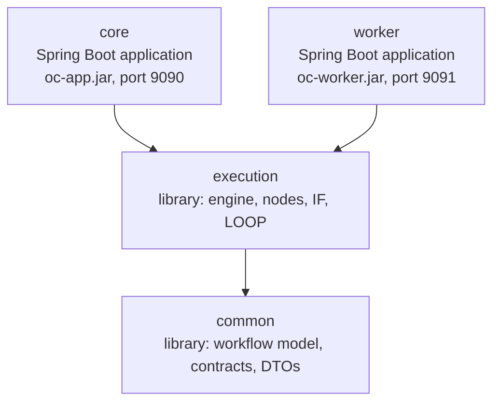
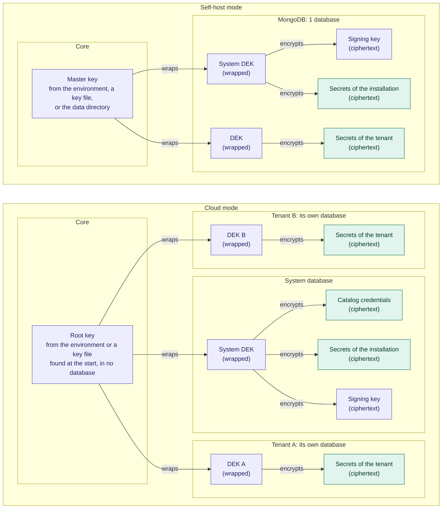

# Backend architecture

This document tells how the OpenCelium backend is made and why. It gives the target design. It does not tell the state of the code. The contribution rules that come from this structure are in [CONTRIBUTING.md](../CONTRIBUTING.md).

## Contents

- [1. Introduction](#1-introduction)
- [2. Solution strategy](#2-solution-strategy)
- [3. Building block view](#3-building-block-view)
  - [3.1 Level 1: the 4 modules](#31-level-1-the-4-modules)
  - [3.2 Level 2: common](#32-level-2-common)
  - [3.3 Level 2: execution](#33-level-2-execution)
  - [3.4 Level 2: core](#34-level-2-core)
  - [3.5 Level 2: worker](#35-level-2-worker)
- [4. Runtime view](#4-runtime-view)
  - [4.1 Core starts](#41-core-starts)
- [5. Deployment view](#5-deployment-view)
  - [5.1 The deployment shapes](#51-the-deployment-shapes)
  - [5.2 Deployment modes](#52-deployment-modes)
  - [5.3 Transport detection rules](#53-transport-detection-rules)
- [6. Cross-cutting concepts](#6-cross-cutting-concepts)
  - [6.1 Domain model](#61-domain-model)
  - [6.2 Transport SPI and events](#62-transport-spi-and-events)
  - [6.3 Tenancy](#63-tenancy)
  - [6.4 Configuration placement](#64-configuration-placement)
  - [6.5 Secrets and keys](#65-secrets-and-keys)
  - [6.6 Persistence](#66-persistence)
  - [6.7 Authentication and authorization](#67-authentication-and-authorization)
  - [6.8 Test concept](#68-test-concept)
  - [6.9 Build checks](#69-build-checks)
- [7. Architecture decisions](#7-architecture-decisions)
  - [Open decisions](#open-decisions)
- [8. Glossary](#8-glossary)

## 1. Introduction

OpenCelium is a platform for API integration and workflow automation, similar to n8n. Users add **invokers**, configure **connectors**, and make **workflows**. A workflow gets data from one API, changes the data, and sends the data to another API. A workflow has 2 flow operators: **IF** for decisions and **LOOP** to do the same steps for each item of a collection. The terms are in the [glossary](#8-glossary).

## 2. Solution strategy

The platform has 2 different workloads:

1. **Management.** Users make connectors, design workflows, and schedule them. This workload is interactive and has a low volume.
2. **Execution.** Workflows execute: they call APIs, evaluate IF nodes, and go through LOOP nodes. This workload is like a batch job and grows with the data volume.

The architecture keeps these 2 workloads apart. All other structure comes from this separation. The strategy in short, with the decision that records each line:

- A modular monolith. The compiler enforces the module boundaries (decision 1).
- One build and 2 deployment shapes. Core finds the shape at runtime (decisions 2, 4).
- The engine is a library. The applications are thin hosts (decision 3).
- Promise-based dataflow execution, with checkpoints (decisions 8, 12).
- Workers without state. Each job message is self-contained (decision 9).
- The tenant context is in each tenant document, each job message, and each event (decisions 11, 15).
- Configuration in 2 places, and envelope encryption for the secrets (decisions 13, 14, 17).
- Authentication is a plug-in, separate from authorization (decisions 7, 10, 18).

## 3. Building block view

### 3.1 Level 1: the 4 modules

Dependencies point only down. No module depends on `core` or on `worker`. A block that fits 2 modules goes to the lower module, because the lower position keeps more options open. The placement rules for new code are in [CONTRIBUTING.md, section 8](../CONTRIBUTING.md#8-backend-code-standards).

| Module | Type | Function |
|---|---|---|
| `common` | Library (plain jar) | The shared vocabulary: the workflow model (workflows, nodes, edges) and the invoker and connector descriptors. Also the access-control model (scopes, ACL entries) and the DTOs that core and the workers exchange (execution requests and results). The module has almost no framework dependencies, on purpose. See [3.2](#32-level-2-common). |
| `execution` | Library (plain jar) | The workflow execution engine, built on promise-based dataflow (decision 8). The module is not an application. Its beans are under `io.opencelium.execution`. The application that embeds the engine scans this package. See [3.3](#33-level-2-execution). |
| `core` | Spring Boot application, `oc-app.jar`, port 9090 | The management application. Only core uses MongoDB: with one static connection in `self-host` mode, and through the tenant catalog in `cloud` mode (decision 11). See [3.4](#34-level-2-core). |
| `worker` | Spring Boot application, `oc-worker.jar`, port 9091 | An engine host without state, fully isolated. The worker has no MongoDB access and no persistent state. Local log files are a temporary spool. The only purpose of the worker is to add execution capacity. See [3.5](#35-level-2-worker). |

Level 2 shows the blocks of each module and the package of each block. The 4 modules are fixed. A new feature becomes a package in one of them. It does not make a new module and does not change the dependency direction.

### 3.2 Level 2: common

The module `common` holds contracts only, with almost no framework dependencies.

| Block | Responsibility | Package |
|---|---|---|
| **Workflow model** | The node and edge model, and the node types, with Wait-for-Human. | `common.workflow` |
| **Descriptors** | The invoker and connector descriptors. | `common.invoker`, `common.connector` |
| **Access-control model** | Subjects and the permission levels View to Admin (decision 7). | `common.acl` |
| **Tenant context** | The tenant identifier, with the reserved values `self-host-tenant` and `system`, and the check of a tenant ID from outside core (decisions 11, 15). | `common.tenant` |
| **Secret contract** | The secret provider SPI and the secret reference. A secret reference does not show the value. | `common.secret` |
| **Transport contract** | The transport SPI, the job message, and the event vocabulary: results, logs, state, variable updates, heartbeat, audit. | `common.transport` |

### 3.3 Level 2: execution

The module `execution` is the engine library. It is identical in the 2 applications.

| Block | Responsibility | Package |
|---|---|---|
| **DAG Scheduler** | Data and control dependencies decide the order. Independent nodes and loop iterations execute at the same time. A limit applies for each external system. Writes to the same connector stay in order, if the branch is not marked as parallel-safe. | `execution.engine` |
| **Workflow Executor** | The promise graph: prepare and execute (decision 8). It executes the nodes and the IF and LOOP operators. | `execution.engine` |
| **Node types** | Connector operation, raw request, IF, LOOP, and wait. | `execution.node` |
| **State machine** | The execution states, the checkpoints, and the graph reconstruction (decision 12). | `execution.state` |
| **Debugger** | Debug sessions, breakpoints, pause and continue. | `execution.debug` |
| **Request Builder** | It evaluates the OCEL expressions and builds the request. HTTP(S) through Spring RestClient is the first protocol. The design permits other protocols. | `execution.request` |
| **Execution logger** | The log stream of one execution. It writes the stream to local files (the spool) and sends it as events. | `execution.logging` |

### 3.4 Level 2: core

The module `core` has one package for each feature (modular monolith, decision 1).

| Block | Responsibility | Package |
|---|---|---|
| **Security filter chain** | 2 security filter chains authenticate the tokens that core issues (decision 18). The refresh chain applies to the refresh and the logout, and it accepts only a refresh token. The main chain applies to each other request, and it accepts only a session JWT. The session service starts, refreshes, and ends the sessions. The login strategies are plug-ins and depend on the deployment mode: local (with 2FA/TOTP), LDAP, OIDC, and Service Portal (decision 10). | `core.auth` |
| **Access control** | RBAC and ACL enforcement, with one authorization manager (decision 7). The method security of Spring Security applies a permission rule to an endpoint, for example the rule "installation admin" (decision 22). | `core.authz` |
| **Users** | The OpenCelium users of a tenant, with the password hash and never the password. Password changes, the first-admin command, generated passwords, and the lock of a user whose generated password is older than 24 h. The lock runs in the self-host mode only, because the Service Portal owns the users in the cloud mode (decision 10). The user repository is on the tenant-document access (decision 16). | `core.user` |
| **Current tenant** | The tenant runner binds the current tenant of a request or a background task (decision 15). The request filter, the task decorator and each background task call it. The principal contract gives the tenant of a principal. The tenant-document access is the 1 path from a repository to its tenant documents. | `core.tenant` |
| **Tenant catalog** | The system database and the per-tenant Mongo connections (decision 11). | `core.tenant` |
| **Management** | CRUD of workflows, connectors, and invokers. The invoker XML parser and importer. | `core.workflow`, `core.connector`, `core.invoker` |
| **Execution quota** | The quota check for each execution. See the note below the table. | `core.subscription` |
| **Triggers** | Quartz, webhook, manual, and test. | `core.trigger` |
| **Execution Dispatcher** | It sends jobs through the transport SPI (decision 4). It enforces the quota. | `core.dispatch` |
| **Global Params storage** | Storage and resolution of the Global Params. | `core.variables` |
| **REST API and WebSocket gateway** | The REST API of each feature, under the path `/api`, with the error form of decision 19. The WebSocket gateway (STOMP, JWT handshake) with the live streams and the execution state API. | The REST API in each feature package. The gateway in `core.monitoring`. |
| **Log aggregation** | It reads the worker events and writes metadata and live status to MongoDB. | `core.monitoring` |
| **Notifications** | The notification channel SPI: email, Slack, and others. | `core.notification` |
| **Admin status** | Service and worker status, and the queued jobs. | `core.admin` |
| **Audit** | Append-only storage and a query API. | `core.audit` |
| **Settings** | The setting registry collects the setting definitions of the features. The settings service reads and changes the installation settings in the `settings` collection. The settings API `GET/PATCH /api/settings` gives them to an installation admin (decisions 13, 19, 22, 24). | `core.settings` |
| **Keys** | The root key, the DEK wrap and unwrap, the generation guard, and the start canary (decision 14). The system DEK of the first start and the signing key of the installation (decision 17). The token signature: it signs each token that core issues and examines each signature. | `core.secrets.keys` |
| **Secret storage** | The secret provider implementation (decision 14). It keeps each secret of the installation as a ciphertext in the `secrets` collection (decision 24). | `core.secrets` |
| **Bootstrap configuration** | The `opencelium.*` bootstrap properties, the defaults, and the failure analyzer. | `core.config` |
| **MongoDB connection** | The connection resolver (decision 11), the client factory, and the start ping. | `core.config.mongo` |

**Execution quota.** The total quota comes from the Service Portal in cloud mode, or from a license file in self-hosted mode. Core keeps the current usage encoded in MongoDB. To browse and to build is free at all times. The Execution Dispatcher enforces the quota for each execution. Test executions and debugger sessions also count.

### 3.5 Level 2: worker

The module `worker` holds the application wiring only. It grows nothing, on purpose. Its one block is the **Transport Endpoint**: it reads self-contained job messages from the broker and sends all output back as events.

## 4. Runtime view

### 4.1 Core starts

This scenario tells what occurs when core starts, in the order of the code. Each step stops the application with the report `APPLICATION FAILED TO START` if its check is not successful. The report names the property or the action.

1. The **defaults post-processor** adds the documented defaults for the bootstrap values that are not set:
   - the deployment mode `self-host`
   - the data directory
   - the MongoDB URI in self-host mode
   - the log pattern `logging.pattern.correlation` (decision 15)

   It writes one `(default)` line to the log for each applied default. It also writes a warning if the Boot 3 property `spring.data.mongodb.uri` is set.
2. The **bootstrap properties** bind and validate `opencelium.deployment-mode`, `opencelium.data-dir`, and `opencelium.master-key-file`.
3. The **data directory guard** makes the data directory if there is none. It makes sure that the directory is writable.
4. The **static connection resolver** reads `spring.mongodb.*` and validates the connection. It does not accept the settings that Boot ignores.
5. The **start-up ping** pings the server and lists the collections, with a 5 s timeout.
6. The **client factory** makes the Mongo client. Spring then makes its Mongo beans for the system database.
7. The **root-key resolver** finds the root key: `OC_MASTER_KEY`, then the file from `opencelium.master-key-file`, then `<data-dir>/master.key`. If no source has a key, it stops in cloud mode. In self-host mode it generates a new key file if the `keys` collection is empty, and it stops if the collection is not empty (decision 14).
8. The **key canary** unwraps the oldest wrapped DEK after Spring has made all beans. A wrong key stops the start here, not at the first secret that a workflow uses.
9. The **signing-key loader** reads the system DEK and the signing key from the database that the yml file names. It decrypts the signing key into memory. On a new installation it generates and stores the 2 keys. A stored signing key that does not decrypt stops the start (decision 17).

When Spring makes the beans, the **setting registry** collects the setting definitions of the features (decision 24). A setting key with 2 setting definitions stops the start, and the error names the setting key.

Steps 1 to 3 are in `core.config`. Steps 4 to 6 are in `core.config.mongo`. Steps 7 to 9 are in `core.secrets.keys`. The setting registry is in `core.settings`.

## 5. Deployment view

### 5.1 The deployment shapes

The 2 deployment shapes, monolith and distributed, are equal. Each shape must operate at all times. Core finds the shape at runtime. The shape is not a build variant and not a configuration property. One `./gradlew build` of one commit makes the monolith jar alone or the 2 jars, with the same version.

| Shape | Artifacts | Transport |
|---|---|---|
| **Monolith**, small installations | `oc-app.jar` (`:core:bootJar`) | `local`. Core selects it automatically when no broker is set. The Execution Dispatcher calls the executor in the same process. No infrastructure other than MongoDB is necessary. |
| **Distributed**, large installations | `oc-app.jar` and N × `oc-worker.jar` | `amqp`. Core selects it automatically when a broker connection is set. The broker connection is a runtime setting in the database. An administrator sets it through the UI or the API. Core applies it without a restart. The Execution Dispatcher publishes **self-contained jobs** to the broker (RabbitMQ or another AMQP broker). A job has the workflow snapshot, the credentials, and the Global Params. It is encrypted on the broker. Workers get the jobs with at-least-once delivery. They publish the results and the logs as events. |
| **Custom**, special environments | the same as distributed | `custom`. A transport SPI implementation from the user on the classpath replaces the automatic detection (Kafka, SQS, and others). |

There is **no HTTP dispatch path**, on purpose (decision 4). Workers read from the broker. They are not servers. The worker has an HTTP port (9091), but core does not dispatch through it. Live-run streams go to the frontend on this path: broker events, then Log aggregation in core, then the WebSocket gateway. WebSocket sessions are only in core. Worker memory does not supply them.

This is why the engine is a library. The same execution code compiles into the 2 applications. Thus local and brokered execution cannot become different. One rule keeps this true: execution features go to `execution`, and transport contracts go to `common`. They do not go directly to `core` or to `worker`.

### 5.2 Deployment modes

The deployment mode is the second axis. It is a bootstrap value in the yml file, `opencelium.deployment-mode`:

- `self-host`: one tenant, the default. A self-hosted installation has exactly one tenant.
- `cloud`: many tenants behind the Service Portal (decision 11).

**Tenancy and deployment shape are independent.** Each shape can operate with one tenant (self-hosted) or with many tenants (cloud, decision 11). The tenant ID travels in the job messages and in the events. Thus the transports and the workers do not have to know about tenants.

### 5.3 Transport detection rules

The rules (decision 4):

- A broker that is set but not reachable causes a **visible dispatch error**. Core does not change to `local` without a message. The admin status API shows the broker health.
- A change to `amqp` at runtime applies to new dispatches only. Local executions that are in progress complete in the same process.
- Test executions always use `local`.
- Workers read the broker address from the environment or from the yml file. They have no database and no UI. A move to a different broker thus also means a new deployment of the workers.

## 6. Cross-cutting concepts

### 6.1 Domain model

The terms are in the [glossary](#8-glossary). The project keeps the OpenCelium vocabulary on purpose. The domain terms carry team knowledge. Only the legacy code is not permitted (decision 6).

**Node types.** A workflow has 4 types of nodes:

- **Connector-operation node**: one operation of a configured connector.
- **Raw request node**: a request without an invoker and without a connector. The user specifies the target, the headers, and the body directly. HTTP(S) is the first protocol. The design permits other protocols as plug-ins.
- **IF node**: a decision. The data goes to one branch or to the other branch.
- **LOOP node**: the same steps for each item of a collection. The iterations can execute as parallel batches.

A fifth type, the **Wait-for-Human node**, stops the execution until a person answers (decision 12).

**Workflow graph rules.** A workflow is a true DAG, not a chain:

- **One or more start nodes.** A workflow can have more than one entry point. All start nodes become active when the workflow starts. In the promise model, a start node is a node whose input promises are complete at the start.
- **Fan-out and parallel paths.** The output of one node can go to more than one branch. The branches execute at the same time. Example: data from one API goes to 4 different APIs at the same time. Branches can come together in one end node. This is an AND-join: the end node waits for all branches. Branches can also go to their own ends without a join.
- **More than one connector.** The nodes of one workflow can belong to different connectors. The engine limits the parallel requests for each external system. Thus parallel execution does not overload one target API.
- **Parallel LOOP.** The iterations of a LOOP can execute as parallel batches. The degree of parallelism is a setting of each LOOP node, with safe defaults. The limit for each external system also applies.
- **Raw request node.** The node has its own target, headers, and body, with OCEL templates. It does not depend on an invoker or on a connector. HTTP(S) is the first protocol. The Request Builder permits other protocols.

### 6.2 Transport SPI and events

The dispatch goes through a **transport SPI** with plug-in implementations: `local`, `amqp`, and `custom` (decision 4). The shapes and the detection rules are in [5. Deployment view](#5-deployment-view).

**Events from the worker to core.** One pipe carries all event families:

- execution **results**
- **log** streams
- execution **state changes**, with checkpoints, for the state machine of decision 12
- **variable updates**: Global Params that a workflow writes during the execution. Workers do not write to MongoDB. The update travels as an event, and core writes it to the database.
- worker **heartbeat and registration**: dynamic membership, shown in the admin status view
- **audit events**

A new requirement extends this vocabulary. It does not open a second channel next to the transport.

### 6.3 Tenancy

The tenant context is a basic part of the design (decision 11). The tenant ID is in 4 places: the principal, each tenant document, each self-contained job message, and each event that a worker publishes. The persistence and API layers enforce the isolation. The engine and the transports do not know about tenants.

In `self-host` mode there is exactly one tenant, with one static MongoDB connection at the start. In `cloud` mode core keeps a **system database** with the **tenant catalog**: tenant ID, cluster, database name, status, and the connection credential. Scheduled and triggered executions find the tenant purely from the catalog. Thus they execute with nobody logged in, and they survive restarts. The details are in decision 11.

**The current tenant** is the tenant for which a request or a background task runs (decision 15). Only the tenant runner binds it, for 1 task, in a scoped value. The request filter gives the tenant runner the tenant ID of the authenticated principal, from the principal contract. A background task gives the tenant runner the tenant ID of the record that starts the task. The task decorator carries the bound tenant to a task on another thread. In the self-host mode the same path binds `self-host-tenant`.

A **tenant document** belongs to exactly 1 tenant and holds its ID in the field `tenantId`. The tenant-document access of `core.tenant` is the 1 path from a repository to its tenant documents. It applies the tenant limit to each operation, and an operation without a current tenant stops. The **data of the installation** belongs to no tenant (decision 20). Examples are the tenant catalog, the system DEK, the signing key, the installation settings, and the secrets of the installation.

The log line of a task shows the tenant of the task through the MDC key `tenant`. In the self-host mode each application log line shows `self-host-tenant` ([6.4](#64-configuration-placement)).

### 6.4 Configuration placement

The place of a configuration value is a rule, not a decision for each feature (decision 13). There are exactly 2 places:

| Place | What goes there | How to change a value |
|---|---|---|
| **yml file** (`opencelium.*` and standard Spring properties) | Only the values that the application must have before it can reach a database | Edit the file and restart the application |
| **Database** (`settings` collection, secret storage) | All other values | `PATCH /api/settings`. The change applies at runtime, without a restart |

**The three placement questions.** Ask the questions in this order for each new value. The first "yes" decides.

**1. Must the application have the value before it can reach a database?** If yes: **bootstrap value (yml file).**

Two namespaces, one rule:

- A property that Spring already owns keeps its standard name, for example `server.port` and `spring.mongodb.uri`. The property is not copied into our namespace.
- `opencelium.*` holds only values that Spring has no concept of: the deployment mode, the data directory, and the master-key file. These values are one typed record of bootstrap properties in `core.config`. The code binds and validates them by hand, not through the automatic binder of Spring. Thus each error names its property.

All bootstrap values are validated at the start. A bad value, or a mandatory value that is not set, stops the application at the start. The error names the property. Cloud mode changes what the URI points at, not the rule. In cloud mode the yml URI is the **system database** of core (the tenant catalog, decision 11). Core finds the per-tenant connections from the catalog at runtime, not from the yml file. The list of bootstrap values is small on purpose. It must grow only in rare cases.

**2. Does the value give access to something?** Examples: passwords, API tokens, private keys, broker credentials. If yes: **secret.**

A secret is kept in the database, but encrypted through the secret provider SPI. All other code holds only a secret reference, which does not show the value. Two more rules apply:

- Plaintext is only in memory, only at the moment of use. The code does not cache plaintext.
- No API returns a secret value. A write endpoint accepts a value and returns a reference. A read endpoint returns masked output. A lost credential is entered again. It is not recovered.

**3. Not 1 and not 2?** Then: **runtime setting (database).**

A runtime setting is declared in the code. A feature declares a setting definition in its own package: the setting key, the type, the default value, and the rule for a valid value. The setting registry collects the setting definitions at the start (decision 24).

The `settings` collection holds **only the values that are different from the defaults**, in 1 document for the installation settings. A setting without a field in the document has the default of the code. Thus a new installation has no document and a complete configuration. A reset removes the field of the setting, and the default applies again. 1 change of more than 1 setting is 1 update of the document, so it changes all the settings or none.

Code reads a setting only through the settings service. The API changes a setting through `GET/PATCH /api/settings`. Unknown keys and invalid values are not accepted. A component subscribes to the change notifications of the settings service. It does not read a value one time at the start. This is what makes a change effective without a restart.

**The 2 owners.** A setting and a secret belong to the installation or to 1 tenant (decision 20). An installation setting applies to the whole installation. It is data of the installation, in the database that the yml file names. A tenant setting applies to 1 tenant. It is a tenant document in the database of that tenant. For each setting, the setting registry tells if it is an installation setting or a tenant setting.

**Examples.**

| Value | Question | Placement |
|---|---|---|
| HTTP port | 1 | yml: `server.port` (standard Spring) |
| MongoDB URI (self-hosted: *the* database, cloud: the system database) | 1 | yml: `spring.mongodb.uri`, or the host-style properties `spring.mongodb.host`, `port`, … (standard Spring, see [6.6 Persistence](#66-persistence)) |
| Deployment mode | 1 | yml: `opencelium.deployment-mode`. Values: `self-host` (the default) or `cloud` |
| Data directory (local state, for example the generated `master.key`) | 1 | yml: `opencelium.data-dir`. Default on Linux: `/var/lib/opencelium`, if that directory is available and writable. Default in all other cases: `./data`. Core makes the directory at the start. The directory must be writable. In a container, mount it as a volume. |
| Master (root) encryption key | 1 | **Outside the yml file and the database.** Core finds the key in this order: the `OC_MASTER_KEY` environment variable, then the file that `opencelium.master-key-file` names, then `master.key` in the data directory. In self-host mode, core generates the file in the data directory on a new installation. In cloud mode a start without a key stops. The key value is not in the yml file at any time. Rules and guards: decision 14. |
| Tenant ID in the application log lines | 1 | yml: `logging.pattern.correlation` (standard Spring). The pattern applies from the first log line. Default: `[%X{tenant:-self-host-tenant}] ` in self-host mode, `[%X{tenant:--}] ` in cloud mode. It prints the MDC key `tenant`, which holds the current tenant (decision 15). |
| Broker host name, port, vhost | 3 | Runtime setting (installation setting) |
| Broker username | 3 | Runtime setting (installation setting). The broker username gives no access without the broker password. |
| Broker password | 2 | Secret of the installation (a secret reference in the broker setting, decision 20) |
| Connector credentials | 2 | Secret |
| Default LOOP parallelism | 3 | Runtime setting |

The broker connection is the most important example of a value with 2 parts. Its plain parts are a runtime setting (question 3). Its password is a secret (question 2) that the setting refers to. This is what makes the transport (decision 4) settable from the UI without a restart. There is **no transport property** (decision 4). Core finds the transport from the broker setting. Thus the broker setting and the selected transport always agree. Workers are the one exception to database settings. They have no database and no UI, so they read the broker address from the environment or from the yml file.

The procedure to add a new value is in [CONTRIBUTING.md, section 8.1](../CONTRIBUTING.md#81-how-to-add-a-configuration-value).

### 6.5 Secrets and keys

Secrets use envelope encryption with 2 key layers (decision 14). One **root key** for each installation encrypts only DEKs. Its self-hosted name is the master key. One **DEK** for each tenant encrypts the secrets of that tenant (AES-256-GCM, a new IV for each secret). The root key is outside each database. Core finds it at the start, from the environment, from a key file, or from the data directory. A DEK is kept wrapped in the database of its tenant.

Each installation has 1 **system DEK** from the first start, in the 2 deployment modes. The system DEK is kept wrapped in the database that the yml file names. This is the system database in the cloud mode and the 1 database in the self-host mode. The system DEK encrypts the **signing key** of the tokens of core (decision 17). The rules and the guards are in decisions 14 and 17.

The system DEK also encrypts the **secrets of the installation**, for example the broker password (decision 20). The secret storage keeps the secrets of the installation in the `secrets` collection of the database that the yml file names (decision 24).

### 6.6 Persistence

The core application excludes the Mongo auto-configuration of Boot. Each Mongo client comes from one path:

- The **connection resolver** finds the connection of a tenant. It is the seam for decision 11. The **static connection resolver** serves the connection of the yml file. In cloud mode the tenant catalog supplies the other connections.
- The **client factory** makes one client for each cluster and login. Tenants whose databases are on the same server with the same login share one connection pool.

In self-hosted mode the yml server is *the* database. In cloud mode it is the **system database**. The tenant connections come from the tenant catalog.

- **How to set the server.** Use `spring.mongodb.uri`, or Boot's host-style properties (`spring.mongodb.host`, `port`, `username`, …). Do not use the 2 together. If the 2 are set, core stops with an error that names the properties. Options that the excluded auto-configuration applied are not accepted: `spring.mongodb.ssl.*` and `spring.mongodb.representation.uuid`. The error names the URI option to use instead. Boot 4 does not read the Boot 3 property `spring.data.mongodb.uri`. If it is set, core writes a warning to the log that points to `spring.mongodb.uri`. The URI option `proxyPassword` is not accepted, because the MongoDB Java driver 5.8 writes it to the log in plaintext.
- **Guard 1: no silent default.** In self-hosted mode core uses the documented default `mongodb://localhost:27017/opencelium` when nothing is set. It writes one log line that names the default (the zero-configuration first start). In cloud mode the server is mandatory. If it is not set, core stops and names the property.
- **Guard 2: an immediate ping in the 2 modes.** The driver connects only at the first use. Without the ping, an unreachable server shows as a driver timeout approximately 30 s into the first use. Thus core pings the server at the start, with a 5 s timeout. The check also lists the collections of the database. Thus a wrong login, or no login where one is necessary, also stops the start. If the server is not reachable, core stops with a clear error and a list of options.
- **Log safety.** All connection strings in logs and error messages are masked. The password and the secret option values become `****`.
- **The yml client is for the system scope only.** In cloud mode no tenant document goes through it. Tenant data flows only through the clients that the catalog specifies.

### 6.7 Authentication and authorization

**Authentication** is a plug-in strategy (decision 10). It produces a principal: identity, tenant, and group or claim mappings. The available strategies depend on the deployment mode. Self-hosted: local credentials, LDAP, and OIDC. Cloud: only the Service Portal. In the 2 modes core issues its own 2 tokens after a login (decision 18):

- The **session JWT** expires after a short time. Each request to a protected endpoint carries it, and core reads no database to accept it.
- The **refresh token** gives a new session JWT and a new refresh token. A logout with it ends the session.

Core signs the 2 tokens with the signing key of the installation (decision 17). IdP and portal tokens do not reach the frontend. The sequence diagrams of the 3 login flows are in [docs/security/README.md](security/README.md).

**Authorization** is RBAC and per-resource ACLs (decision 7). It uses the principal. Security filters have no permission logic. Enforcement is in core for the API access, and in the execution engine for the resolution of parameters and credentials at runtime.

### 6.8 Test concept

A test is in the module of the code that it tests. But not each module gets each type of test:

| Module | Unit | Slice | Full application | Why |
|---|---|---|---|---|
| `common` | ✅ only | — | — | A plain data model. There is nothing to slice and nothing to boot. |
| `execution` | ✅ only | — | — | A library without an application to start. The engine, IF, and LOOP are tested with `new` and Mockito. External APIs are mocked at the Spring RestClient interface. Promise-graph tests complete the node promises in controlled orders, also in the worst orders. Examples: the right branch before the left branch, or a failure in the middle of a join. The executor and the clock are always injected. If `@SpringBootTest` seems necessary here, the code is in the wrong module. |
| `core` | ✅ | ✅ | ✅ | The full application. Unit tests for the services. `@WebMvcTest` and `@JsonTest` slices. Each test that touches MongoDB is a full `@SpringBootTest` against a real MongoDB. Do not use `@DataMongoTest`: the core application excludes the Mongo auto-configuration of Boot and uses its own Mongo configuration, and slices ignore that exclusion. Such a test passes against the wrong client. |
| `worker` | ✅ | ✅ | ✅ | The same types as core, but much fewer tests. The worker is only a thin shell for the engine. |

The mechanics of the MongoDB tests, the test helpers, and the commands are in [CONTRIBUTING.md, section 9](../CONTRIBUTING.md#9-testing).

The intended result: most product logic (the graph walk, IF, LOOP, data mapping) is in the 2 unit-only modules. Thus most tests take milliseconds. The slow `@SpringBootTest` suite stays small. It answers one question: do the API, MongoDB, and the engine operate together? In the distributed shape the question extends to core, the broker, and the worker.

### 6.9 Build checks

ArchUnit rules make these 5 rules build failures. Decisions 21 and 25 give the limits of the rules.

1. No class uses `@Value`.
2. Only `core.secrets` uses key material for cryptography (decision 21).
3. A `@Document` class has no plaintext field with a secret word in its name (decision 25).
4. Only the settings service reads and writes the `settings` collection.
5. A class reads and writes a tenant document only through the tenant-document access of `core.tenant` (decisions 15, 25).

Rules 1 and 2 apply to each module. Rules 3 to 5 apply to `core` only, because only `core` has a database.

The rule for the tenant documents does not apply to the data of the installation (decision 20). These building blocks are outside the rule:

- the tenant-document access of `core.tenant`
- the MongoDB connection of `core.config.mongo`: the client, the client factory, and the start-up ping. They read no document.
- the data of the installation: the settings repository of `core.settings`, the secret storage of `core.secrets`, and the DEK access of `core.secrets.keys`

The index operations of a feature are also outside the rule.

The rule for the tenant documents has 3 exceptions. They are operations of the start of core:

- The wizard runs before Spring, with its own MongoDB client. Each read and each write of the wizard is outside the tenant-document access.
- The completion runner of the wizard reads the admin marker by its document ID, which is the tenant ID. It deletes the marker after the admin exists.
- The start checks of the root key read the `keys` collection of the database that the yml file names, without a tenant (decision 14). The signing-key loader reads and writes only the system DEK and the signing key there. They are data of the installation, not tenant documents (decision 17).

## 7. Architecture decisions

The decisions are recorded so that they are not discussed again without a reason. Each decision can be changed, on purpose. The numbers do not change and are not used again.

1. **Modular monolith, not microservices.** One deployable unit by default. The compiler enforces the module boundaries (`common`, then `execution`, then `core` and `worker`). ArchUnit rules examine the feature-package boundaries in `core`. Real microservices (an auth service, a scheduler service, …) add operational cost without a benefit at this scale. The only split that is worth its cost is the split along the 2 workloads: management and execution. Even that split is not mandatory at runtime.

2. **The deployment shape is decided at runtime, not a build variant.** Two different builds mean that 2 artifacts must be tested at each release. One artifact whose transport is found at runtime (decision 4) is one artifact to trust.

3. **The engine is a library. The applications are thin hosts.** Thus local and brokered execution share one implementation. And the engine logic must be testable with unit tests, without Spring.

4. **Dispatch through a transport SPI with plug-ins: `local | amqp | custom`.** *(It replaces "HTTP first, queue later". The transport is found at runtime, not set in the configuration.)*

    - The monolith shape uses the in-process `local` transport. No infrastructure is necessary.
    - The distributed shape must have a message broker (`amqp`, at-least-once delivery).
    - The SPI lets users add Kafka, SQS, and other brokers.
    - There is no HTTP dispatch path. Workers read from the broker. They are not servers.
    - No property sets the transport. An earlier draft had `opencelium.execution.transport`. It was removed on purpose. No broker set: `local`. A broker connection set: `amqp`. The broker connection is a runtime setting (decision 13), so the UI can set it without a restart. A custom SPI implementation on the classpath replaces the automatic detection.
    - A broker that is set but not reachable causes a visible dispatch error. Core does not change to `local` without a message.

5. **Tests are in the package of the code that they test.** The rule and the reasons are in [CONTRIBUTING.md, section 9.2](../CONTRIBUTING.md#92-test-file-location).

6. **A rewrite from zero.** Legacy OpenCelium code is not ported. The domain vocabulary (invoker, connector) is kept on purpose. The rule is in [CONTRIBUTING.md, section 10](../CONTRIBUTING.md#10-what-not-to-commit).

7. **Platform-wide access control: RBAC and ACLs for each resource.**

   *Why:* Role checks alone are not precise enough. "Share this one workflow with that one colleague" must not make a new role necessary.

    - **RBAC** (component × action) is the general layer. **Each resource** (workflow, connector, invoker, data-store entry) also has an ACL: subject, permission, this resource.
    - **First increment: ACLs on connectors and workflows.** The ACL is kept on each resource document. It is enforced in Mongo queries, REST, the scheduler, and WebSocket topic subscriptions. Execution logs use the ACL of the workflow.
    - **Permission model:** grants to users and groups. Levels: View, Execute, Edit, Delete, Admin. RBAC roles give the defaults. ACL entries change them for one resource. The creator gets Admin and can give Admin to others.
    - Enforcement is in core (API access) **and** in the execution engine (resolution of parameters and credentials at runtime, identical on the 2 transports). Thus the ACL model itself belongs in `common`.

   *(The detailed design is on the [open decisions](#open-decisions) list.)*

8. **Promise-based (dataflow) execution.**

   *Why:* A DAG with fan-out, AND-joins, and parallel loops maps naturally to promises. Blocked waits hold threads and serialize branches. A reactive framework changes each method signature.

    - The lifecycle of a node has 2 phases. **Prepare** is immediate. The engine parses the node and evaluates the OCEL that it can already evaluate. It identifies the inputs that are not available yet and subscribes to the promises that will deliver them. Then it continues with the next node. **Execute** is triggered: when the last input promise completes, the placeholders get the real data and the request is sent.
    - Graph semantics: fan-out = more than one subscriber on one promise. AND-join = `allOf` over the branch promises. Parallel LOOP = a bounded batch of iteration promises.
    - Implementation: promises (`CompletableFuture` style) for coordination. **Virtual threads** do the operations in a node, so that the code in a node looks sequential. **Structured concurrency** for the branch scopes, so that a branch with a failure cancels the other branches that execute in parallel. No reactive framework.
    - The preparation is bounded. LOOP iterations are prepared in windows, only when necessary, not all 50,000 at the start.
    - Visibility: each promise and node carries the execution ID and the node ID into logs and events. The node state (`prepared`, `waiting-on`, `running`, `done`, `failed`) can be examined. This supplies the live WebSocket stream.
    - Testability: engine tests must be able to complete promises in controlled orders, also in the worst orders. The executor and the clock are always injected.

9. **Workers are fully isolated and have no state.** No MongoDB access, no persistent state. The job message is self-contained: workflow snapshot, credentials, and Global Params, encrypted on the broker. All output leaves the worker as events. Local log files are a temporary spool. Thus a worker can be removed or replaced at each time, and more workers add capacity. And infrastructure that only core has cannot get into the engine.

10. **Authentication is a plug-in strategy, separate from authorization.**

    *Why:* The authentication methods vary with the deployment mode. The authorization (decision 7) must stay identical. Thus no side can know the internals of the other side.

    - Authentication produces a principal: identity, tenant, and group or claim mappings. Authorization (RBAC and ACLs, decision 7) uses the principal. Security filters have no permission logic.
    - The available strategies depend on the deployment mode (`opencelium.deployment-mode`: `self-host` or `cloud`, a yml bootstrap value).
    - **Self-hosted:** local credentials, LDAP, and OIDC if necessary. Core is the OIDC client. Users and the tenant are in the database of core. External IdPs map claims to users and groups with just-in-time provisioning. 2FA/TOTP is a layer on the local strategy.
    - **Cloud:** only the external **Service Portal**, on 2 paths that end in the same portal-issued token. Path (a) is the OIDC redirect flow. The portal authenticates the user itself (portal-native credentials) or connects to an external IdP (Google, Apple, …). The offered methods are a configuration of the portal that core does not see. Path (b) is a direct credential login. The user enters a user name and a password in the OpenCelium login form. Core exchanges them at the authentication API of the portal for the access token and the claims. This path is for portal-native accounts only. Brokered-IdP users must use the redirect flow. In cloud mode the portal owns the claim mapping and the provisioning.
    - Core trusts only the portal issuer. It keeps a copy of the user row, which is not the source of truth. The token or login response of the portal supplies the **tenant identifier only**. A login tells who the user is. It is not the key that opens database connections. The connection resolution is the tenant catalog of decision 11.
    - Core always issues its own session JWT and its own refresh token (decision 18). IdP and portal tokens do not reach the frontend.
    - Sequence diagrams for the 3 flows: [docs/security/README.md](security/README.md).

11. **The tenant context is a basic part of the design. In cloud mode, core keeps a system database with a tenant catalog.**

    *Why:* Connection data that arrived at login stopped the scheduled executions. After a restart of core with nobody logged in, no tenant data was reachable. Core must be able to find the database of each tenant at each time, by itself.

    - **The Service Portal owns the business** (SaaS vocabulary: the control plane): tenant identity and lifecycle (onboarding, suspension, deletion), subscriptions, and placement. It is the only component with **admin access to the shared MongoDB clusters**. Provisioning makes the scoped database user of the tenant, with rights on that one database only. It gives `(cluster, dbName, credential)` to core. Core has no cluster-admin rights at any time. It can reach the tenants that it serves. It cannot make, drop, or list databases.
    - **The system database of core** (`spring.mongodb.uri` in cloud mode) is the internal map. It holds the **tenant catalog**: tenant ID, then cluster, database name, status, and the connection credential. The credential is a **system-scope** secret reference. It is encrypted under the **system DEK**, which is kept wrapped in the system database and wrapped by the root key like each DEK (decision 14). It is not encrypted under the DEK of the tenant. That DEK is in the database of the tenant, so that is circular. The system database also holds data that core owns: analytics and usage, per-tenant quotas and flags, the tenant-admin view, and the scheduler state.
    - The catalog is a **projection, not the source of truth**. Portal provisioning events or the portal API fill it. Core compares it with the portal periodically and corrects the differences. User logins do not fill it at any time.
    - **Tenant databases are on shared MongoDB clusters** (SaaS vocabulary: the data plane). The isolation is by database name (one database for each tenant) and by the scoped database user, not by physical server. Core keeps **one Mongo client for each cluster and login**. A client carries connection pools and monitor threads. Tenants that share a cluster and a login share one client. Premium or isolated tiers are only a different placement in the catalog.
    - **Logins carry identity only** (the tenant ID as a token claim). Scheduled and triggered executions find the tenant purely from the catalog. Thus they execute with nobody logged in, and they survive restarts.
    - **Each record carries the tenant ID.** The tenant ID is in the principal and on each document in the database (workflows, connectors, executions, variables, ACL entries, audit records). It is also in the self-contained job message and on each event that a worker publishes. The engine and the transports do not know about tenants. The persistence and API layers enforce the isolation.
    - **Self-hosted** is the same code path with one static tenant: one MongoDB connection at the start.

    *(It replaced "cloud starts without a database, connection data arrives with the portal login". That design left scheduled executions without access to tenant data.)*

12. **Executions have checkpoints. The promise graph can be rebuilt.** *(Extends decision 8.)*

    *Why:* A workflow must be able to wait days for a human answer without a thread that waits. It must survive restarts of core and of workers. It must be able to continue on a *different* worker. In-memory promises that are held for days make this impossible.

    - Above the node states of decision 8 is an execution-level state machine: `RUNNING → PAUSED | WAITING | COMPLETED | FAILED`. `PAUSED` is a debugger breakpoint. `WAITING` is Wait-for-Human. Transitions and checkpoints flow as events to core. Core writes them to Mongo after each completed node.
    - Resume = rebuild the promise graph from a checkpoint. The promises of the completed nodes start as complete. The execution continues from the first nodes that are not complete. A resume job message carries the checkpoint (the self-contained rule of decision 9, extended to resumes). Thus each worker can take it.
    - The **Execution Debugger** is the same mechanism, driven interactively on the `local` transport. A breakpoint pauses the execution. The UI examines the node state and the variables through the visibility of decision 8. *Continue* completes the held promise.

    *(The state machine and the checkpoint design are part of the execution engine, not of the debugger.)*

13. **Configuration is in 2 places: the yml file or the database.**

    *Why:* The legacy platform kept all configuration in `application.yml`. Each change meant shell access and a restart. The `/application-config` yml-editor endpoint was a temporary solution for this. It is not ported.

    - **The yml file holds only what the application must have to start.** The list is small on purpose. A change means a restart. Standard Spring properties keep their standard names. `opencelium.*` holds only values that Spring has no concept of.
    - **All other values are database settings.** They can be changed at runtime through `GET/PATCH /api/settings` (the path rule: decision 19).
    - **Credentials are database values with 2 more rules.** They are encrypted through the secret provider SPI. The default is a Mongo storage with AES-256-GCM, a new IV for each secret, and key versions. The master key is found outside the yml file and the database (decision 14). No API can read a credential back. Domain documents hold a secret reference. The value is decrypted only at the moment of use. It is not cached in plaintext.
    - The build checks of [6.9](#69-build-checks) enforce this.

    *(The master-key clause is in decision 14. The path rule of the REST API is in decision 19. The placement questions and the examples are in [6.4 Configuration placement](#64-configuration-placement).)*

14. **Envelope encryption: one root key for each installation, one DEK for each tenant.** *(Changes the master-key clause of decision 13 and extends its secret storage. Diagram: [6.5 Secrets and keys](#65-secrets-and-keys).)*

    *Why:* The effect of a lost key is limited to one tenant. Tenant offboarding becomes crypto-shredding: when the wrapped DEK is deleted, the secrets of that tenant cannot be recovered from the live data. Backups from before the deletion still hold the wrapped DEK. They stay decryptable under the root key until the backup retention period deletes them. A rotation of the root key has a low cost: N small DEKs are wrapped again, and the secrets are not encrypted again.

    - Two key layers. One **root key** (self-hosted name: master key) for each installation. It encrypts only DEKs. One **data-encryption key (DEK)** for each tenant. It encrypts the secrets of that tenant (AES-256-GCM, a new IV for each secret). The system DEK encrypts the catalog credentials (decision 11), the signing key (decision 17), and the secrets of the installation (decision 20).
    - The root key is **outside each database**. Core finds it at the start in this order: (1) the `OC_MASTER_KEY` environment variable, (2) the file from `opencelium.master-key-file`, (3) `master.key` in the data directory. In self-host mode, core generates the file there on a new installation (`SecureRandom`, 32 bytes, `chmod 600`, with a backup warning in the log). The key is not made from a passphrase and has no hard-coded default. If the variable and the file property are set together, the start stops with an error.
    - **Generation only in self-host mode, and only on a new installation.** In cloud mode all nodes must use the one key that the operator gives, so a start without a key stops and names `opencelium.master-key-file`. In self-host mode, if the database already holds a wrapped DEK but no source has a key, the application **stops at the start** and names the problem. The same occurs if the found key cannot unwrap the DEK (GCM authentication makes a wrong key a clear, detectable error). The application does not generate a replacement key without a message. Secrets under a lost key are locked, not corrupted. Recovery is "restore the original key" or an explicit secrets reset. The database for this check is the one that the yml file names: the only database in self-hosted mode, the system database in cloud mode.
    - DEKs are **managed by the application only**. A DEK is generated at the first secret of a tenant. It is kept wrapped in the database of that tenant. The system DEK is generated at the first start and is kept wrapped in the database that the yml file names (decisions 11, 17). A DEK is unwrapped in the memory of core at use. No UI, API, or configuration shows a DEK.
    - The wrap authenticates the tenant ID and the DEK version as associated data. Thus a wrapped DEK that is copied to another tenant does not unwrap.
    - Self-hosted is the same code path with exactly one tenant.
    - The root key does not leave core: not to the workers, not to the broker, and not to a job message.

    *(The generation of the system DEK and the signing key is in decision 17. The worker-side key material for encrypted job payloads is on the [open decisions](#open-decisions) list.)*

15. **One current tenant for each request and for each background task. Only the tenant runner binds it, in a scoped value.** *(Extends decision 11.)*

    *Why:* Decision 11 puts the tenant ID on each document, but a rule without 1 place of enforcement is easy to omit. A tenant that arrives as a parameter can differ from the tenant that selects the database. A tenant that a thread keeps after its task leaks into the next task. The self-host mode uses the same bind path, so an omitted bind shows in the hand tests of that mode. The log pattern is a standard Spring property, so core adds no log configuration file.

    - **The current tenant** is the tenant for which a request or a background task runs. Only the tenant runner binds it, for 1 task, in a scoped value. The value ends with the task, also after an error. The task decorator carries the bound tenant to a task on another thread. Code that reads the current tenant without a bound tenant gets an error. Core has no default tenant.
    - **The source of the tenant.** The request filter binds the tenant of the authenticated principal through the tenant runner. The principal gives its tenant ID through the principal contract. The filter reads no header, no parameter, and no body. The WebSocket gateway binds the tenant of the session for each message through the tenant runner, with the same rule. A background task binds, through the tenant runner, the tenant ID of the record that starts it, for example a schedule or an event. Thus it runs with nobody logged in (decision 11).
    - **The self-host mode binds `self-host-tenant` on the same path.** The request filter and each background task of the self-host mode bind `self-host-tenant` through the tenant runner. In the self-host mode the tenant runner starts no task for a different tenant. In the cloud mode it starts no task for a reserved value. In the 2 modes it starts no task for a tenant inside the task of another tenant.
    - **The form of a tenant ID.** A tenant ID has 1 to 64 characters: the letters `a` to `z`, the digits, and the hyphen. The first character and the last character are not a hyphen. The reserved values `self-host-tenant` and `system` have this form. From outside core, for example from the Service Portal, core accepts only a tenant ID with this form that is not a reserved value.
    - **The tenant-document access is the 1 path from a repository to its tenant documents.** It reads the current tenant and stops without one, before a query goes to MongoDB. It uses the MongoDB connection of the current tenant ([6.6](#66-persistence)). It adds the condition on the field `tenantId` to each read, each change, and each delete. It does not accept a new document of another tenant, and it does not accept a change of the field `tenantId`. Thus a document of another tenant does not exist for the current tenant, and no role and no ACL entry opens it (decision 7).
    - **The log line of a task carries the tenant ID.** The tenant runner writes the tenant ID into the MDC key `tenant` for the time of the task. The default of the Spring property `logging.pattern.correlation` prints the key. For a line without a bound tenant, it prints `self-host-tenant` in the self-host mode and `-` in the cloud mode: `[%X{tenant:-self-host-tenant}] ` and `[%X{tenant:--}] `. An operator who sets a log pattern prints the key with `%X{tenant}`. The log lines of the engine carry the execution ID (decision 8).

16. **The repositories are in the package of their feature, on the tenant-document access.** *(Extends decision 1.)*

    *Why:* A shared persistence package makes each feature depend on it, and it grows with each feature. The features share only the tenant limit, and the tenant-document access of decision 15 holds that limit in 1 place. A feature package that owns its repository stays self-contained, as decision 1 intends.

    - A repository of a tenant document is in the core package of its feature, for example the user repository in `core.user`.
    - Each operation of such a repository goes through the tenant-document access of `core.tenant` (decision 15). A repository has no query without the tenant limit. The build rule of [6.9](#69-build-checks) enforces this.
    - The repositories of the admin marker and of the wrapped DEKs are also in their feature packages. The 3 operations of the start that are outside the tenant-document access are in [6.9](#69-build-checks).

17. **Core signs its tokens with 1 signing key for each installation. The system DEK encrypts the signing key, and the key has its own collection.** *(Extends decisions 10 and 14. Changes the clause of decision 14 on the generation of a DEK, for the system DEK.)*

    *Why:* A session JWT from 1 core instance must be valid on each other core instance and after a restart. Thus a key in the memory of 1 instance, or a new key at each start, is not possible. A key in the yml file makes the bootstrap list of decision 13 larger, and the root key encrypts only DEKs (decision 14). Core examines a token before it knows the tenant, so the key belongs to the installation and not to a tenant. Each request uses the key, so core holds it in memory and does not decrypt it for each request. The start checks read each document of the `keys` collection as a wrapped DEK, so the signing key has its own collection.

    - **Key material.** The signing key is key material of the installation, the same as the root key and each DEK. Thus the secret rules of decision 13 do not apply to it. Core holds the decrypted signing key in its memory until core stops. Core does not send the key to the frontend, to a worker, or to the broker.
    - **The system DEK.** Each installation has 1 system DEK from the first start, in the 2 deployment modes. The wrap of the system DEK authenticates the reserved value `system` as the tenant ID. Thus the guards of decision 14 apply to each installation after its first start.
    - **The signing key.** Core generates the signing key at the first start. The key has 32 random bytes. The system DEK encrypts it with AES-256-GCM and a new IV. The associated data holds the purpose and the version of the key.
    - **The collections.** The system DEK and the signing key are in the database that the yml file names. The wrapped system DEK is in the `keys` collection, and the encrypted signing key is in the `signing_keys` collection. The `keys` collection holds only wrapped DEKs.
    - **1 signing key for all core instances.** Unique indexes accept only 1 system DEK and only 1 signing key for each version. When an index does not accept the key of a core instance, that instance reads the key in the collection. Thus each core instance and each start use the same signing key.
    - **A signing key that does not decrypt.** If the signing key in the database does not decrypt, core stops at the start and names the problem. Core does not generate a replacement key without a message. A reset of the secrets (decision 14) also deletes the signing key.
    - **The signature.** Core signs each token with HS256, because only core examines the signature. The JWT header field `kid` gives the version of the signing key. The building block of the keys signs each token and examines each signature, because cryptography is only in `core.secrets` ([6.9](#69-build-checks)). The package `core.auth` holds no key.

18. **A session has 2 signed tokens: a session JWT and a refresh token. Core keeps 1 session record for each session, as a tenant document.** *(Extends decisions 10 and 15.)*

    *Why:* Core accepts a session JWT without a database read, so a logout cannot end it and it must expire after a short time. A refresh token and a session record give the session a longer life, and a logout deletes the record. A refresh arrives without a session JWT, so in the cloud mode only the refresh token can give the tenant. A tenant ID without a signature is against decision 15, and a session record in the system database adds 1 more exception to [6.9](#69-build-checks). Thus the refresh token is a signed JWT with the tenant ID, and a security filter chain authenticates it before the tenant bind. With bearer tokens, core has no server session and no CSRF token, and the refresh rules limit the damage of a copied token.

    - **The 2 tokens.** Core signs the session JWT and the refresh token with the signing key (decision 17). The JWT header field `typ` gives the type of a token. Core does not accept a refresh token as a session JWT, and it does not accept a session JWT as a refresh token.
    - **The claims.** The session JWT holds the ID of the OpenCelium user, the tenant ID, the session ID, and the roles. Core reads no database to accept a session JWT, and a change of the roles applies at the next refresh. The refresh token holds the ID of the OpenCelium user, the tenant ID, the session ID, and a token ID. Thus in the cloud mode the principal of a refresh token gives the tenant of a refresh and of a logout (decision 15).
    - **Bearer tokens.** Core gives the 2 tokens in the body of the response to a login and to a refresh. The HTTP client sends each token as a bearer token in the header `Authorization`. Core keeps no server session, sets no cookie, and uses no CSRF token.
    - **The 2 security filter chains.** The refresh chain applies to the refresh endpoint and to the logout endpoint, and it accepts only a refresh token. The main chain applies to each other request, and it accepts only a session JWT. Only the feature of an endpoint can open that endpoint to a request without a session JWT.
    - **The session record.** Core keeps 1 session record for each session in the `sessions` collection, as a tenant document (decision 16). The record holds the token ID of the newest refresh token of the session. It holds no token and no hash of a token, because a token ID gives no access without the signature of core. A TTL index on the end of the session deletes an old record.
    - **The refresh.** A refresh gives a new session JWT and a new refresh token, and the old refresh token stops. A second use of a refresh token ends the session, also when 2 refreshes come at the same time. A refresh for a locked or deleted OpenCelium user also ends the session.
    - **The end of a session.** A refresh does not move the end of the session, and no token expires after that end. A logout ends the session, but core accepts a session JWT of that session until it expires. The times of a session are values of the code, not bootstrap values and not runtime settings (decision 13).

19. **An error response of the REST API has the problem-details form with an error code. Each path of the REST API starts with `/api`.** *(Changes the path of the settings endpoint of decision 13.)*

    *Why:* An HTTP client must read the error responses of all features in 1 way, without a message text that can change. The problem-details form of RFC 9457 is a standard that Spring supports, so core adds no form of its own. An error code in 1 more field gives the HTTP client 1 stable value to compare. A request without a valid token gets the response of the bearer-token standard, which has a header and no body. The first part `/api` keeps the paths of the REST API apart from the pages of the frontend, for example `/login`. Thus a proxy can send the path `/api` to core and each other path to the frontend.

    - The body of an error response has the problem-details form of RFC 9457 and 1 more field, `code`.
    - The field `code` holds the error code, for example `invalid-credentials`. An error code does not change, and the HTTP client reads it and not the message text.
    - Each feature writes the error responses of its endpoints in this form. The plan of the feature gives a list of its error codes, each with its status code.
    - A request without a token that core accepts gets the status code 401, the header `WWW-Authenticate`, and no body (decision 18).
    - Each path of the REST API of core starts with `/api`. For example, the settings endpoint of decision 13 has the path `/api/settings`.

    *(The response to a refused permission and the more fields of an error response are in decision 23. The error response to a request that reaches no endpoint of a feature is on the [open decisions](#open-decisions) list.)*

20. **A setting and a secret belong to the installation or to 1 tenant. The system DEK encrypts the secrets of the installation.** *(Extends decisions 11, 13 and 14.)*

    *Why:* Decision 13 gives 1 `settings` collection and 1 secret storage, but it does not say whose they are. In the cloud mode the broker connection is 1 value for all tenants, so it cannot be in the database of 1 tenant. Decision 14 gives a DEK for each tenant, and a secret of the installation has no tenant. The system DEK already encrypts the catalog credentials (decision 11), and it exists from the first start (decision 17). Thus a secret of the installation needs no new key. The data of the installation is not a tenant document ([6.3](#63-tenancy)), so [6.9](#69-build-checks) gets no new exception.

    - **The owner of a setting.** The owner of a setting is the installation or 1 tenant. An installation setting applies to the whole installation, and a tenant setting applies to 1 tenant. For each setting, the setting registry tells if it is an installation setting or a tenant setting.
    - **The installation settings.** Core keeps the installation settings in the `settings` collection of the database that the yml file names. An installation setting is data of the installation and not a tenant document. The settings service gives an installation setting to each task, with a current tenant or without one.
    - **The secrets of the installation.** A secret that an installation setting refers to is a secret of the installation, for example the broker password. A secret of the installation is data of the installation and not a tenant document. The system DEK encrypts it, the same as the catalog credentials (decision 11). The secret storage keeps the ciphertext in the database that the yml file names. Its secret reference is a system-scope secret reference.
    - **The tenant settings and the secrets of a tenant.** A tenant setting is a tenant document in the database of its tenant, on the tenant-document access (decisions 15, 16). The DEK of a tenant encrypts the secrets of that tenant (decision 14).
    - **The build rules.** The rule for the tenant documents does not apply to the data of the installation, so [6.9](#69-build-checks) gets no new exception. Code reads each setting only through the settings service (decision 13).

    *(Who changes an installation setting in the cloud mode is on the [open decisions](#open-decisions) list. The collection of the tenant settings and of the secrets of a tenant in the self-host mode is also on that list.)*

21. **The cryptography rule of the build applies to key material. A password hash and a random value that is not a key are outside the rule.** *(Extends decisions 13 and 17.)*

    *Why:* [6.9](#69-build-checks) keeps cryptography in `core.secrets`, but no section says what the rule examines. A build rule must have an exact limit, or it stops code that the design accepts. The users block keeps the password hash and generates passwords ([3.4](#34-level-2-core)), and a session gets random IDs (decision 18). None of them uses a key. Decision 17 uses the rule to keep each key out of the other packages. The glossary ties the cryptography of core to its key material.

    - **What the rule examines.** The rule applies to code that uses key material: to encrypt, decrypt, wrap, unwrap, sign, or examine a signature. Only `core.secrets` holds key material and does these operations.
    - **The password hash.** A password hash is outside the rule. The users block makes the hash, and an admin login compares the password of an OpenCelium user with it.
    - **Random values.** A random value that is not key material is outside the rule. Examples are a generated password, a session ID and a token ID.
    - **Other packages.** For an operation with key material, a package calls a building block of `core.secrets`. It holds no key (decision 17).

22. **Core examines a permission in 1 place, the access control. The roles of a session JWT are authorities for it.** *(Extends decisions 7, 10 and 18.)*

    *Why:* Decision 7 gives RBAC and ACLs, and decision 10 keeps permission logic out of the security filters. No decision says where core examines a role. A role check in each feature puts the same logic in many places, and the ACL story then has no 1 place to extend. A rule for a path in a security filter chain is permission logic in a filter. The session JWT already holds the roles (decision 18), so the access control needs no database read.

    - **The authorities.** The authentication gives each role of a session JWT to Spring Security as the authority `ROLE_<role>`. The authentication examines no permission (decision 10).
    - **The 1 place.** The access control of `core.authz` has each permission rule. The method security of Spring Security applies a rule to an endpoint.
    - **The features.** A feature names the rule for its endpoint. A feature does not read a role, and a security filter chain has no rule for a role.
    - **The rule "installation admin".** In the self-host mode, an OpenCelium user with the role `ADMIN` passes the rule. In the cloud mode, no OpenCelium user passes it. The settings API uses this rule.
    - **The ACL story.** The ACL story adds its rules to the access control. It adds no second place (decision 7).

    *(The other roles, the RBAC table of components and actions, and the permission levels are part of the ACL detailed design. Who changes an installation setting in the cloud mode is also open. The 2 items are on the [open decisions](#open-decisions) list.)*

23. **1 handler writes the response to each refused permission. An error response can have more fields than `code`.** *(Extends decision 19. Changes its clause on the writer of an error response, for a refused permission only.)*

    *Why:* The access control refuses a request before the code of the feature runs (decision 22). Thus the feature cannot write that response, and 1 handler gives each feature the same response with the same error code. Decision 19 gives an error response only the field `code`. An error with more than 1 incorrect item needs a list that the HTTP client reads without the message text.

    - **The refused permission.** A request that the access control refuses gets the status code 403. The body has the problem-details form with the error code `access-denied`.
    - **The writer.** The access-denied handler of the main chain writes this response for each feature. A feature does not write it.
    - **More fields.** An error response can have more fields than `code`. The plan of the feature lists each such field with its error code.
    - **The example.** The error `invalid-settings` has the field `errors`. The field has 1 item for each incorrect setting key, with the key and the problem.

24. **Core keeps the installation settings in 1 document, and each secret of the installation in 1 document of the `secrets` collection. A secret reference names the owner and the secret ID.** *(Extends decisions 13, 14, 17 and 20.)*

    *Why:* Decision 20 gives the owner and the database of a setting and of a secret, but not the form of the data. A change of more than 1 setting must change all of them or none, and 1 update of 1 document gives that without a transaction. When each feature declares its own settings, the settings package knows no feature (decision 1). The wrap of the system DEK already uses `system` as the tenant ID, so this value also names the installation as an owner. The `keys` collection holds only wrapped DEKs, so a ciphertext has its own collection (decision 17). Associated data with the owner and the secret ID stops a ciphertext that a person copies to another secret.

    - **The settings document.** The `settings` collection has 1 document for the installation settings. The document has 1 field for each value that is different from its default.
    - **A change and a reset.** 1 update of the document applies all the changes of a request, or none. A reset removes the field of the setting, and the default applies again.
    - **The setting definitions.** A feature declares each of its settings in its own package, as a setting definition. The setting registry collects the setting definitions at the start. A setting key with 2 setting definitions stops the start.
    - **The secret reference.** A secret reference has the owner and the secret ID, and it shows no value. The owner is a tenant ID. The reserved value `system` is the owner of each secret of the installation.
    - **The secret provider SPI.** The SPI has 3 operations: it keeps a secret, it reads a secret, and it deletes a secret. A read gives the plaintext as bytes, and the caller zeroes the bytes after use.
    - **The ciphertext.** The secret storage keeps each secret of the installation as 1 document of the `secrets` collection. The collection is in the database that the yml file names.
    - **The associated data.** The associated data of a secret has the owner, the secret ID, and the DEK version. Thus a ciphertext under another secret ID or another owner does not decrypt.

    *(The collection of the secrets of a tenant is on the [open decisions](#open-decisions) list. The change notifications of the settings service and how a change reaches another core instance are also on that list.)*

25. **The build rule for the secret fields examines the name and the type of a field. The build rule for the tenant documents examines each read and each write of a collection.** *(Extends decisions 13, 15, 16, 20 and 21.)*

    *Why:* [6.9](#69-build-checks) names the 5 build rules, but it does not say what each rule examines. A rule without an exact limit stops code that the design accepts, or it passes code that breaks the design (decision 21). A field for a password hash or for a token ID has a secret word in its name and holds no secret. An index is not a tenant document, and the data of the installation is outside the tenant rule (decision 20). A permit for a full package also passes the tenant documents that the package gets later.

    - **The secret fields.** The rule examines each text field and each byte field of a `@Document` class. The fields of a tenant document without the annotation, of a superclass, of a subclass, and of each embedded class are also in the rule. A text in a list, in an array, in an optional value, or in a map value is also a text field. The secret words are `password`, `secret`, `token`, `credential`, `apikey`, `privatekey`, and `passphrase`, in upper case or in lower case.
    - **The permitted fields.** The rule permits a field with a secret word in 2 cases. The field has the type of the secret reference, or its name ends with `Hash` or `Id`.
    - **The tenant documents.** The rule examines each read and each write of a collection outside the tenant-document access. A repository interface of Spring Data is also in the rule.
    - **Outside the tenant rule.** The index operations are outside the rule. The building blocks that keep the data of the installation are outside the rule, and [6.9](#69-build-checks) names each one. The building blocks of the MongoDB connection are also outside the rule.
    - **The 3 exceptions.** The 3 exceptions of [6.9](#69-build-checks) do not change (decision 16).
    - **The modules.** The rules for `@Value` and for the cryptography apply to each module. The other 3 rules apply to `core` only, because only `core` has a database.

### Open decisions

These decisions are open on purpose. The first feature that needs one closes it:

- **Where the transport implementations go.** `local` goes to `execution`. `amqp` goes to `execution` or to its own package, but not to `core`. If it is in `core`, the workers cannot use it.
- **ACL detailed design:** the roles, the RBAC table of components and actions, and the exact meaning of each permission level. It also contains the extension beyond connectors and workflows, secret encryption, and masked logs.
- **Job message contract:** the codec interface. JSON first. Protobuf is a possible transport codec, but not the domain model.
- **Payload encryption and key distribution:** the worker-side key material for encrypted job payloads (preferred option: a separate transport key, see decision 14).
- **Idempotent job consumption** under at-least-once delivery.
- **Credential safety of the raw request node:** refer to the secret storage through OCEL instead of plaintext tokens in headers. A raw node has no connector, so it has no connector ACL to use.
- **Default parallelism for each LOOP.**
- **Database-user model for tenants:** one scoped user for each tenant, or one core login for each cluster. The decision changes the pool sizes and the catalog schema (decision 11).
- **REST API contract style:** the OpenAPI file of a feature, and the error response that no feature writes. Examples: a request to an unknown path, and an error that no feature handles (decision 19).
- **The change notifications of the settings service:** how a component gets a changed setting, and how a change reaches another core instance (decision 24).
- **Who changes an installation setting in the cloud mode.** No OpenCelium user passes the rule "installation admin" in the cloud mode (decision 22), so the operator of a cloud installation must have another path.
- **The collection of the tenant settings and of the secrets of a tenant in the self-host mode.** In the self-host mode the tenant documents and the data of the installation are in 1 database (decision 20).
- **The database of the indexes of a tenant collection in the cloud mode.** At the start, core makes the indexes of a tenant collection, for example `sessions`, in the database that the yml file names. In the cloud mode the tenant documents are in the database of each tenant (decision 11).

## 8. Glossary

| Term | Meaning |
|---|---|
| **Invoker** | The description of an external API: the operations that the API offers. It is the node-type descriptor. |
| **Connector** | An invoker that is connected to one installation of that API: an endpoint and credentials. Users configure connectors. |
| **Workflow** | The executable graph of nodes with the IF and LOOP operators. It replaces the OC 5.x term *Connection*. The old integration of 2 connectors is one special case of a workflow. |
| **Node** | One step in a workflow. See [6.1 Domain model](#61-domain-model). |
| **Edge** | A line between 2 nodes in the graph. An edge is not a *Connection* in the legacy sense. |
| **Deployment shape** | **Monolith**: `oc-app.jar` alone, with the `local` transport. **Distributed**: `oc-app.jar` and N × `oc-worker.jar`, with a broker. Core finds the shape at runtime (decision 4). No configuration value sets it. |
| **Deployment mode** | `self-host`: one tenant, the default. `cloud`: many tenants behind the Service Portal (decision 11). The mode is a bootstrap value in the yml file. Each shape can operate in each mode. |
| **Tenant** | One customer whose data is kept apart from the data of all other customers. A self-hosted installation has exactly one tenant. |
| **Current tenant** | The tenant for which a request or a background task runs. Only the tenant runner binds it (decision 15). |
| **Tenant document** | A database document that belongs to exactly 1 tenant, with its ID in the field `tenantId`. The data of the installation is not a tenant document. |
| **Data of the installation** | The data that belongs to the whole installation and to no tenant (decision 20). Examples are the tenant catalog, the system DEK, the signing key, the installation settings, and the secrets of the installation. It is in the database that the yml file names. |
| **Service Portal** | The external system that owns the cloud business: tenants, subscriptions, and user accounts. It is not part of the backend. |
| **OCEL** | The OpenCelium Expression Language. Users write OCEL expressions in node parameters, for example to map data from one node to another node. |
| **Global Params** | Variables that a workflow can read and write during an execution. Core keeps them between executions. |
| **Secret** | A value that gives access to something, for example a password, an API token, or a private key. |
| **Key material** | A key that core finds or generates for its own cryptography: the root key, a DEK, or the signing key. The secret rules of decision 13 do not apply to it (decisions 14, 17). |
| **Runtime setting** | A configuration value in the database. An administrator can change it through the API, without a restart. |
| **Job message** | The self-contained message that core sends to a worker: a workflow snapshot, the credentials, and the parameters. |
| **Event** | A message that a worker sends back to core. Examples: a result, a log line, a state change, a variable update, a heartbeat, an audit record. |
