# Specifications

This folder holds the specification of each backend feature. A feature has a folder `<feature>/` with 3 files: `spec.md`, `plan.md` and `tasks.md`. A feature with endpoints also has the OpenAPI file `api.yaml`. The reviewer is the developer who owns the backend and approves each artifact and each PR. The PM (product manager) answers the product questions. The fixed rules of the project are in [CONTRIBUTING.md](../../CONTRIBUTING.md), [architecture.md](../architecture.md) and the [writing guide](../writing-guide.md).

## The 3 artifacts

| Artifact | File | Content | Approval |
|---|---|---|---|
| Spec | `spec.md` | What the feature does, with numbered acceptance criteria | The reviewer; the PM for product questions |
| Plan | `plan.md` | How: the modules, the packages, the decisions, the risks, the test strategy | The reviewer |
| Task list | `tasks.md` | The PR-sized tasks, with their tests, their hand tests and their status | The reviewer reads; the agent updates |

The templates are in `templates/`: [spec.md](templates/spec.md), [plan.md](templates/plan.md) and [tasks.md](templates/tasks.md).

## The lifecycle

1. **Spec.** The agent drafts `spec.md` from the ticket or from the idea. Gate 1 examines the spec. The reviewer approves it, and the PM answers the product questions. The reviewer merges the spec PR.
2. **Plan.** The agent drafts `plan.md`. Gate 2 examines the plan. The reviewer confirms each decision before task 1 starts.
3. **Tasks.** The agent drafts `tasks.md`. The reviewer examines the cut into PRs.
4. **Each task.** Commit 1 has the tests that the agent writes from the criteria of the task. Gate 3 examines the tests. Commit 2 has the implementation. Gate 4 examines the diff. The reviewer squash-merges the PR, and the same PR sets the status in `tasks.md`.
5. **Close.** When each criterion has a test, the plan and the task list do not change again. The spec continues to change with the feature.

The diagram shows the same flow with the 4 gates.

```mermaid
flowchart TB
    subgraph SPEC["1. Spec"]
        T["Ticket or idea"] --> S["spec.md draft"]
        S --> G1{"Gate 1<br/>the architect agent examines the spec"}
        G1 -- "findings" --> S
        G1 -- "no findings" --> A1["the reviewer approves the spec<br/>the PM answers the product questions<br/>the reviewer merges the spec PR"]
    end
    subgraph PLAN["2. Plan"]
        P["plan.md draft"] --> G2{"Gate 2<br/>the architect agent examines the plan"}
        G2 -- "findings" --> P
        G2 -- "no findings" --> A2["the reviewer confirms each decision"]
    end
    subgraph TASKS["3. Tasks"]
        K["tasks.md draft"] --> A3["the reviewer examines the cut into PRs"]
    end
    subgraph TASK["4. Each task, 1 PR"]
        C1["Commit 1: the tests<br/>from the criteria of the task"] --> G3{"Gate 3<br/>the code reviewer agent compares<br/>the tests with the criteria"}
        G3 -- "findings" --> C1
        G3 -- "no findings" --> R3["the reviewer reviews the tests"]
        R3 --> C2["Commit 2: the implementation"]
        C2 --> G4{"Gate 4<br/>the code reviewer agent reviews the diff"}
        G4 -- "findings" --> C2
        G4 -- "no findings" --> R4["the reviewer reviews the diff<br/>and does the hand test"]
        R4 --> M["the reviewer squash-merges the PR<br/>the PR sets the status in tasks.md"]
    end
    A1 --> P
    A2 --> K
    A3 --> C1
    M --> Q{"Open tasks?"}
    Q -- "yes" --> C1
    Q -- "no" --> E["5. Close<br/>the plan and the task list do not change again<br/>the spec continues to change with the feature"]
```

## The 4 gates

| Gate | When | The agent | The reviewer |
|---|---|---|---|
| 1 | After the spec draft | The architect agent examines the spec against the decisions of the architecture document | The reviewer approves the spec |
| 2 | After the plan draft | The architect agent examines the module placement and the decisions | The reviewer confirms each decision |
| 3 | After the test commit of a task | The code reviewer agent compares the tests with the criteria | The reviewer reviews the tests |
| 4 | After the implementation commit | The code reviewer agent reviews the diff | The reviewer reviews the diff and does the hand test |

## The rules that keep the artifacts true

- A behaviour change and its spec change are in the same PR.
- A spec and a plan have no status, no date and no commit hash. The task list is the only place with a status.
- A decision with an effect on the whole system moves to [architecture.md, section 7](../architecture.md#7-architecture-decisions). The architect agent drafts the record.
- The Jira ticket carries the summary and a link to `spec.md`. A document does not name a ticket.
- The documents in this folder are in STE. The rules are in the [writing guide](../writing-guide.md).
