# Specifications

This folder holds the specification of each backend feature. A feature has a folder `<feature>/` with 3 files: `spec.md`, `plan.md` and `tasks.md`. A feature with endpoints lists them in `plan.md` and gets the OpenAPI file `api.yaml` when the contract-style decision is closed. The reviewer is the developer who owns the backend and approves each artifact and each PR. The PM (product manager) answers the product questions. The fixed rules of the project are in [CONTRIBUTING.md](../../CONTRIBUTING.md), [architecture.md](../architecture.md) and the [writing guide](../writing-guide.md).

## The 3 artifacts

| Artifact | File | Content | Approval |
|---|---|---|---|
| Spec | `spec.md` | What the feature does, with numbered acceptance criteria | The reviewer; the PM for product questions |
| Plan | `plan.md` | How: the modules, the packages, the decisions, the risks, the test strategy | The reviewer |
| Task list | `tasks.md` | The PR-sized tasks, with their tests, their hand tests and their status | The reviewer reads; the agent updates |

The templates are in `templates/`: [spec.md](templates/spec.md), [plan.md](templates/plan.md) and [tasks.md](templates/tasks.md).

## The lifecycle

1. **Spec.** The agent drafts `spec.md` from the ticket or from the idea. Gate 1 examines the spec. The reviewer approves it, and the PM answers the product questions. The reviewer merges the spec PR.
2. **Plan.** The agent drafts `plan.md`. Gate 2 examines the plan. The reviewer confirms each decision before task 1 starts.
3. **Tasks.** The agent drafts `tasks.md`. The reviewer examines the cut into PRs.
4. **Each task.** Commit 1 has the tests that the agent writes from the criteria of the task. Gate 3 examines the tests. Commit 2 has the implementation. Gate 4 examines the diff. The reviewer squash-merges the PR, and the same PR replaces the task with its done stub in `tasks.md`.
5. **Close.** When each task is done, the close PR moves `plan.md` and `tasks.md` to `_archive/<feature>/`. The spec stays in the folder of the feature and continues to change with the feature.

The diagram shows the same flow with the 4 gates.

```mermaid
flowchart TB
    subgraph SPEC["1. Spec"]
        T["Ticket or idea"] --> S["spec.md draft"]
        S --> G1{"Gate 1<br/>the architect agent examines the spec"}
        G1 -- "findings" --> S
        G1 -- "no findings" --> A1["the reviewer approves the spec<br/>the PM answers the product questions<br/>the reviewer merges the spec PR"]
    end
    subgraph PLAN["2. Plan"]
        P["plan.md draft"] --> G2{"Gate 2<br/>the architect agent examines the plan"}
        G2 -- "findings" --> P
        G2 -- "no findings" --> A2["the reviewer confirms each decision"]
    end
    subgraph TASKS["3. Tasks"]
        K["tasks.md draft"] --> A3["the reviewer examines the cut into PRs"]
    end
    subgraph TASK["4. Each task, 1 PR"]
        C1["Commit 1: the tests<br/>from the criteria of the task"] --> G3{"Gate 3<br/>the code reviewer agent compares<br/>the tests with the criteria"}
        G3 -- "findings" --> C1
        G3 -- "no findings" --> R3["the reviewer reviews the tests"]
        R3 --> C2["Commit 2: the implementation"]
        C2 --> G4{"Gate 4<br/>the code reviewer agent reviews the diff"}
        G4 -- "findings" --> C2
        G4 -- "no findings" --> R4["the reviewer reviews the diff<br/>and does the hand test"]
        R4 --> M["the reviewer squash-merges the PR<br/>the PR sets the done stub in tasks.md"]
    end
    A1 --> P
    A2 --> K
    A3 --> C1
    M --> Q{"Open tasks?"}
    Q -- "yes" --> C1
    Q -- "no" --> E["5. Close<br/>the plan and the task list move to _archive<br/>the spec continues to change with the feature"]
```

## The 4 gates

| Gate | When | The agent | The reviewer |
|---|---|---|---|
| 1 | After the spec draft | The architect agent examines the spec against the decisions of the architecture document | The reviewer approves the spec |
| 2 | After the plan draft | The architect agent examines the module placement and the decisions | The reviewer confirms each decision |
| 3 | After the test commit of a task | The code reviewer agent compares the tests with the criteria | The reviewer reviews the tests |
| 4 | After the implementation commit | The code reviewer agent reviews the diff | The reviewer reviews the diff and does the hand test |

## The budgets

A small feature is easy to review and to keep true. Each artifact of an active feature has a budget:

| Artifact | Budget |
|---|---|
| `spec.md` | 9 criteria or less and 1,500 words or less. A criterion is 1 sentence "Given ..., when ..., then ..." with 20 words or less. A criterion with its sub-items has 50 words or less. |
| `plan.md` | 2,000 words or less. The approach is 1 paragraph with 150 words or less. A plan has 8 decisions or less, and a decision is only for a real choice. |
| `tasks.md` | 8 tasks or less. The Tests line names the test classes and their kind. A hand test has 5 steps or less. A done task is a stub of 2 lines. |

A feature that is larger than its budget is 2 features. The plan does not describe the mechanism: the order of the steps, the fields and the algorithms are in the code and in its Javadoc.

## A new detail after the approval

A detail that comes after the approval of the spec goes through this triage. Most details do not change a document.

| Detail | The result |
|---|---|
| A defect or a missing check inside a criterion | A repair and a test go into a PR. The PR text says what changed. No document changes. |
| A contract change: the behaviour that a tester sees changes | `spec.md` changes first. `plan.md` changes only when a decision or a contract changes. Then `tasks.md` changes. |
| New behaviour that the user story does not need | An open feature under its budgets gets a new criterion and 1 task. A closed feature or a feature at a budget gets the light lane. A ticket goes to the PM when the behaviour waits for the PM. |
| A product idea or a product question | A ticket for the PM. The idea goes into the open questions only when it blocks a criterion. |
| A removal of approved scope | The reviewer decides before a change to the code. The PM decides a product question. |

A done task stays as it is. A contract change to a done task gets 1 follow-up task with a letter, for example task 3a. A second follow-up of the same task is a new feature folder.

The light lane is a small feature folder `<feature>-<subject>/` with `spec.md` and `tasks.md` only. The spec has 3 criteria or less, and the task list has 1 task. The light lane has no plan and no gate 2. Gate 1 runs only when the addition touches a decision of the architecture document. The reviewer approves the spec and the task together.

## The rules that keep the artifacts true

- A behaviour change and its spec change are in the same PR.
- A spec and a plan have no status, no date and no commit hash. The task list is the only place with a status.
- The `_archive` folder holds the plan and the task list of each closed feature. These documents do not change.
- A decision with an effect on the whole system moves to [architecture.md, section 7](../architecture.md#7-architecture-decisions). The architect agent drafts the record.
- The Jira ticket carries the summary and a link to `spec.md`. A document does not name a ticket.
- The documents in this folder are in STE. The rules are in the [writing guide](../writing-guide.md).
